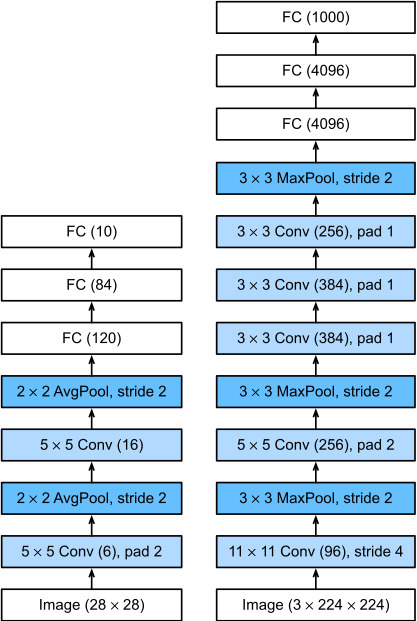

> Krizhevsky, Sutskever, Hinton. *ImageNet Classification with Deep Convolutional Neural Networks*. NeurIPS 2012.

---

## 1. Why did it appear? (Problem)

Before 2012, image classification relied on **features designed by people**. Feature extractors like SIFT and HOG turned images into vectors, and a classifier such as an SVM sat on top. This approach had hit two walls.

- **Stalled performance**: because people hand-crafted the features, the limits were obvious on complex images. Top-5 error on the ImageNet challenge hovered around 25%.
- **Neural networks were "good in theory, broken in practice"**: CNNs had existed since LeNet (1998), but only worked on small problems like handwritten digits. Making the network deeper and larger meant
  - training was far too slow (saturating sigmoid/tanh gradients, limited CPU compute), and
  - there were so many parameters relative to the data that **overfitting** was severe.

So the problem to solve was this:
**"Can we train a huge CNN on a large dataset of 1.2 million images and 1,000 classes, in a realistic amount of time, without overfitting?"**

---

## 2. How is it different from other approaches?

| Compared with | Their approach | AlexNet |
|---|---|---|
| Traditional (SIFT + SVM) | Features designed by people | Features **learned from data** (end-to-end) |
| LeNet-5 (1998) | Small input (32×32), shallow, ~60K parameters, CPU, tanh | 224×224 color, 5 Conv + 3 FC, **~60M parameters**, GPU, ReLU |



*LeNet-5 on the left, AlexNet on the right. Image source: [daeun-computer-uneasy.tistory.com](https://daeun-computer-uneasy.tistory.com/33)*


The key difference is not that it "invented a new layer", but that it **solved, in practice, the problems that appear when you scale up, and proved that a deep CNN actually works**.

---

## 3. So how did it solve it? (Solve)

### Architecture: 5 Conv layers + 3 FC layers

| Layer | Configuration | Notes |
|---|---|---|
| Conv1 | 96 filters, 11×11, stride 4 | ReLU → LRN → MaxPool |
| Conv2 | 256 filters, 5×5 | ReLU → LRN → MaxPool |
| Conv3 | 384 filters, 3×3 | ReLU |
| Conv4 | 384 filters, 3×3 | ReLU |
| Conv5 | 256 filters, 3×3 | ReLU → MaxPool |
| FC6 | 4096 | ReLU + Dropout |
| FC7 | 4096 | ReLU + Dropout |
| FC8 | 1000 | Softmax |

### A fix for each problem

**Training is slow → ReLU + GPU**
- `max(0, x)` keeps a gradient of 1 in the positive range, so it does not saturate. In the paper's experiment it reached the same error rate about 6× faster than tanh.
- The model did not fit on a single GTX 580 (3GB), so they **split the network in half across two GPUs**. The GPUs only communicate at certain layers. (That is why the architecture diagram has two branches, top and bottom.)

**Overfitting is severe → Dropout + Data Augmentation**
- **Dropout (p=0.5)**: randomly switches off neurons in FC6 and FC7, directly targeting overfitting in the FC layers where the parameters are concentrated.
- **Data Augmentation**: random 224×224 crops from 256×256 images, horizontal flips and PCA-based color jitter effectively enlarged the dataset by a lot.

**A bit more generalization → Overlapping Pooling, LRN**
- 3×3 pooling applied with stride 2 so the windows overlap.
- LRN normalizes across neighboring channels. (It was later shown to have little effect and gave way to BatchNorm.)

**What is LRN (Local Response Normalization)?**
LRN is the normalization technique used in AlexNet. It adjusts each value using the activations of neighboring channels at the same spatial position. The larger the activations of the surrounding channels, the larger the divisor, so that channel's output becomes smaller.
Here, **"suppressing"** a value does not mean setting it to zero; it means shrinking it. Even a large activation can become smaller after LRN, which has the effect of comparing responses across channels relative to each other.
AlexNet applied LRN after the ReLU and before max pooling in some convolutional layers. Today, normalization methods such as Batch Normalization are used instead of LRN.

**What is Overlapping Pooling?**
It moves the pooling window so that adjacent windows overlap. If the stride is smaller than the window size, overlap occurs.
For example, AlexNet used 3×3 max pooling with stride 2. If the first window covers values 1–3 horizontally, the next covers values 3–5, so the 3rd value is included in both windows.
In contrast, a 2×2 window moved with stride 2 never overlaps. The AlexNet paper reported a slightly lower error rate with overlapping pooling.

**Training setup**: SGD + momentum 0.9, weight decay 0.0005, batch 128, learning rate starting at 0.01 and divided by 10 when it plateaued, about 90 epochs, 5–6 days.

### Results
ILSVRC 2012 top-5 error of **15.3%**, against 26.2% for second place. With that gap, mainstream computer vision moved to deep learning almost overnight.

---

## 4. How do you use it in code?

In practice you will almost never train AlexNet from scratch. It is mostly used **to understand CNNs by implementing the architecture yourself**, or **to practice transfer learning with a pretrained model**.

> Note: AlexNet in `torchvision` is not the original paper's version but a single-GPU variant. Conv1 has 64 channels and there is no LRN.

### (1) Implementing it yourself (PyTorch)

```python
import torch
import torch.nn as nn

class AlexNet(nn.Module):
    def __init__(self, num_classes=1000):
        super().__init__()
        self.features = nn.Sequential(
            nn.Conv2d(3, 96, kernel_size=11, stride=4, padding=2),
            nn.ReLU(inplace=True),
            nn.LocalResponseNorm(size=5),
            nn.MaxPool2d(kernel_size=3, stride=2),     # overlapping pooling

            nn.Conv2d(96, 256, kernel_size=5, padding=2),
            nn.ReLU(inplace=True),
            nn.LocalResponseNorm(size=5),
            nn.MaxPool2d(kernel_size=3, stride=2),

            nn.Conv2d(256, 384, kernel_size=3, padding=1),
            nn.ReLU(inplace=True),
            nn.Conv2d(384, 384, kernel_size=3, padding=1),
            nn.ReLU(inplace=True),
            nn.Conv2d(384, 256, kernel_size=3, padding=1),
            nn.ReLU(inplace=True),
            nn.MaxPool2d(kernel_size=3, stride=2),
        )
        self.classifier = nn.Sequential(
            nn.Dropout(0.5),
            nn.Linear(256 * 6 * 6, 4096),
            nn.ReLU(inplace=True),
            nn.Dropout(0.5),
            nn.Linear(4096, 4096),
            nn.ReLU(inplace=True),
            nn.Linear(4096, num_classes),
        )

    def forward(self, x):
        x = self.features(x)
        x = torch.flatten(x, 1)
        return self.classifier(x)

model = AlexNet()
print(model(torch.randn(1, 3, 224, 224)).shape)  # torch.Size([1, 1000])
```

### (2) Inference with a pretrained model

```python
from torchvision.models import alexnet, AlexNet_Weights
from PIL import Image

weights = AlexNet_Weights.IMAGENET1K_V1
model = alexnet(weights=weights).eval()
preprocess = weights.transforms()   # 리사이즈·크롭·정규화를 한 번에

img = preprocess(Image.open("dog.jpg")).unsqueeze(0)
with torch.no_grad():
    pred = model(img).softmax(dim=1)

idx = pred.argmax().item()
print(weights.meta["categories"][idx], pred[0, idx].item())
```

### (3) Transfer learning: fitting it to your own data (e.g. 5 classes)

```python
model = alexnet(weights=AlexNet_Weights.IMAGENET1K_V1)

# 특징 추출부는 고정
for p in model.features.parameters():
    p.requires_grad = False

# 마지막 FC층만 내 클래스 수로 교체
model.classifier[6] = nn.Linear(4096, 5)

optimizer = torch.optim.SGD(
    filter(lambda p: p.requires_grad, model.parameters()),
    lr=1e-3, momentum=0.9, weight_decay=5e-4,   # 논문 설정과 같은 계열
)
```
