> **같은 Oxford-IIIT Pet 얼굴 박스 데이터에서 SSDLite320과 YOLOv8n 중 어떤 모델이 얼굴을 더 정확하고 빠르게 찾는가?**

품종 37개를 맞히는 분류 문제가 아니라, 사진 속 동물의 얼굴(head ROI) 위치를 `cat_face`, `dog_face` 두 클래스로 찾는 객체 탐지 문제다. 두 경량 탐지 모델을 비교하면서 "정말 같은 조건에서 비교하고 있는가?"를 계속 확인했고, 그 과정에서 비교 실험을 한 번 다시 설계했다.

## 한 줄 요약

- 학습 조건(optimizer, 학습률 후보, EMA, 후처리)을 SSDLite320에 맞춘 YOLOv8n이 holdout mAP@0.5:0.95 **0.7533 → 0.8401**(시드 3개 평균)로 더 정확했다.
- mAP@0.5는 두 모델 모두 0.99 근처로 비슷했다. 차이는 **높은 IoU 기준의 박스 정밀도**에서 났다.
- 추론도 YOLOv8n이 빨랐다. 이 Mac 기준 중앙값으로 MPS **11.5 → 7.2 ms**, CPU **108.1 → 11.0 ms**였다.

## 데이터셋

| 항목 | 내용 |
| --- | --- |
| 출처 | Oxford-IIIT Pet Dataset (Parkhi et al., CVPR 2012) |
| 이미지 | 7,390장 (고양이 12종, 개 25종, 총 37품종) |
| 정답 | PASCAL VOC 형식 XML의 얼굴 박스 3,686개 파일 |
| 클래스 | `0 = cat_face`, `1 = dog_face` |
| 공식 분할 | `trainval` 3,680장, `test` 3,669장 |

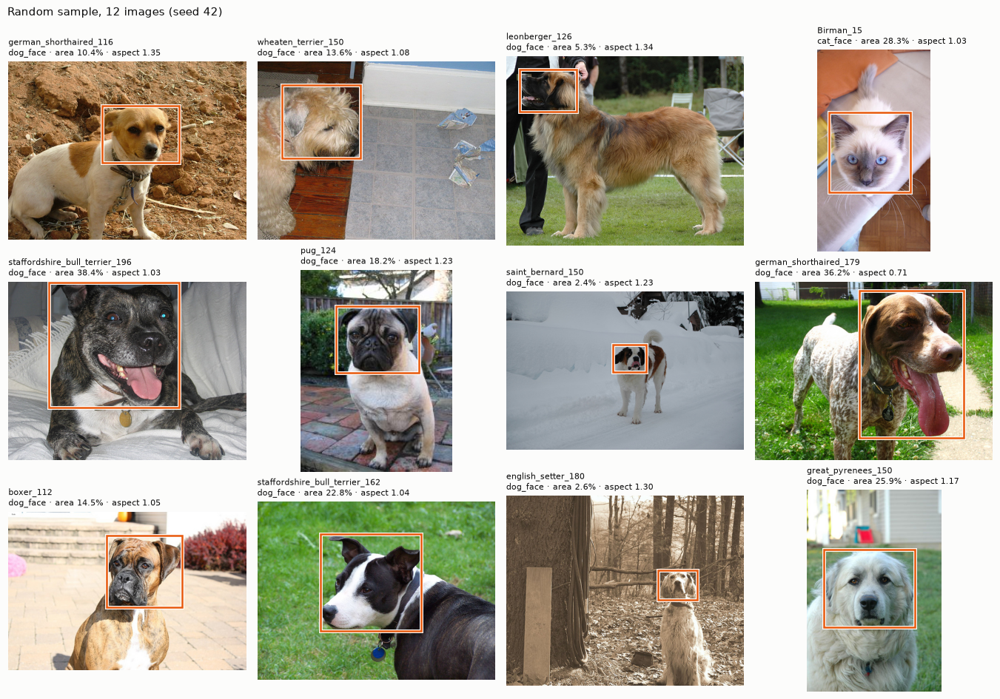

*train·validation에서 무작위로 뽑은 12장. 주황 박스가 XML 정답이다. 얼굴 크기와 위치, 배경이 다양하다.*

여기서 첫 번째 문제가 나온다. **공식 test에는 얼굴 정답 XML이 하나도 없다.** 그래서 test로는 AP를 계산할 수 없고, 정답이 있는 `trainval`을 train/validation/holdout으로 다시 나눠야 했다.

## 데이터 확인: 학습 전에 무엇을 믿을 수 있는가

### README와 실제 파일 대조

README 설명 중 대부분은 실제 파일과 맞았다. 다만 그대로 믿으면 안 되는 부분이 세 가지 있었다.

| README 설명 | 실제 데이터 | 판단 |
| --- | --- | --- |
| BREED ID: 고양이 1\~25, 개 1\~12 | `list.txt`에서는 **고양이 1\~12, 개 1\~25** | README 오기로 보고 `list.txt` 값을 기준으로 삼음 |
| `list.txt`는 전체 이미지 목록 | 이미지 7,390장 중 `list.txt`에는 7,349장 | 목록 밖 41장 존재 |
| 모든 이미지에 head ROI 정답 | XML은 3,686개뿐, 공식 test는 0개 | test는 AP 평가에 쓰지 않음 |

### 파일 대응과 이미지 품질

| 점검 | 결과 |
| --- | --- |
| `trainval` 중 이미지+XML이 모두 있는 것 | **3,671장** (XML 없는 9장) |
| 목록 밖 이미지 | 41장 (그중 15장은 XML 있음) |
| 파일명·XML 불일치, 파싱 실패, 분할 간 중복 ID, 메타데이터 충돌 | 모두 0건 |
| 디코딩 실패 | 0 / 7,390 |
| 확장자는 `.jpg`인데 실제 형식이 다른 파일 | 10장 (GIF 6, PNG 4) — 모두 XML 없음 |
| 학습 후보 3,671장의 형식 | 전부 RGB JPEG, XML 크기와 실제 크기 전부 일치 |

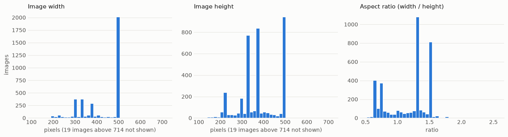

*학습 후보 이미지의 너비·높이·종횡비 분포.* 대부분 500×375 근처(종횡비 중앙값 1.33)에 몰려 있지만, 짧은 변은 108\~2,448px, 종횡비는 0.52\~2.56까지 퍼져 있다. 이 꼬리 때문에 320×320으로 줄일 때 얼굴 모양이 얼마나 바뀌는지 따로 확인해야 했다.

### 박스 좌표

XML 3,686개에서 박스 3,687개가 나왔다. 좌표 형식 오류, 크기 0 이하, 이미지 밖 좌표, 알 수 없는 클래스, 공식 종 정보와의 충돌은 모두 0건이었다. 박스가 2개인 이미지는 `Bengal_105` 한 장(고양이 두 마리)이라, 데이터셋과 평가기는 이미지당 여러 박스를 받도록 만들었다.

좌표 최솟값이 0이 아니라 1이고, `xmax`가 이미지 너비와 같은 박스도 있었다. PASCAL VOC식 "1부터 세고 끝점 포함" 좌표로 보고, 모델에 넣을 때는 `xmin-1, ymin-1, xmax, ymax` 연속 좌표로 바꿨다.

좌표 규칙을 통과해도 박스가 실제로 얼굴을 덮는지는 따로 확인했다. 무작위 12장, 상대 면적이 가장 작은·큰 박스 각 8개, 종횡비 극단 6개, 박스 2개 이미지까지 서로 다른 34장을 눈으로 봤다.

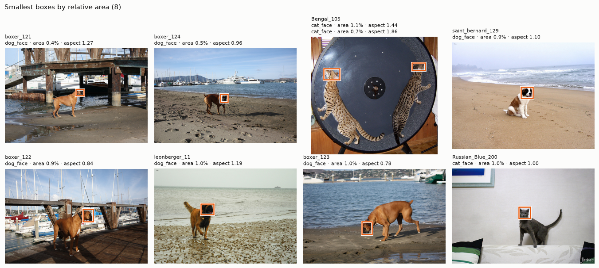

*상대 면적이 가장 작은 박스 8개(이미지의 0.4\~1.0%).* 작은 박스도 멀리 있는 동물의 얼굴을 정확히 가리키고 있었다. 종횡비 극단 중 `beagle_181` 한 장만 박스가 몸통 일부까지 넓게 잡혀 있었는데, 한 사례만으로 정답을 고치지는 않았다.

### 중복 이미지와 분할

MD5 해시로 바이트가 완전히 같은 파일을 찾았다. 7,390장 중 고유 해시는 7,360개, 같은 해시 묶음은 29개(59장)였다.

- 후보끼리 같은 묶음에 2장 이상 들어간 경우: **0**
- 후보와 공식 test가 같은 묶음인 경우: **0**
- 목록 밖 41장 중 30장은 목록 안 이미지의 복사본이었다.

그래서 **목록 밖 41장은 분할에서 제외했다.** 공식 종·품종 근거가 없고, 복사본이 분할 경계를 넘으면 평가가 낙관적으로 나올 수 있기 때문이다.

남은 후보 3,671장을 품종별 비율을 유지하며 70:15:15로 나눴다(분할 시드 42).

| 분할 | 이미지 | 박스 | 고양이 비율 | 용도 |
| --- | --- | --- | --- | --- |
| train | 2,567 | 2,568 | 0.321 | 학습 |
| validation | 554 | 554 | 0.323 | 학습률·best epoch·모델 선택 |
| holdout | 550 | 550 | 0.322 | 설정 확정 후 마지막 1회 평가 |

분할 간 공유 `image_id`와 MD5는 0개였다. **holdout은 이후 전처리 결정, 박스 시각 점검, 튜닝 어디에도 쓰지 않았다.**

## 전처리: 레터박스냐, 그냥 늘리냐

두 모델 입력을 320×320으로 통일해야 했다. 후보는 두 가지였다.

| 방식 | 박스 짧은 변 중앙값 | 짧은 변 < 16px | 얼굴 모양 |
| --- | --- | --- | --- |
| 레터박스 (비율 유지 + 패딩) | 99.8px | 0% | 유지, 대신 캔버스의 평균 26.4%가 패딩 |
| 직접 리사이즈 (stretch) | 108.2px | 0% | 이미지 종횡비만큼 왜곡 (5\~95% 구간 0.67\~1.51, 최대 2.56) |

얼굴 크기 면에서는 두 방식 차이가 작았다. 그래서 얼굴 모양을 보존하는 쪽을 택해 **레터박스**로 정했다.

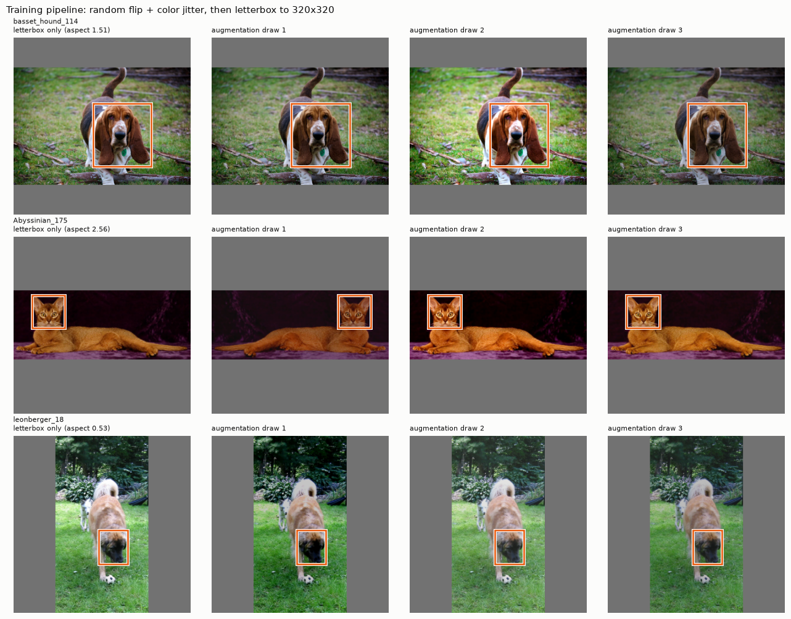

*왼쪽 열은 레터박스만 적용한 입력, 오른쪽 세 열은 증강을 더한 예시.* 종횡비 2.56(가운데 줄)이나 0.53(아래 줄)인 이미지도 얼굴이 찌그러지지 않고, 패딩만 늘어난다.

| 증강 설정 (train에만 적용) | 값 |
| --- | --- |
| 좌우 반전 | 확률 0.5 |
| 밝기·대비·채도 | ±0.3 |
| 색조 | ±0.02 |
| 패딩 색 | 114 (증강을 레터박스 전에 적용해 패딩 색이 변하지 않게 함) |
| 제외한 것 | 확대·축소·이동·크롭, YOLO Mosaic |

Mosaic처럼 한 모델에만 익숙한 증강을 빼서, 두 모델이 **같은 입력**을 보게 했다.

## 학습 전에: 평가기와 학습 경로부터 검증

두 모델의 내장 평가 함수는 서로 정의가 조금씩 다르다. 그래서 **공통 평가기**를 따로 만들고 두 모델 모두 이 평가기로 채점했다.

| 평가 설정 | 값 |
| --- | --- |
| 주 지표 | mAP@0.5:0.95 (보조: mAP@0.5, 클래스별 AP) |
| IoU 임계값 | 0.50\~0.95, 0.05 간격 10개 |
| 정밀도 보간 | COCO 방식 101점 |
| 최대 검출 수 | 이미지·클래스당 100 |
| 점수 필터 | 없음 (정량 평가 시) |

평가기는 손으로 계산 가능한 사례(완벽한 예측, 예측 없음, IoU 0.667, 클래스 오류, 중복 예측 등)를 포함한 30개 점검을 통과했다. 별도 환경에서 pycocotools와 무작위 시나리오 4개로 대조했을 때 mAP 차이는 6e-17 이하였다.

실제 학습 전에는 학습 이미지 16장만 증강 없이 반복 학습해, 모델이 그 16장을 외울 수 있는지 봤다.

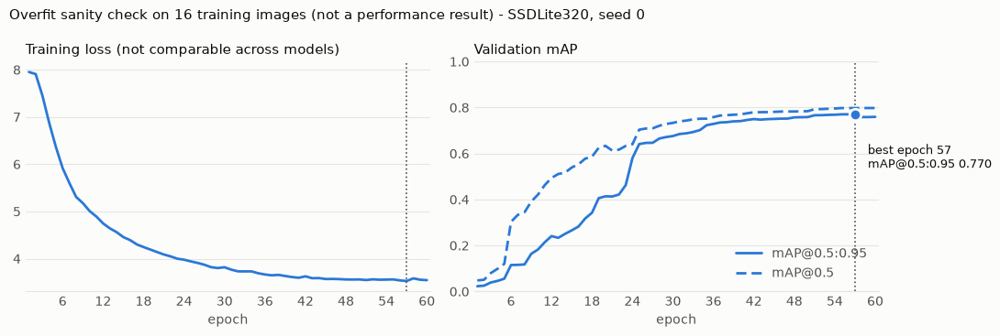

*SSDLite320 과적합 점검.* 60 epoch 동안 손실은 7.95 → 3.54로 줄고, 같은 16장의 mAP@0.5:0.95는 0.023 → 0.759로 올랐다. 일반화 성능이 아니라 **로딩 → 좌표 변환 → 손실 → 예측 → 좌표 복원 → 평가**가 끝까지 연결됐다는 증거로만 쓴다. YOLOv8n도 같은 점검에서 0.176 → 1.000까지 올랐다.

이 밖에 조기 종료와 best epoch 복원, NaN 손실 시 중단, 중간에 끊었다가 이어서 학습해도 결과가 같은지까지 확인한 뒤 본 학습에 들어갔다.

## 실험 설계: 결과를 보기 전에 예산을 고정

두 모델 모두 같은 규칙을 썼다.

| 항목 | 값 |
| --- | --- |
| 사전학습 | COCO (분류 헤드만 2클래스로 새로 초기화) |
| 배치 / 최대 epoch | 16 / 30 |
| 조기 종료 | validation mAP@0.5:0.95가 5 epoch 동안 오르지 않으면 종료 |
| 학습률 스케줄 | 100회 선형 워밍업 후 코사인 감소 |
| 실험 예산 | 학습률 후보 3개 × 시드 0 → 선정한 학습률로 시드 1·2 추가 (모델당 5회) |
| 선정 기준 | validation mAP@0.5:0.95의 best epoch 값 |

결과를 본 뒤 후보를 늘리지 않도록 예산을 미리 정했다. 최종 숫자는 가장 좋은 시드 하나가 아니라 **시드 3개 평균 ± 표본 표준편차**로 보고한다.

## 실험 1: SSDLite320

SGD(모멘텀 0.9, weight decay 4e-5)로 학습률 1e-3, 3e-4, 1e-4를 탐색했다.

> 중간에 데이터·분할·annotation 해시를 실행 ID에 넣는 재현성 가드를 추가했다. 그 전에 돌린 SSDLite320 결과는 예비 기록으로 남기고, 아래 수치는 수정된 코드로 다시 학습한 결과다.

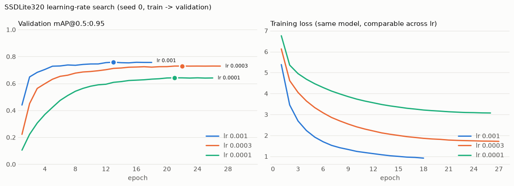

*왼쪽: validation mAP@0.5:0.95, 오른쪽: 학습 손실(같은 모델이라 학습률끼리 비교 가능).* 학습률이 낮을수록 손실이 높은 곳에서 멈췄다. 30 epoch 예산 안에서는 덜 학습된 것으로 보인다.

| 학습률 | best / 종료 epoch | mAP@0.5:0.95 | mAP@0.5 | 마지막 학습 손실 |
| --- | --- | --- | --- | --- |
| **1e-3** | 13 / 18 | **0.7580** | 0.9757 | 0.92 |
| 3e-4 | 22 / 27 | 0.7293 | 0.9644 | 1.72 |
| 1e-4 | 21 / 26 | 0.6420 | 0.9078 | 3.07 |

1e-3을 골라 시드 1·2를 추가했고, 세 시드 모두 조기 종료했다.

| 시드 | 0 | 1 | 2 | 평균 ± 표준편차 |
| --- | --- | --- | --- | --- |
| mAP@0.5:0.95 | 0.7580 | 0.7655 | 0.7605 | **0.7613 ± 0.0038** |

## 실험 2: YOLOv8n 기본 방식 — 공정한 비교인가?

처음에는 YOLOv8n을 Ultralytics 기본 학습 방식에 가깝게 돌렸다. AdamW, EMA, 기울기 자르기, NMS IoU 0.7이고 학습률 후보는 2e-3, 8e-4, 3e-4였다.

| 학습률 | best / 종료 epoch | mAP@0.5:0.95 |
| --- | --- | --- |
| 2e-3 | 30 / 30 | 0.8014 |
| 8e-4 | 30 / 30 | 0.8377 |
| **3e-4** | 25 / 30 | **0.8534** |

3e-4로 시드를 반복하니 **0.8511 ± 0.0025**가 나왔다. SSDLite320보다 0.09 가까이 높다.

그런데 이 숫자를 그대로 비교할 수는 없었다. optimizer, EMA 유무, 후처리 NMS 기준, 학습률 범위가 **모두 다르기** 때문이다. 이대로라면 차이가 모델 구조에서 왔는지 학습 방식에서 왔는지 구분할 수 없다.

## 실험 3: 조건을 SSDLite320에 맞춘 YOLOv8n

그래서 YOLOv8n의 학습 방식을 SSDLite320 쪽에 최대한 맞춰 다시 학습했다.

| 항목 | SSDLite320 | YOLOv8n 기본 (참고) | **YOLOv8n 공통 조건** |
| --- | --- | --- | --- |
| optimizer | SGD, 모멘텀 0.9, wd 4e-5 | AdamW, wd 5e-4 | **SGD, 모멘텀 0.9, wd 4e-5** |
| 학습률 후보 | 1e-3, 3e-4, 1e-4 | 2e-3, 8e-4, 3e-4 | **1e-3, 3e-4, 1e-4** |
| EMA | 없음 | 있음 | **없음** |
| 기울기 자르기 | 없음 | 노름 10 | **없음** |
| 역전파 손실 | 이미지당 평균 | 배치 합 | **이미지당 평균** |
| 검증 NMS IoU | 0.55 | 0.7 | **0.55** |
| 데이터·증강·평가기·시드 | — | 같음 | 같음 |

손실 함수, 모델 구조, 새로 초기화되는 범위는 모델마다 다르므로 완전히 같은 조건은 아니다. 다만 **바꿀 수 있는 학습 설정은 모두 맞췄다.**

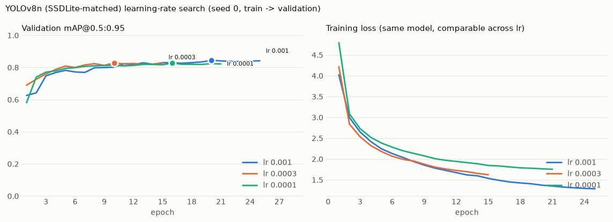

*공통 조건 YOLOv8n의 학습률 탐색.* SSDLite320은 학습률에 따라 best 점수가 0.64\~0.76으로 벌어졌지만, YOLOv8n은 세 학습률이 0.827\~0.844 안에 모여 있다. 같은 후보 범위에서 학습률에 덜 민감했다.

| 학습률 | best / 종료 epoch | mAP@0.5:0.95 | mAP@0.5 |
| --- | --- | --- | --- |
| **1e-3** | 20 / 25 | **0.8442** | 0.9916 |
| 3e-4 | 10 / 15 | 0.8281 | 0.9836 |
| 1e-4 | 16 / 21 | 0.8272 | 0.9800 |

| 시드 | 0 | 1 | 2 | 평균 ± 표준편차 |
| --- | --- | --- | --- | --- |
| mAP@0.5:0.95 | 0.8442 | 0.8451 | 0.8306 | **0.8399 ± 0.0081** |

조건을 맞추자 YOLOv8n 점수는 기본 방식(0.8511)보다 0.0112 내려갔다. 그래도 SSDLite320보다는 여전히 크게 높다. optimizer, EMA, 학습률 범위가 함께 바뀌었으므로 이 0.0112가 어느 항목 때문인지는 분리하지 않았다.

## validation 비교

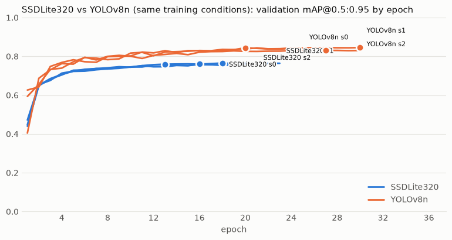

*파랑 SSDLite320, 주황 YOLOv8n(공통 조건), 각 3시드.* 첫 몇 epoch 이후 두 모델의 곡선은 겹치지 않는다. 시드 간 흔들림보다 모델 간 간격이 훨씬 크다.

| 모델 | mAP@0.5:0.95 | mAP@0.5 | epoch당 학습(s) | 파라미터(M) |
| --- | --- | --- | --- | --- |
| SSDLite320 | 0.7613 ± 0.0038 | 0.9760 ± 0.0008 | 34 | 2.22 |
| **YOLOv8n (공통 조건)** | **0.8399 ± 0.0081** | 0.9890 ± 0.0023 | 24 | 3.01 |

- 평균 차이는 **+0.0786**이다.
- YOLOv8n의 가장 낮은 시드(0.8306)도 SSDLite320의 가장 높은 시드(0.7655)보다 높다.
- 그런데 **mAP@0.5는 두 모델 모두 0.97\~0.99로 비슷하다.**

이게 이 실험에서 가장 중요한 단서였다. 얼굴이 대략 어디 있는지 찾는 능력은 둘 다 거의 포화 상태다. 차이는 IoU 0.75, 0.9처럼 **박스를 얼마나 딱 맞게 그리느냐**에서 벌어진다. 다만 박스 오차를 위치·크기별로 따로 분해하지는 않았다.

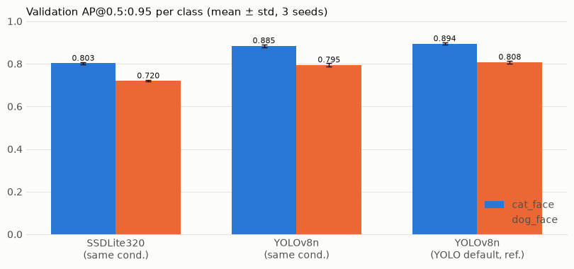

*클래스별 AP@0.5:0.95 (3시드 평균 ± 표준편차).* 두 모델 모두 고양이가 개보다 높다. SSDLite320은 0.803 vs 0.720, YOLOv8n은 0.885 vs 0.795다. 이 경향은 학습률·시드를 바꾼 모든 실행에서 같았다. 원인은 따로 실험하지 않았다.

같은 validation 이미지 8장에 두 모델의 예측을 그려 보면 차이가 눈에 들어온다(시각화용으로 점수 0.5 이상만 표시).

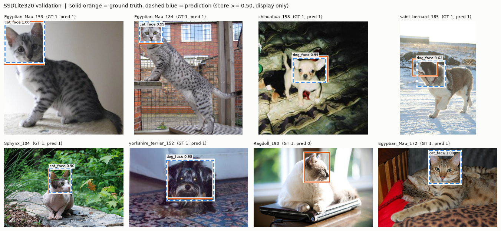

*SSDLite320.* 실선 주황이 정답, 점선 파랑이 예측이다.

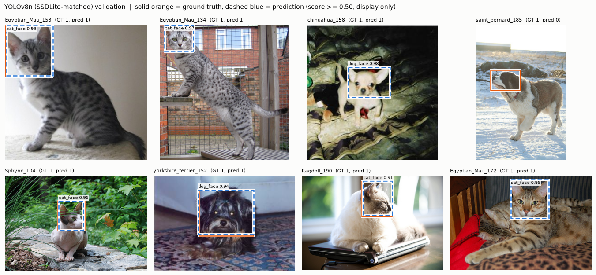

*YOLOv8n (공통 조건).* 같은 8장이다.

대부분의 이미지에서 YOLOv8n의 점선이 정답 실선에 더 가깝게 붙어 있다. 두 모델 모두 놓친 사례도 하나씩 있다. SSDLite320은 옆을 보는 `Ragdoll_190`에서 0.5 이상 박스가 없었다. YOLOv8n은 눈밭의 `saint_bernard_185`에서 0.5 이상 박스가 없었는데, SSDLite320도 이 이미지에서는 정답보다 크게 어긋난 박스(0.63)를 냈다. 8장 표본이고 표시 기준 0.5를 적용한 그림이라, 정량 평가(점수 필터 없음)와는 구분해서 봐야 한다.

### 추가 확인: YOLOv8n을 3e-4로 해도 결론이 같을까?

공통 조건 YOLOv8n에서 1e-3의 시드 변동(0.8306\~0.8451)이 보여, 두 번째 후보였던 3e-4도 시드 1·2를 돌려 봤다.

| YOLOv8n 공통 조건 | 시드별 mAP@0.5:0.95 | 평균 ± 표준편차 |
| --- | --- | --- |
| lr 1e-3 (선정) | 0.8442 / 0.8451 / 0.8306 | 0.8399 ± 0.0081 |
| lr 3e-4 (사후 확인) | 0.8281 / 0.8334 / 0.8328 | 0.8314 ± 0.0029 |

두 학습률의 범위가 겹쳐 우열은 단정하기 어렵다. 그래도 3e-4에서도 SSDLite320보다 0.0701 높아 **모델 비교의 방향은 그대로**였다. 결과를 본 뒤 YOLOv8n에만 추가 예산을 쓴 확인이므로, 대표 학습률은 사전 규칙대로 1e-3을 유지했다.

## 최종 평가: holdout과 추론 속도

설정을 모두 고정한 뒤 holdout 550장(고양이 177, 개 373)에 두 모델의 시드 0·1·2 체크포인트 6개를 한 번씩 평가했다. 각 체크포인트는 먼저 저장된 validation 점수를 그대로 재현하는지 확인했고(6개 모두 통과), 그다음에 holdout을 채점했다.

*holdout mAP@0.5:0.95, 고양이 AP, 개 AP. 막대는 3시드 평균, 점은 각 시드.*

| 모델 | mAP@0.5:0.95 | mAP@0.5 | cat AP | dog AP |
| --- | --- | --- | --- | --- |
| SSDLite320 | 0.7533 ± 0.0015 | 0.9872 ± 0.0032 | 0.7854 ± 0.0028 | 0.7211 ± 0.0005 |
| **YOLOv8n (공통 조건)** | **0.8401 ± 0.0082** | 0.9895 ± 0.0056 | **0.8667 ± 0.0142** | **0.8134 ± 0.0022** |

holdout에서도 차이는 **+0.0868**로 validation과 같은 방향이었다. YOLOv8n의 가장 낮은 시드(0.8341)가 SSDLite320의 가장 높은 시드(0.7544)보다 높다.

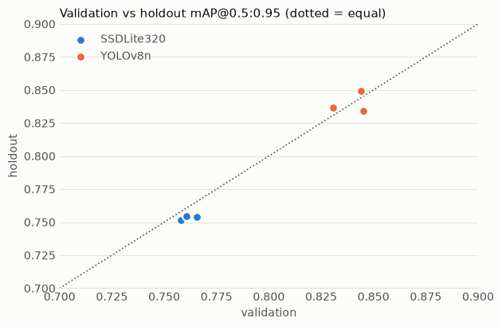

*점선은 validation = holdout.* 여섯 점이 모두 대각선 근처에 있다. validation에서 holdout으로 옮겼을 때 평균 변화는 SSDLite320 −0.0080, YOLOv8n +0.0001이었다. validation으로 학습률과 epoch를 골랐는데도 holdout 점수가 크게 무너지지 않았다.

속도는 정확도 평가와 분리해서 쟀다.

| 측정 조건 | 값 |
| --- | --- |
| 범위 | 메모리의 RGB 이미지 1장 → 레터박스 → 장치 전송 → 추론 → NMS → 원본 좌표 복원 (파일 읽기·모델 로딩 제외) |
| 설정 | 배치 1, float32, holdout 200장, 워밍업 20장, 모델당 3회 반복(모델 순서 교차) |
| 후처리 | 점수 0.001, NMS IoU 0.55, 최대 300개 |
| 환경 | Apple Silicon Mac (MPS, CPU 12스레드) |

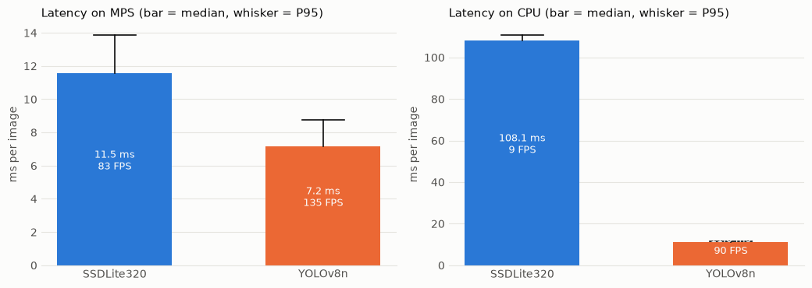

*막대는 중앙값, 수염은 P95.*

| 장치 | 모델 | 중앙값 (ms) | P95 (ms) | FPS |
| --- | --- | --- | --- | --- |
| MPS | SSDLite320 | 11.5 | 13.9 | 83.1 |
| MPS | **YOLOv8n** | **7.2** | 8.8 | **134.7** |
| CPU | SSDLite320 | 108.1 | 110.8 | 9.2 |
| CPU | **YOLOv8n** | **11.0** | 11.5 | **90.3** |

파라미터는 SSDLite320(2.22M)이 YOLOv8n(3.01M)보다 적지만, 추론은 YOLOv8n이 MPS에서 약 1.6배, CPU에서 약 10배 빨랐다. 파라미터 수만으로 속도를 짐작하면 안 된다는 점을 확인했다.

## 결론

선정 규칙은 실험 전에 정해 두었다. **"validation mAP@0.5:0.95가 최고 모델 대비 1%p 이내인 후보 중 가장 빠른 모델"** 이다.

- SSDLite320은 YOLOv8n보다 validation에서 7.86%p 낮아 1%p 이내 후보가 아니다. holdout에서도 같은 방향이었다.
- 속도까지 YOLOv8n이 빨라, 정확도와 속도의 트레이드오프 자체가 없었다.
- 최종 모델은 **YOLOv8n (공통 조건, 학습률 1e-3)** 으로 정했고, holdout 결과를 본 뒤 설정은 바꾸지 않았다.

돌아보면 결정적이었던 판단은 두 가지다.

1. **YOLO 기본 방식 결과를 그대로 쓰지 않은 것.** 0.8511이라는 더 좋은 숫자가 있었지만, optimizer·EMA·후처리가 다른 상태로는 모델 비교라고 말할 수 없었다. 조건을 맞추자 격차가 줄었고(0.8511 → 0.8399), 줄어든 뒤에도 남은 차이가 모델 사이의 차이에 더 가깝다.
2. **mAP@0.5와 mAP@0.5:0.95를 나란히 본 것.** mAP@0.5만 봤다면 두 모델이 비슷하다고 결론 냈을 것이다. 차이는 박스를 얼마나 정밀하게 맞추느냐에 있었다.

## 한계와 다음 단계

- **완전히 같은 조건은 아니다.** 손실 함수, 모델 구조, 새로 초기화되는 범위는 맞출 수 없었다. SGD 1e-3\~1e-4는 SSDLite320 기준 범위라 YOLOv8n의 최선 설정을 찾은 실험도 아니다.
- **학습률 탐색이 범위 끝에 걸렸다.** SSDLite320과 공통 조건 YOLOv8n 모두 후보 중 가장 큰 1e-3이 선정됐다. 더 큰 학습률이 더 좋을 가능성이 남아 있다.
- **학습률 선택 기회가 비대칭이다.** YOLOv8n에만 3e-4 시드 반복을 사후에 추가했다.
- **시드 3개, 분할 시드 1개(42)** 뿐이다. 근접 중복(리사이즈·재압축본)은 확인하지 못했고, holdout은 품종당 13\~15장이라 품종별 해석은 어렵다.
- **속도는 이 Mac의 참고값**이다. 원래 계획한 Colab GPU나 실제 배포 환경과 다를 수 있다.
- **이미지별 실패 사례와 메모리 사용량은 분석하지 않았다.** 두 모델의 차이가 높은 IoU에서 났으므로, 다음 단계는 박스가 어긋나는 사례를 모아 오차를 위치와 크기로 나눠 보는 것이다. 모든 실행에서 개 AP가 고양이 AP보다 낮았던 이유도 아직 확인하지 못했다.
