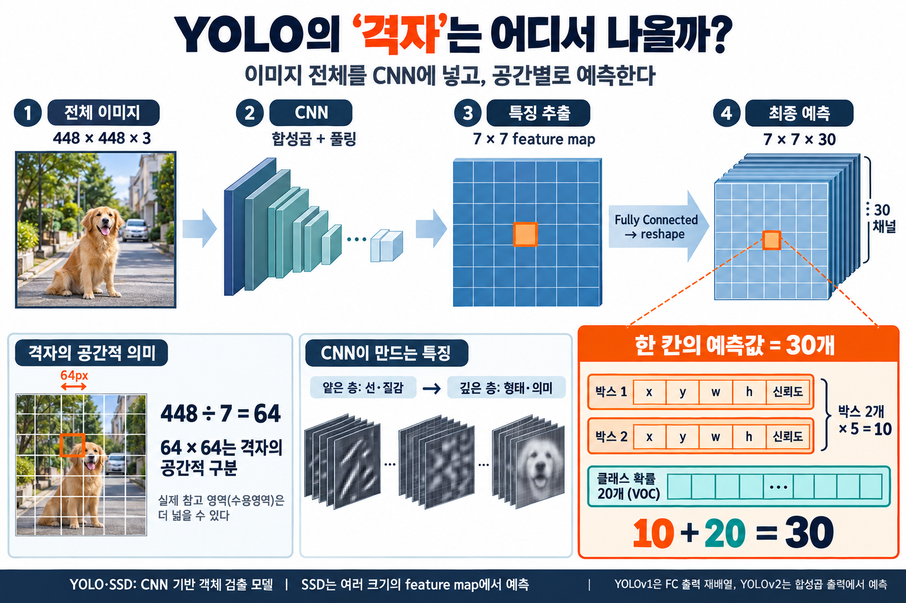
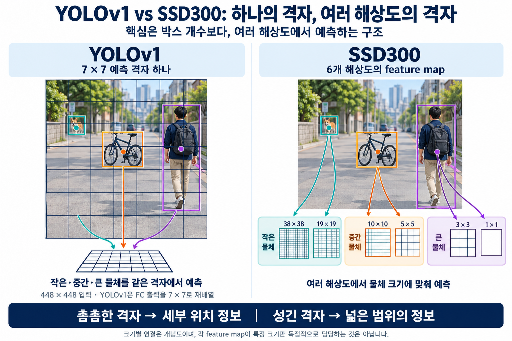
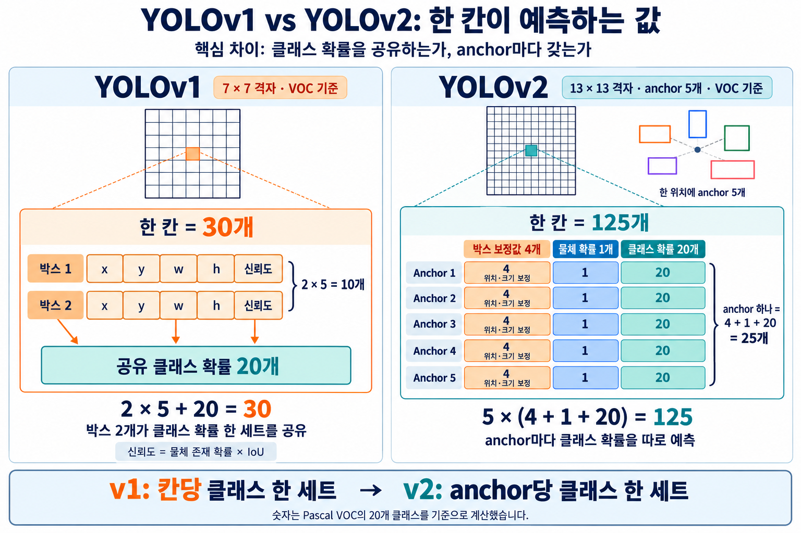
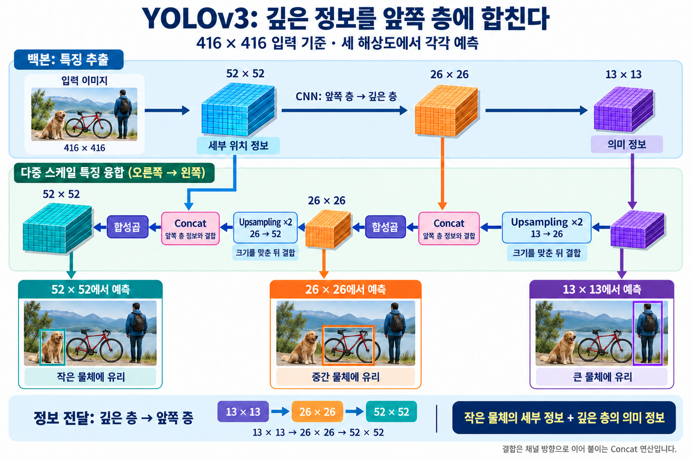
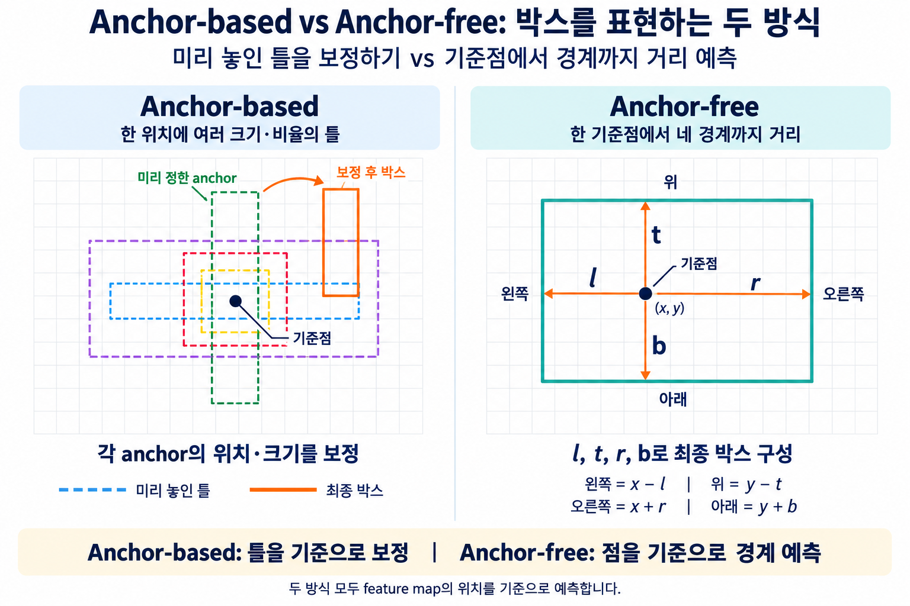
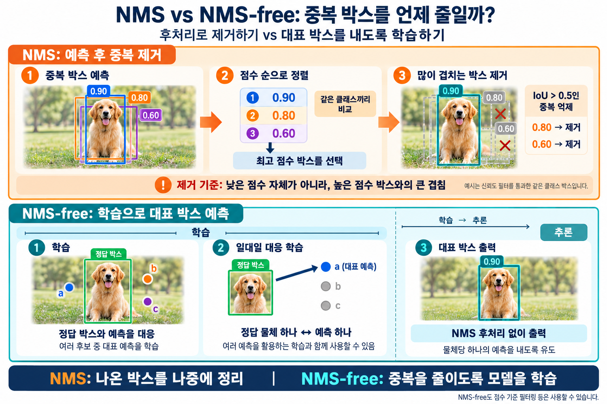

## 들어가며

SSD300과 YOLO는 모두 이미지를 한 번만 보고 물체를 찾는 1-stage 탐지기다. 둘의 차이는 결국 두 가지로 정리된다. **격자를 몇 개, 어떤 해상도로 쓰는가**, 그리고 **박스를 처음부터 그리는가, 미리 놓인 틀을 고치는가**다.

이 글은 이 두 축으로 SSD300과 YOLOv1을 비교한 뒤, YOLO가 v1부터 YOLO26까지 각 버전에서 이전 버전의 어떤 약점을 무엇으로 해결했는지 따라간다. 바운딩 박스와 IoU 같은 객체 탐지 기본 개념은 안다고 가정한다.

## 기초: 격자는 곧 feature map이다

YOLO와 SSD는 모두 CNN이다. 이미지를 잘라서 넣는 게 아니라 통째로 넣고, CNN을 거쳐 나온 **feature map의 가로세로 크기가 곧 '격자'**다.

YOLOv1으로 보면 448×448×3 이미지가 합성곱과 풀링을 거쳐 7×7 크기의 feature map이 된다. 448 ÷ 7 = 64이므로, feature map의 한 위치는 원본 이미지의 약 64×64 픽셀 영역에 대응한다. 흔히 말하는 "한 칸"은 feature map의 한 위치이고, 그 위치에 담긴 숫자 묶음이 예측값이다.

YOLOv1의 최종 출력은 7×7×30이다. 한 칸의 숫자 30개는 박스 2개 × (x, y, w, h, 신뢰도) = 10개에 클래스 확률 20개(VOC 기준)를 더한 값이다. 엄밀히 말하면 v1은 마지막 fully connected 층의 출력을 7×7×30 모양으로 바꾼 것이고, v2부터는 합성곱 feature map을 그대로 격자로 쓴다.

CNN의 층 위치에 따라 feature map의 성격이 다르다. 이 차이가 뒤의 모든 내용을 관통한다.

|  | 앞쪽 층 | 깊은 층 |
| --- | --- | --- |
| feature map 크기 | 크다 (촘촘한 격자) | 작다 (성긴 격자) |
| 한 위치의 시야 | 좁다 | 넓다 |
| 잘 아는 것 | 선, 질감 같은 세부 정보 | "이건 새다" 같은 의미 정보 |
| 비유 | 시력은 좋지만 경험 없는 신입 | 경험은 많지만 시력이 나쁜 베테랑 |

## YOLOv1 vs SSD300: 차이는 두 가지다

### 차이 1. Feature Map: 하나 vs 여러 해상도

YOLOv1은 7×7 격자 하나로 모든 크기의 물체를 예측한다. SSD300은 CNN의 여러 지점에서 나온 feature map 6개를 각각 예측에 쓴다. 각 위치에는 모양이 다른 default box가 4\~6개씩 놓인다.

| SSD300 feature map | 한 위치의 시야 (300px 기준) | 위치당 default box | 박스 수 |
| --- | --- | --- | --- |
| 38×38 | 약 8px | 4 | 5,776 |
| 19×19 | 약 16px | 6 | 2,166 |
| 10×10 | 30px | 6 | 600 |
| 5×5 | 60px | 6 | 150 |
| 3×3 | 100px | 4 | 36 |
| 1×1 | 300px | 4 | 4 |
| 합계 |  |  | 8,732 |

YOLOv1의 박스는 7 × 7 × 2 = 98개다. 그래서 "SSD는 박스가 많아서 작은 물체를 잘 잡는다"고 생각하기 쉽지만, 핵심은 개수가 아니다. YOLOv1의 칸당 박스를 178개로 늘려 총 8,722개로 맞춰도 작은 물체는 여전히 잘 못 잡는다. 이유는 두 가지다.

- **해상도**: 7×7은 가장 깊은 층의 feature map이라 20px짜리 작은 물체는 이미 뭉개져 있다. 보이지 않는 물체는 박스를 아무리 많이 그려도 못 잡는다.
- **칸당 클래스 한 세트**: v1은 한 칸에서 클래스 예측을 한 번만 한다. 작은 물체 여러 개의 중심이 한 칸에 몰리면 사실상 하나만 담당할 수 있다.

SSD는 이를 **크기별 분업**으로 푼다. 덜 압축된 38×38 feature map에는 작은 틀을 놓아 작은 물체를 맡기고, 시야가 넓은 3×3, 1×1에는 큰 틀을 놓아 큰 물체를 맡긴다.

> 차이는 박스 개수가 아니라, 여러 해상도의 격자로 물체 크기별 분업을 하느냐다.

### 차이 2. 박스: 처음부터 그리기 vs 틀 보정하기

사람 박스가 가로 50, 세로 150 픽셀이라고 하자.

- **YOLOv1**: 아무 기준 없이 "가로 50, 세로 150"이라는 값 자체를 맞혀야 한다. 학습 초반에는 엉뚱한 값에서 출발한다.
- **SSD300**: 그 자리에 이미 세로로 긴 default box(예: 60×180)가 놓여 있다. "가로 조금 줄이고, 세로 조금 줄여라" 같은 작은 보정값만 배우면 된다.

맞혀야 하는 값의 범위가 좁으니 학습이 더 안정적이다.

### 정리: v1의 약점 두 개와 해결 도구

| v1의 약점 | 해결 도구 | SSD | YOLO |
| --- | --- | --- | --- |
| 작은 물체를 못 잡음 | 여러 해상도의 격자 (feature map) | 처음부터 사용 | v3에서 도입 |
| 박스 학습이 어려움 | 미리 놓인 틀 | default box | v2에서 anchor 도입 |

SSD는 두 도구를 처음부터 갖고 나왔고, YOLO는 v2와 v3에 걸쳐 하나씩 따라잡았다.

단, SSD에도 약점이 있다. 작은 물체를 맡는 38×38은 앞쪽 층이라 위치는 잘 보지만 정체를 판단하는 의미 정보가 부족하다. 신입 혼자 판단하는 셈이다. 이 약점은 YOLOv3에서 다시 등장한다.

## YOLOv2: 틀을 바꾸다

**해결한 문제**: v1은 박스를 틀 없이 예측해서 학습이 어려웠다.

**바꾼 것**: k-means로 뽑은 anchor 5개를 13×13 feature map(416×416 입력 기준)의 각 칸에 놓고, 그 틀을 보정하는 값만 예측하게 했다.

SSD의 default box는 연구자가 모양을 정했다. 그런데 전봇대나 기차처럼 길쭉한 물체가 대부분인 데이터라면 미리 정한 틀이 잘 맞지 않는다. v2는 학습 데이터의 실제 박스들을 k-means로 묶어 대표 모양을 뽑았다. 이때 거리 기준으로 유클리드 거리(몇 픽셀 차이인가) 대신 **1 − IoU**를 썼다. 유클리드 거리를 쓰면 큰 박스는 조금만 달라도 거리가 크게 나와 불공평하기 때문이다.

칸은 한 위치지만 anchor는 그 칸을 중심으로 원본 이미지 위에 놓이는 틀이라 칸보다 훨씬 커도 된다. 지도에 꽂은 핀 하나를 중심으로 크기가 다른 원을 여러 개 그리는 것과 같다. 한 칸의 깊은 feature는 여러 번의 합성곱을 거쳐 32×32보다 훨씬 넓은 주변을 보고 만들어졌으므로 큰 박스도 판단할 수 있다.

출력은 13×13×125다(VOC 기준).

- anchor 하나 = 위치 보정값 4 + 물체 확률 1 + 클래스 확률 20 = 25개
- 칸 하나 = 25 × anchor 5개 = 125개

v1은 클래스 확률을 칸당 한 세트만 가졌지만, v2는 **anchor마다** 따로 가진다. 그래서 한 칸에서 사람과 자전거처럼 서로 다른 물체를 동시에 말할 수 있다.

참고로 v2도 앞쪽 26×26의 세부 정보를 끌어오는 passthrough layer를 썼지만, 예측은 여전히 13×13 한 곳에서만 했다. 격자 문제는 v3로 넘어간다.

## YOLOv3: 격자를 바꾸다

**해결한 문제**: v2는 예측에 쓰는 feature map이 1개뿐이라 작은 물체에 약했다.

**바꾼 것**: 13×13, 26×26, 52×52 세 feature map에서 예측하고(416×416 입력 기준), 깊은 층의 정보를 upsampling으로 키워 앞쪽 층에 합쳤다.

anchor는 v2의 k-means 방식을 이어받아 9개를 뽑고, 크기에 맞게 격자마다 3개씩 나눠 맡긴다. SSD의 크기별 분업과 v2의 데이터 맞춤형 틀을 합친 셈이다.

여기에 SSD보다 한 걸음 더 나간 부분이 있다. SSD는 작은 물체를 앞쪽 층(신입) 혼자 판단하지만, YOLOv3는 깊은 층(베테랑)의 판단 정보를 확대해서 앞쪽 층의 세부 정보와 합쳐 예측한다. 이 구조는 FPN(Feature Pyramid Network)의 아이디어에서 왔다.

정보가 흐르는 방향은 연산의 모양으로 확인할 수 있다. upsampling은 작은 feature map을 키우는 연산이다. 13×13과 26×26을 합치려면 크기가 같아야 하므로, 깊은 층인 13×13을 두 배로 키워 26×26에 합친다. 26×26도 같은 방식으로 52×52에 합친다. 즉 정보는 **깊은 층 → 앞쪽 층**으로 흐른다.

## YOLOv8: anchor를 버리다

**해결한 문제**: k-means anchor는 데이터에 갇혀 있었다. 데이터셋이 바뀔 때마다 다시 계산해야 하고, 결국 정해진 몇 개의 모양 안에서만 출발한다.

**바꾼 것**: anchor 없이(anchor-free), 격자의 각 점에서 물체의 왼쪽·위·오른쪽·아래 경계까지의 거리 4개를 직접 예측한다.

세 가지 해상도의 격자는 그대로 유지했다. 640×640 입력이면 80×80, 40×40, 20×20 feature map에서 예측한다. 촘촘한 80×80의 점은 작은 물체만, 성긴 20×20의 점은 큰 물체만 맡는다.

그렇다면 v1처럼 틀 없이 예측하는데 왜 학습이 어렵지 않을까? v1에도 기준점(칸)은 있었다. 차이는 기준점이 얼마나 촘촘하고, 각자 맡은 범위가 얼마나 좁으냐다. v1은 한 점이 모든 크기를 다 맡았지만, v8은 크기별 분업 덕분에 각 점이 예측하는 거리가 자기 격자 크기에 맞는 좁은 범위로 줄어든다.

> v3부터 이어진 크기별 격자 분업이 "대략 이 정도 크기"라는 출발점을 대신해 주기 때문에, v8은 데이터마다 다시 맞춰야 하는 anchor 없이도 각 점에서 경계까지의 거리를 안정적으로 학습할 수 있다.

주의할 점이 두 가지 있다.

- YOLO 계열에서 anchor-free를 처음 시도한 것은 v8이 아니라 YOLOX(2021)다.
- v8은 anchor-free 외에도 여러 부분을 동시에 바꿨다. 그래서 "anchor를 버려서 성능이 좋아졌다"고 단정할 수는 없다. "구조가 더 단순해졌다"가 정확한 표현이다.

## YOLOv10 / YOLO26: NMS를 버리다

**해결한 문제**: NMS는 바짝 붙은 같은 클래스 물체 중 하나를 지울 수 있고, 모델 밖의 별도 후처리라 느리다.

**바꾼 것**: 중복 박스를 나중에 지우는 대신, 처음부터 물체 하나당 박스 하나만 내도록 모델을 훈련해서 NMS를 없앴다.

### NMS는 어떻게 동작하나

1. **신뢰도 필터 (NMS 전)**: 점수가 기준값(예: 0.25)보다 낮은 박스를 버린다.
2. **정렬**: 남은 박스를 클래스별로 점수 순으로 줄 세운다.
3. **억제**: 1등 박스와 IoU가 기준값(예: 0.5)보다 큰 박스를 지운다. 남은 박스 중 다시 1등을 뽑아 반복한다.

점수는 "누가 대표가 될지"를, IoU는 "누가 그 대표의 중복인지"를 정한다. 박스는 점수가 낮아서가 아니라 **나보다 점수 높은 박스와 많이 겹쳐서** 지워진다. 예를 들어 같은 고양이에 점수 0.9, 0.8, 0.3인 박스가 있을 때, 0.9와 IoU 0.7로 겹친 0.8은 지워지고, IoU 0.1인 0.3은 다른 물체로 보고 남는다.

### NMS의 약점

- **밀집한 물체**: 어깨동무한 두 사람의 박스 점수가 0.9, 0.85이고 IoU가 0.6이면, 기준값 0.5에서 실제로 존재하는 두 번째 사람이 사라진다. 기준값을 0.7로 올리면 이번엔 중복 박스가 살아남는다. 데이터마다 사람이 적당한 값을 찾아야 한다는 점에서 anchor와 같은 구조의 문제다.
- **속도와 배포**: 박스를 하나씩 비교하며 반복하므로 박스가 많을수록 느려지고, 엣지 기기에 모델을 올릴 때 걸림돌이 된다.

### NMS-free

YOLOv10은 학습할 때 "물체 하나에 여러 점이 답하는 방식"과 "물체 하나에 가장 좋은 점 하나만 답하는 방식"을 함께 학습하고, 추론할 때는 후자만 써서 NMS를 없앴다.

[Ultralytics](https://docs.ultralytics.com/models)가 2026년 1월 공개한 YOLO26도 이 방향을 잇는다. Ultralytics 로드맵에 따르면 YOLO26 논문은 NMS-free end-to-end 구조와 MuSGD라는 새 옵티마이저를 핵심으로 다룬다. 2026년 9월 YOLO Vision 2026 행사에서는 차세대 YOLO27이 발표됐지만, 공식 GitHub 기준으로 아직 모델은 공개되지 않았다.

## 한눈에 정리

YOLO의 발전은 "이전 버전의 약점을 하나씩 해결한 과정"으로 읽으면 하나의 이야기가 된다.

| 버전 | 이전의 문제 | 바꾼 것 | 바꾼 대상 |
| --- | --- | --- | --- |
| YOLOv1 | (출발점) | 7×7 feature map 하나에서 칸마다 박스 2개를 틀 없이 예측 | — |
| SSD300 | YOLOv1의 두 약점 | 6개 feature map으로 크기별 분업 + default box 보정 | 격자, 틀 |
| YOLOv2 | 박스를 틀 없이 예측해 학습이 어려움 | k-means(1 − IoU)로 뽑은 anchor 5개를 보정 | 틀 |
| YOLOv3 | 예측 feature map이 1개라 작은 물체에 약함 | 3개 feature map + 깊은 층 정보를 앞쪽 층에 합침(FPN식) | 격자 |
| YOLOv8 | anchor가 데이터에 갇힘 | anchor-free, 각 점에서 경계까지 거리 예측 | 틀 제거 |
| YOLOv10 / YOLO26 | NMS가 밀집 물체를 지우고 느림 | 물체 하나당 박스 하나로 훈련, NMS 제거 | 후처리 제거 |

어떤 구조가 약점이었는지 판단하는 기준은 하나다. **이후 버전들이 그 구조를 유지했으면 성공한 아이디어, 버렸으면 약점이다.** 여러 해상도의 격자는 v3 이후 지금까지 유지됐고, anchor와 NMS는 결국 버려졌다.

## 참고자료

- [Liu et al., "SSD: Single Shot MultiBox Detector", ECCV 2016 (arXiv 1512.02325)](https://arxiv.org/pdf/1512.02325)
- [Redmon et al., "You Only Look Once: Unified, Real-Time Object Detection", CVPR 2016 (arXiv 1506.02640)](https://arxiv.org/pdf/1506.02640)
- [Redmon & Farhadi, "YOLO9000: Better, Faster, Stronger", CVPR 2017 (arXiv 1612.08242)](https://arxiv.org/pdf/1612.08242)
- [Redmon & Farhadi, "YOLOv3: An Incremental Improvement", 2018 (arXiv 1804.02767)](https://arxiv.org/pdf/1804.02767)
- [Lin et al., "Feature Pyramid Networks for Object Detection", CVPR 2017 (arXiv 1612.03144)](https://arxiv.org/pdf/1612.03144)
- [Ge et al., "YOLOX: Exceeding YOLO Series in 2021" (arXiv 2107.08430)](https://arxiv.org/pdf/2107.08430)
- [Wang et al., "YOLOv10: Real-Time End-to-End Object Detection", 2024 (arXiv 2405.14458)](https://arxiv.org/pdf/2405.14458)

공식 문서

- [Ultralytics 지원 모델 목록](https://docs.ultralytics.com/models)
- [Ultralytics 로드맵](https://www.ultralytics.com/roadmap)
- [Ultralytics GitHub](https://github.com/ultralytics/ultralytics)
- [YOLO Vision 2026 하이라이트](https://www.ultralytics.com/blog/key-highlights-from-ultralytics-yolo-vision-2026)
