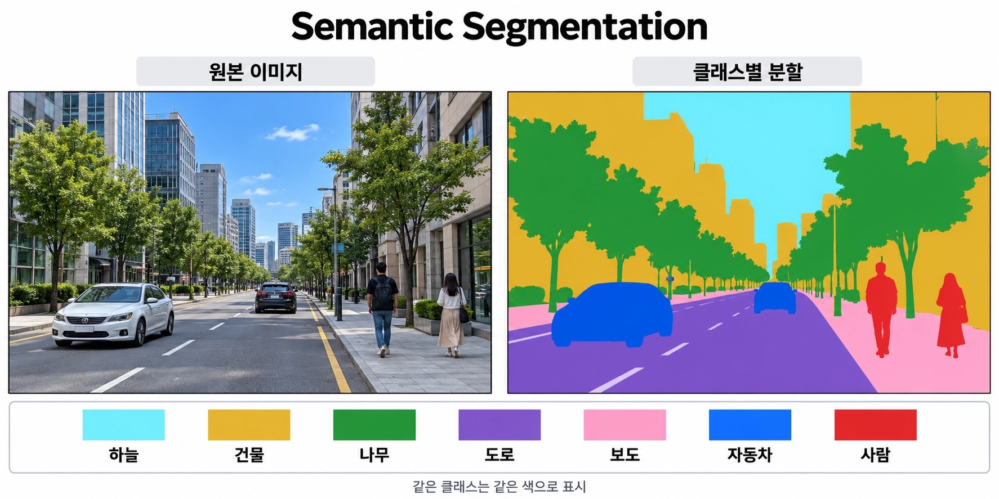
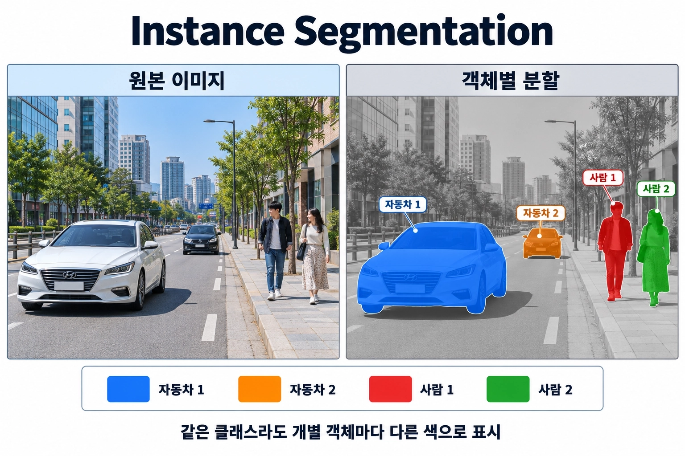
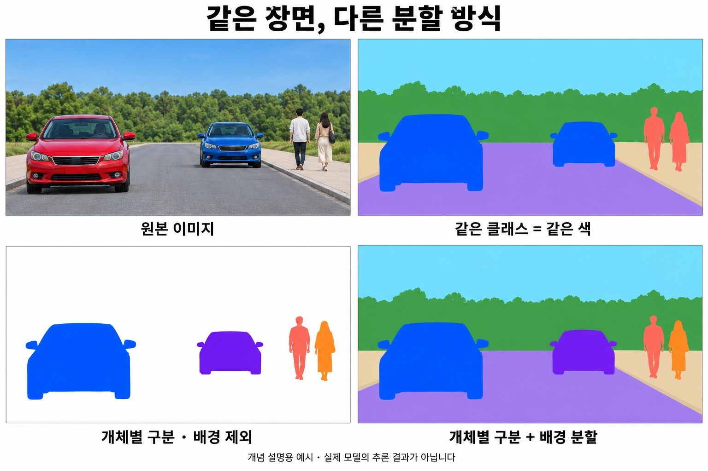
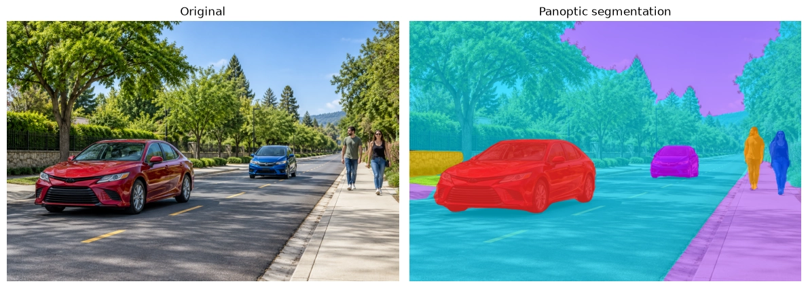

자율주행 차량은 주변의 자동차와 보행자를 구분하는 동시에 도로와 인도 같은 영역도 파악해야 합니다. 이러한 장면 이해에 활용할 수 있는 기술 중 하나가 **Panoptic Segmentation**입니다.

## 1. 먼저, Image Segmentation이란?

Segmentation은 ‘분할’이라는 뜻입니다. **Image Segmentation은 이미지의 픽셀을 분류하거나 묶어, 물체와 영역의 경계를 나누는 기술**입니다.

자동차가 어디 있는지 사각형으로 표시하는 객체 탐지(Object Detection)와 달리, 세그멘테이션은 자동차가 차지하는 픽셀의 모양까지 표현합니다. 이렇게 특정 영역을 표시한 결과를 **마스크(Mask)**라고 부릅니다.

어떤 기준으로 픽셀을 나누는지에 따라 Semantic, Instance, Panoptic Segmentation으로 구분할 수 있습니다.

## 2. Semantic Segmentation — 이 픽셀은 무엇인가요?

**각 픽셀에 클래스, 즉 종류를 부여하는 방식**입니다. 사람 픽셀은 사람 색, 자동차 픽셀은 자동차 색, 도로 픽셀은 도로 색으로 표시합니다.

같은 클래스라면 같은 색을 사용합니다. 자동차가 두 대 있어도 모두 ‘자동차’로 표시하며, 개별 자동차를 구분하지는 않습니다. 서로 다른 자동차를 같은 개체라고 판단한다는 뜻은 아닙니다.



### 어디에 활용할까요?

장면의 영역 구성이 중요한 문제에 활용합니다. 위성 영상에서 농지·도시·숲의 면적을 분석하거나, 의료 영상에서 종양이 차지하는 영역을 찾는 것이 예입니다.

### 대표 모델

- **FCN:** 합성곱 기반으로 이미지의 픽셀별 클래스를 예측하는 대표적인 초기 모델입니다.
- **U-Net:** 인코더와 디코더의 특징을 연결해 영역과 경계를 복원하며, 의료 영상 분할에 널리 활용됩니다.
- **DeepLab 시리즈:** 여러 범위의 문맥 정보를 활용해 픽셀별 클래스를 예측합니다.
- **SegNet:** 인코더의 풀링 위치 정보를 디코더에서 재사용해 분할 결과를 복원합니다.

## 3. Instance Segmentation — 같은 종류라도 각각 누구인가요?

**같은 클래스에 속하는 객체도 개체별로 구분하는 방식**입니다.

자동차가 두 대라면 둘 다 ‘자동차’ 클래스이지만 서로 다른 마스크를 받습니다. 사람도 한 명씩 따로 구분합니다.



### 어디에 활용할까요?

매장에 있는 사람 수를 세거나, 세포 이미지에서 개별 세포를 분리하는 문제에 활용합니다. 추적 기술과 결합하면 영상에서 특정 차량이나 사람을 따라가는 데도 사용할 수 있습니다.

**한 이미지 안에서 개체를 구분하는 것과 여러 프레임에서 동일한 개체를 추적하는 것은 별개의 문제**입니다. 인스턴스 ID가 있다고 해서 다음 프레임에서도 같은 ID가 유지되는 것은 아닙니다.

### 대표 모델

- **Mask R-CNN:** 객체 탐지 결과와 함께 개체별 마스크를 예측합니다.
- **YOLO의 세그멘테이션 모델:** 객체의 클래스와 개체별 마스크를 예측하며, 빠른 추론이 필요한 문제에 활용됩니다.
- **YOLACT / YolactEdge:** 공통 마스크 패턴과 개체별 계수를 조합해 마스크를 생성합니다.

## 4. 왜 Panoptic Segmentation이 필요할까요?

도로 장면을 생각해봅시다. 자동차 두 대, 보행자 두 명, 도로, 인도, 하늘이 있습니다.

Semantic Segmentation은 모든 픽셀의 종류를 설명하지만 **자동차와 보행자를 개체별로 구분하지 못합니다.** Instance Segmentation은 개별 객체를 구분하지만 **일반적으로 도로·하늘 같은 배경 영역의 분할은 다루지 않습니다.**

장면 전체를 이해하려면 두 가지 정보가 모두 필요합니다.

- 자동차와 보행자는 개체별로 구분해야 합니다.
- 도로·인도·하늘은 영역의 클래스를 구분해야 합니다.

**Panoptic Segmentation은 픽셀별 클래스 분류와 개체별 분할을 하나의 과제로 통합한 개념입니다.**

## 5. 세 방식은 무엇이 다를까요?

| 구분 | Semantic | Instance | Panoptic |
| --- | --- | --- | --- |
| 핵심 질문 | 이 픽셀은 무엇인가? | 이 객체는 어떤 개체인가? | 이 픽셀은 무엇이고, 어떤 개체에 속하는가? |
| 같은 클래스의 개체 구분 | 하지 않음 | 구분함 | 구분함 |
| 도로·하늘 같은 영역 분할 | 포함 | 일반적으로 제외 | 포함 |
| 출력 | 픽셀별 클래스 | 개체별 클래스와 마스크 | 픽셀별 클래스와 개체 구분 정보 |

자동차 두 대가 있는 장면이라면 Semantic은 두 자동차를 같은 클래스로 표시합니다. Instance는 자동차 두 대를 서로 다른 마스크로 표시합니다. Panoptic은 자동차를 각각 구분하면서 도로와 하늘도 함께 표시합니다.



## 6. 어떻게 해결할까요?

### 6.1. Things와 Stuff를 구분합니다

Panoptic Segmentation에서는 클래스를 다음 두 부류로 나눕니다.

- **Things:** 사람·자동차처럼 개별 객체로 구분하는 클래스입니다.
- **Stuff:** 도로·하늘·잔디처럼 개체보다 영역으로 다루는 클래스입니다.

‘셀 수 있는 것’과 ‘셀 수 없는 것’으로 이해하면 쉽지만, 실제 구분은 사용하는 데이터셋의 클래스 정의를 따릅니다.

### 6.2. 클래스와 개체 정보를 함께 표현합니다

예를 들어 다음과 같이 결과를 표현할 수 있습니다.

| 영역 | 클래스 | 개체 구분 |
| --- | --- | --- |
| 첫 번째 자동차 | 자동차 | 자동차 A |
| 두 번째 자동차 | 자동차 | 자동차 B |
| 첫 번째 보행자 | 사람 | 사람 A |
| 두 번째 보행자 | 사람 | 사람 B |
| 도로 | 도로 | 개체 구분 대상 아님 |
| 하늘 | 하늘 | 개체 구분 대상 아님 |

**Things는 같은 클래스 안에서도 개체를 구분하고, Stuff는 클래스별 영역으로 표현합니다.** 이상적인 파놉틱 결과에서는 각 픽셀에 하나의 클래스와 영역을 부여하므로, 최종 영역끼리 겹치지 않습니다. 실제 추론에서는 신뢰도 기준 등으로 미할당 픽셀이 남을 수 있습니다.

### 6.3. 결과를 만드는 방식은 모델마다 다릅니다

개념적으로 Semantic과 Instance의 목표를 결합하지만, 반드시 두 모델을 따로 실행해 합치는 것은 아닙니다.

- **결과를 결합하는 방식:** 개체 마스크와 배경 분할을 예측한 뒤 겹치는 영역 등을 정리합니다.
- **중심점으로 묶는 방식:** 픽셀의 클래스와 객체 중심점 방향을 예측해 같은 개체의 픽셀을 묶습니다.
- **클래스와 마스크를 함께 예측하는 방식:** 여러 영역의 클래스와 마스크를 예측하고 후처리로 최종 분할 맵을 만듭니다.

### 대표 모델

- **Panoptic FPN**: 특징을 공유하며 개체 분할과 배경 분할을 함께 예측하고 통합합니다.
- **Panoptic-DeepLab**: 클래스와 객체 중심점·오프셋을 예측해 픽셀을 개체별로 묶습니다.
- **Mask2Former**: 예측 마스크 영역에 집중하는 어텐션을 사용하며 세 가지 분할 과제를 지원합니다.
- **OneFormer**: 작업 종류를 지정해 하나의 모델로 Semantic·Instance·Panoptic 분할을 수행합니다.

## 7. 대표 모델이 다르면, 모델이 과제를 정하는 걸까요?

앞에서 과제마다 대표 모델을 나눠 소개했지만, **세 과제는 출력 형태로 정의되며 특정 아키텍처에 묶여 있지 않습니다.** Semantic의 대표 모델로 소개한 U-Net도 무엇을 예측하도록 학습하느냐에 따라 Instance Segmentation에 사용할 수 있습니다.

### 7.1. 왜 그대로는 어려울까요?

Semantic은 '자동차', '도로'처럼 클래스가 정해져 있어 출력 채널 하나에 클래스 하나를 대응시킬 수 있습니다. 반면 개체 ID에는 고정된 의미가 없습니다.

- 자동차 A와 자동차 B의 이름을 서로 바꿔도 같은 정답입니다.
- 이미지마다 개체 수가 다릅니다.

그래서 정해진 수의 채널로 픽셀별 클래스를 예측하는 구조에 개체 ID를 그대로 정답으로 줄 수는 없습니다. 이 문제를 푸는 방식에 따라 크게 두 갈래로 나뉩니다.

- **Top-down (탐지 후 분할):** 먼저 객체를 찾고, 찾은 객체마다 마스크를 예측합니다. 개체 수 문제를 탐지 단계가 해결합니다. Mask R-CNN이 대표적입니다.
- **Bottom-up (픽셀 예측 후 묶기):** 개체 ID 대신 번호와 무관한 값을 픽셀마다 예측하고, 후처리로 같은 개체의 픽셀을 묶습니다. U-Net 같은 인코더-디코더 구조를 그대로 활용할 수 있습니다.

### 7.2. U-Net으로 개체를 구분하는 방법

| 픽셀마다 예측하는 값 | 개체로 묶는 방법 | 예시 |
| --- | --- | --- |
| 전경 / 경계 / 배경 | 경계로 끊긴 영역을 각각 분리 | U-Net 원 논문 (붙어 있는 세포 경계에 가중치) |
| 객체 중심까지의 거리 | Watershed | 세포·핵 분할 |
| 중심에서 경계까지의 방사형 거리 | 다각형으로 복원 | StarDist |
| 중심을 향하는 흐름 벡터 | 흐름을 따라 모이는 픽셀끼리 묶기 | Cellpose |
| 픽셀별 임베딩 벡터 | 클러스터링 | Discriminative Loss |
| 클래스 + 중심점 + 오프셋 | 가장 가까운 중심점에 할당 | Panoptic-DeepLab |

**구조는 거의 그대로 두고, 출력과 손실 함수만 바꾼 것**입니다. 6.3에서 소개한 '중심점으로 묶는 방식'도 이 흐름에 속합니다.

### 7.3. 그래도 방식마다 잘 맞는 문제가 있습니다

- Bottom-up은 한 픽셀에 하나의 개체만 부여하므로, 서로 겹친 객체를 각각 온전한 마스크로 표현하기 어렵습니다. Top-down은 개체마다 마스크를 따로 예측하므로 마스크끼리 겹칠 수 있습니다.
- 크기 차이가 큰 객체가 섞인 장면에서는 탐지 기반 방식이 안정적인 경우가 많습니다.
- 비슷한 크기의 객체가 빽빽하게 모인 세포 이미지에서는 Bottom-up 방식이 널리 쓰입니다.
- Bottom-up은 후처리 기준(경계 임계값, 클러스터링 기준 등)에 따라 결과가 달라질 수 있습니다.

### 7.4. 하나의 구조로 세 과제를 다루기

Mask2Former는 정해진 개수의 마스크와 각 마스크의 클래스를 예측하고, 학습할 때 예측과 정답을 **일대일로 짝지어(Hungarian Matching)** 비교합니다. 순서와 관계없이 가장 잘 맞는 짝을 찾으므로 개체 ID의 순서 문제가 사라집니다. 그래서 같은 구조를 Semantic·Instance·Panoptic 데이터로 각각 학습해 세 과제에 모두 사용할 수 있습니다.

**대표 모델 목록은 각 과제에서 먼저 좋은 성능을 보인 모델을 정리한 것이며, 과제와 모델이 일대일로 대응하는 것은 아닙니다.**


## 8. 코드에서는 어떻게 활용할까요?

사전 학습된 Mask2Former로 이미지 한 장을 분할해봅시다. 다음 코드는 Hugging Face 공식 문서와 COCO Panoptic 체크포인트의 API를 참고한 예제입니다.

이 체크포인트는 COCO의 클래스 체계를 사용합니다. 자율주행 전용 도로·인도 분할이 목적이라면 해당 클래스가 포함된 데이터셋으로 학습한 체크포인트를 선택해야 합니다.

### 8.1. 준비

```bash
pip install torch torchvision transformers pillow matplotlib numpy
```

분할할 이미지를 `scene.jpg`로 준비합니다. 최초 실행에는 모델 파일을 내려받기 위한 인터넷 연결이 필요합니다.

### 8.2. 이미지 입력 → 모델 추론 → 후처리

```python
import numpy as np
import torch
import matplotlib.pyplot as plt
from PIL import Image
from transformers import AutoImageProcessor, Mask2FormerForUniversalSegmentation

checkpoint = "facebook/mask2former-swin-small-coco-panoptic"
processor = AutoImageProcessor.from_pretrained(checkpoint)
model = Mask2FormerForUniversalSegmentation.from_pretrained(checkpoint)
model.eval()

image = Image.open("scene.png").convert("RGB")
inputs = processor(images=image, return_tensors="pt")

with torch.inference_mode():
    outputs = model(**inputs)

result = processor.post_process_panoptic_segmentation(
    outputs,
    target_sizes=[(image.height, image.width)],
    label_ids_to_fuse=set(),
)[0]

segmentation = result["segmentation"].cpu().numpy()
segments_info = result["segments_info"]

for segment in segments_info:
    label = model.config.id2label[segment["label_id"]]
    pixel_count = int((segmentation == segment["id"]).sum())
    print(
        f"영역 ID={segment['id']}, 클래스={label}, "
        f"점수={segment['score']:.3f}, 픽셀 수={pixel_count}"
    )
```

```powershell
#output
[transformers] Mask2FormerForUniversalSegmentation LOAD REPORT from: facebook/mask2former-swin-small-coco-panoptic
Key                                                                                                                      | Status     | 
-------------------------------------------------------------------------------------------------------------------------+------------+-
model.pixel_level_module.encoder.swin.encoder.layers.{0, 1, 2, 3}.blocks.{0...17}.attention.self.relative_position_index | UNEXPECTED | 
model.pixel_level_module.encoder.swin.layernorm.bias                                                                     | MISSING    | 
model.pixel_level_module.encoder.swin.layernorm.weight                                                                   | MISSING    | 

Notes:
- UNEXPECTED:	can be ignored when loading from different task/architecture; not ok if you expect identical arch.
- MISSING:	those params were newly initialized because missing from the checkpoint. Consider training on your downstream task.
영역 ID=1, 클래스=car, 점수=0.998, 픽셀 수=140758
영역 ID=2, 클래스=wall-stone, 점수=0.910, 픽셀 수=17587
영역 ID=3, 클래스=person, 점수=0.999, 픽셀 수=12782
영역 ID=4, 클래스=pavement-merged, 점수=0.994, 픽셀 수=164265
영역 ID=5, 클래스=grass-merged, 점수=0.861, 픽셀 수=4038
영역 ID=6, 클래스=mountain-merged, 점수=0.876, 픽셀 수=4870
영역 ID=7, 클래스=person, 점수=0.999, 픽셀 수=12482
영역 ID=8, 클래스=car, 점수=0.999, 픽셀 수=20824
영역 ID=9, 클래스=sky-other-merged, 점수=1.000, 픽셀 수=190229
영역 ID=10, 클래스=tree-merged, 점수=0.998, 픽셀 수=591433
영역 ID=11, 클래스=road, 점수=0.997, 픽셀 수=413505
```

`label_ids_to_fuse`는 같은 Stuff 클래스의 마스크들을 합칠 때 사용합니다.

### 8.3. 영역별로 색을 칠해봅시다

```python
# facebook/mask2former-swin-small-coco-panoptic 기준
# 클래스 ID 0~79: Things(개별 객체)
thing_ids = set(range(80))

object_colors = np.array([
    [255, 40, 40],    # 빨강
    [0, 80, 255],    # 파랑
    [255, 150, 0],   # 주황
    [210, 0, 255],   # 보라
    [0, 210, 110],   # 초록
    [255, 0, 150],   # 분홍
], dtype=np.uint8)

background_colors = np.array([
    [180, 205, 220],
    [195, 215, 185],
    [220, 205, 180],
    [205, 195, 220],
], dtype=np.uint8)

original = np.array(image)
overlay = original.copy()
object_index = 0

for segment in segments_info:
    mask = segmentation == segment["id"]
    label_id = segment["label_id"]

    if label_id in thing_ids:
        # 객체마다 다른 선명한 색
        color = object_colors[object_index % len(object_colors)]
        object_index += 1
        alpha = 0.75
    else:
        background_colors = np.array([
            [0, 220, 255],    # 하늘색
            [160, 255, 40],   # 연두색
            [255, 210, 0],    # 노란색
            [180, 100, 255],  # 보라색
        ], dtype=np.uint8)

        color = background_colors[
            (label_id - 80) % len(background_colors)
        ]
        alpha = 0.65

    overlay[mask] = (
        (1 - alpha) * original[mask] + alpha * color
    ).astype(np.uint8)

fig, axes = plt.subplots(1, 2, figsize=(12, 6))
axes[0].imshow(image)
axes[0].set_title("Original")
axes[1].imshow(overlay)
axes[1].set_title("Panoptic segmentation")

for axis in axes:
    axis.axis("off")

plt.tight_layout()
plt.savefig("panoptic_result.png", dpi=150)
plt.show()
```



이 결과에서 특정 클래스의 마스크를 추출하거나, 예측된 자동차 영역 수를 세거나, 영역이 차지하는 픽셀 수를 계산할 수 있습니다. 픽셀 면적을 실제 거리·면적으로 바꾸려면 카메라 보정과 깊이 같은 추가 정보가 필요합니다.

## 참고 자료

- Panoptic Segmentation 원 논문
- Mask2Former 원 논문
- Hugging Face Mask2Former 공식 문서
- 예제에서 사용한 모델 체크포인트
