> **Problem: how should class imbalance be handled in image segmentation?**

This is a record of training a pixel-level segmentation model on 100 soccer broadcast frames, and narrowing down through experiments why **small classes that make up less than 1% of pixels (ball, referee, goalkeeper B)** were so hard to detect, and what the cause was.

**TL;DR**
- U-Net++ trained with BCE + Dice had decent average performance, but small classes swung between IoU 0 and 0.8 depending on the fold.
- Results diverged even when only the seed changed → the cause was not the data split but **unstable learning of small classes**.
- Switching to **CE + Dice + class weights** raised test mIoU from **0.770 → 0.873** and Ball IoU from **0 → 0.771**.

---

## 1. Dataset

- **Football Semantic Segmentation** (Acme AI, Kaggle)
- **100 frames** (1920×1080) sampled every 12 frames from highlights of the 2017 UEFA Super Cup, Real Madrid vs Manchester United
- 915 COCO polygon annotations, 11 classes
  - Team A / Team B / Goalkeeper A / Goalkeeper B / Referee / Coaches & Officials
  - Ball / Goal Bar / Ground / Audience / Advertisement
- `Coaches & Officials` has zero annotations and was excluded → **10 classes actually trained**, no background class (every pixel has a label)

## 2. Looking at the data – what I checked before training

### 2.1. Exact duplicate images (MD5)

There was **one pair of images with different file names but identical content** (`Frame 1 (14)`, `Frame 1 (71)`).
If they ended up split across train and test, it would be like taking an exam after seeing the answers, so they have to be kept on the same side when splitting.

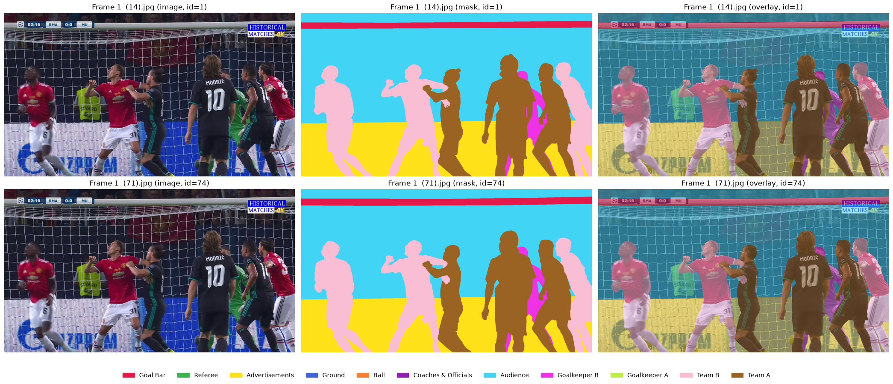

### 2.2. Near-duplicate images (pHash)

Since the frames were extracted from video, I expected many scenes that are "not identical but nearly the same", and checked them with pHash (64-bit, Hamming distance ≤ 5).

- **32 of 100** images were near-duplicates, in 8 groups (largest group: 10 images)
- With a third of the data being look-alike frames, a random split carries a high risk of inflating val/test scores

→ **All near-duplicate groups were fixed to train**, and val/test were drawn from the rest.

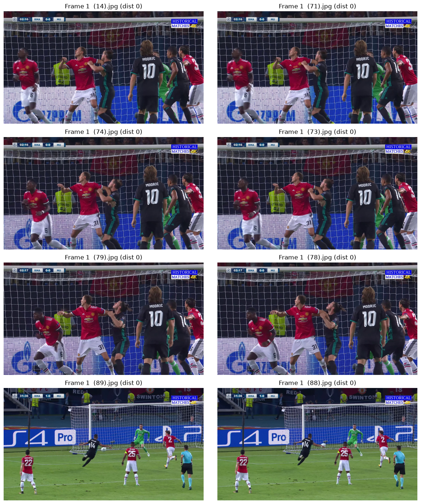

### 2.3. Class ratios – instance count vs pixel area

The class ratios in the dataset's documentation (PDF) are **by instance count**. But the segmentation loss is computed **per pixel**, so I looked again by pixel area.

| Class | Instance ratio | Pixel area ratio |
|---|---|---|
| Ground | 9.4% | **40.5%** |
| Audience | 10.3% | **25.1%** |
| Ball | 7.0% | **0.1%** |
| Referee | 2.6% | **0.4%** |
| Goalkeeper B | 5.1% | **0.6%** |

By instance count the ball looks fairly common at 7%, but **by pixels it is 0.1%** — 400 times less than Ground.
This is where the core problem of the project showed up.

Other checks:
- Images with no people (players/goalkeepers/referee): 0 (5.1 people per image on average)
- Mask coordinates outside the image: 0 cases (2,397 polygons checked)

### 2.4. train / val / test split

- 70 / 15 / 15 images
- The 32 near-duplicate images fixed to train
- From the rest, searched for a split where **instance count, pixel area and number of images containing each class** were all close to 7:1.5:1.5 (deviation score 0.094)

## 3. Preprocessing / augmentation

| Transform | Settings | Applied to mask too |
|---|---|---|
| RandomResizedCrop | scale 0.4–1.0, output 576×1024 | O (nearest) |
| HorizontalFlip | p=0.5 | O |
| ColorJitter | brightness/contrast/saturation 0.3 | X |
| GaussianBlur | p=0.2 | X |
| Normalize | ImageNet mean/std (ResNet34 backbone) | X |

- Input size 576×1024: the same 16:9 as the original, and a multiple of 32
- The label map was **painted from the largest objects first** so small objects (like the ball) end up on top

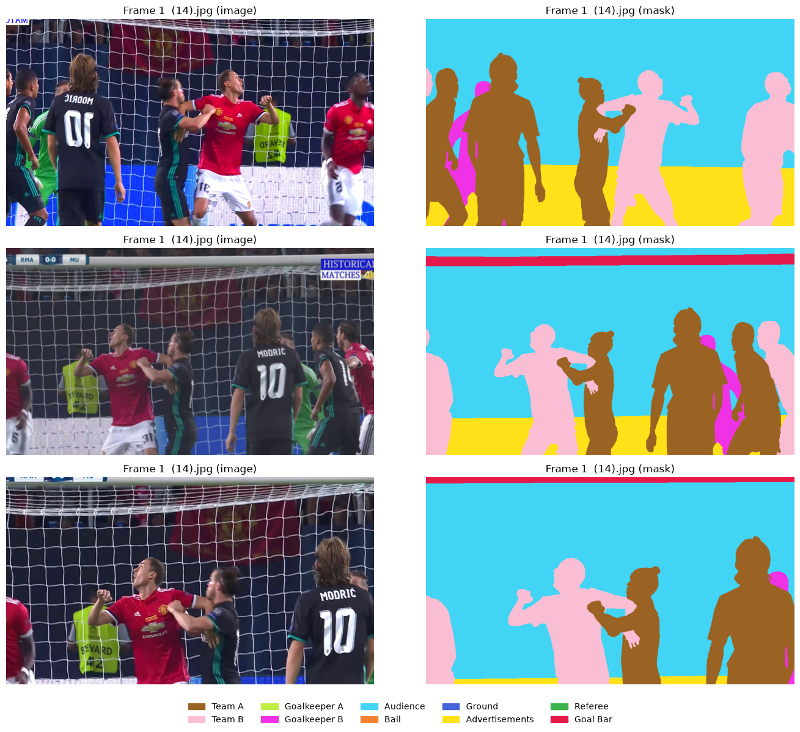

## 4. LAB 1 – U-Net++ + BCE + Dice

### 4.1. Model

**U-Net++** (encoder: ResNet34 pretrained on ImageNet)

In U-Net, the decoder receives **only one feature map from the same level** of the encoder through a skip connection. U-Net++ places intermediate nodes between the encoder and decoder, and **each node concatenates all of the earlier nodes at the same level** (the DenseNet idea). The structure reduces the semantic gap between encoder and decoder features.

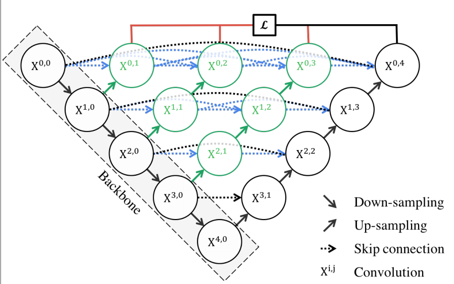
*Source: Zhou et al., UNet++ (2018)*

- Loss: **BCE + Dice** (per-class sigmoid)
- Metrics: mIoU, mDice, mAP, boundary metrics (Boundary F1, Boundary IoU)
- Pretrained encoder at lr 1e-4, newly built decoder at 1e-3

### 4.2. Training results

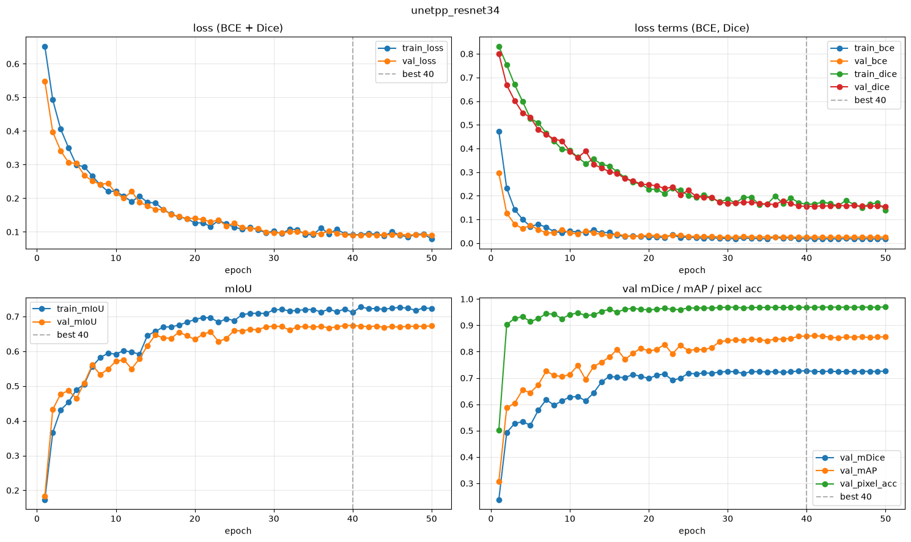

- Best epoch 40, val mIoU **0.674**, mDice 0.727, mAP 0.859
- Train and val loss went down together, so overfitting was not large
- However, **mIoU and mDice were noticeably lower than mAP (0.86)** → a sign that the model ranks scores correctly but some classes lose at the final decision (argmax)

### 4.3. 5-fold cross-validation

15 val images are too few, so to check whether this score could be trusted I ran **5-fold on the 85 train+val images**. (Test untouched; each near-duplicate group kept whole within one fold.)

| fold | mIoU | mDice | mAP | best epoch |
|---|---|---|---|---|
| 1 | 0.645 | 0.698 | 0.732 | 14 |
| 2 | 0.664 | 0.711 | 0.864 | 44 |
| 3 | 0.792 | 0.841 | 0.951 | 49 |
| 4 | 0.884 | 0.937 | 0.958 | 50 |
| 5 | 0.780 | 0.832 | 0.922 | 41 |
| **Mean** | **0.753 ± 0.099** | 0.804 ± 0.100 | 0.886 ± 0.093 | |

The mIoU gap between folds, **0.645 – 0.884**, is far too large.

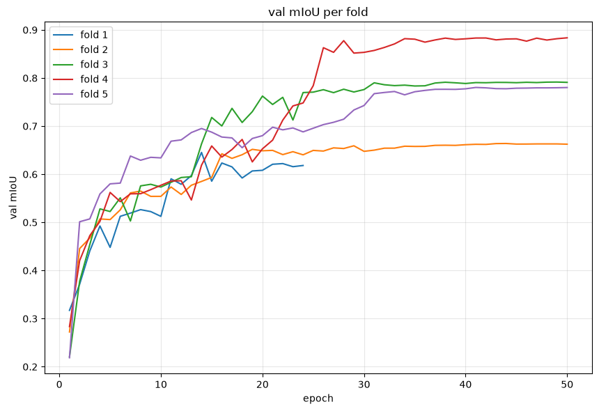

Breaking it down by class shows the cause right away. Bars are the 5-fold mean, whiskers the standard deviation.

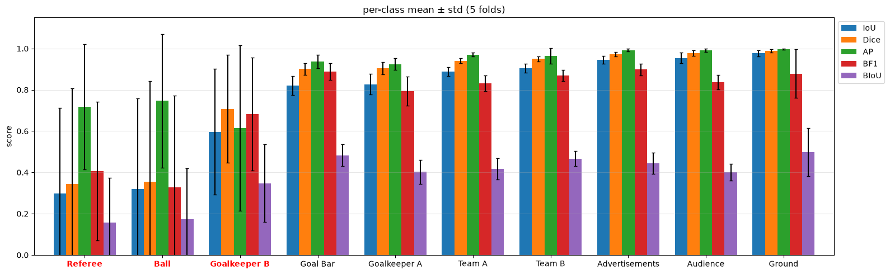

| Class | Pixel ratio | IoU (mean ± std) | AP (mean ± std) |
|---|---|---|---|
| Ground | 40.1% | 0.976 ± 0.016 | 0.997 |
| Audience | 25.3% | 0.954 ± 0.026 | 0.991 |
| Team B | 8.3% | 0.905 ± 0.022 | 0.965 |
| **Goalkeeper B** | **0.56%** | **0.596 ± 0.304** | 0.615 |
| **Referee** | **0.37%** | **0.299 ± 0.412** | 0.717 |
| **Ball** | **0.11%** | **0.320 ± 0.438** | 0.746 |

The large classes are stable above 0.9, but **only the three classes under 1% of pixels swing with a standard deviation of 0.3–0.44**. Per-fold IoU is even more extreme.

| | fold 1 | fold 2 | fold 3 | fold 4 | fold 5 |
|---|---|---|---|---|---|
| Ball | **0.000** | **0.000** | 0.780 | 0.819 | **0.000** |
| Referee | 0.010 | **0.000** | **0.000** | 0.850 | 0.634 |
| Goalkeeper B | 0.235 | 0.309 | 0.879 | 0.852 | 0.707 |

It is not "detects them a little poorly" but either **not at all (0) or fairly well (0.8)**.

### 4.4. Looking at the missed objects directly

I zoomed in on the objects with the lowest recall in val. (Green = hit, red = missed)

**Ball – missed all 10 of 10 (recall 0)**

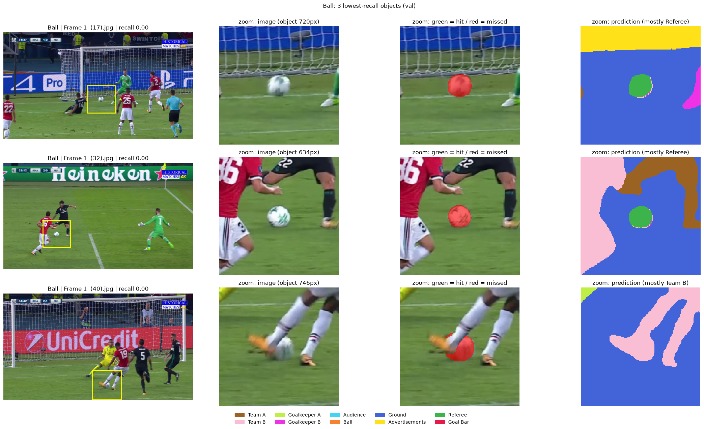

- Median ball area is **720px** (0.1% of a 576×1024 input)
- **74% of missed balls were predicted as Referee**
- Yet AP is above 0.7 → the model does give ball pixels some "probability of being the ball", but **loses to a larger class at argmax**

**Goalkeeper B – mostly confused with Team A (32%)**

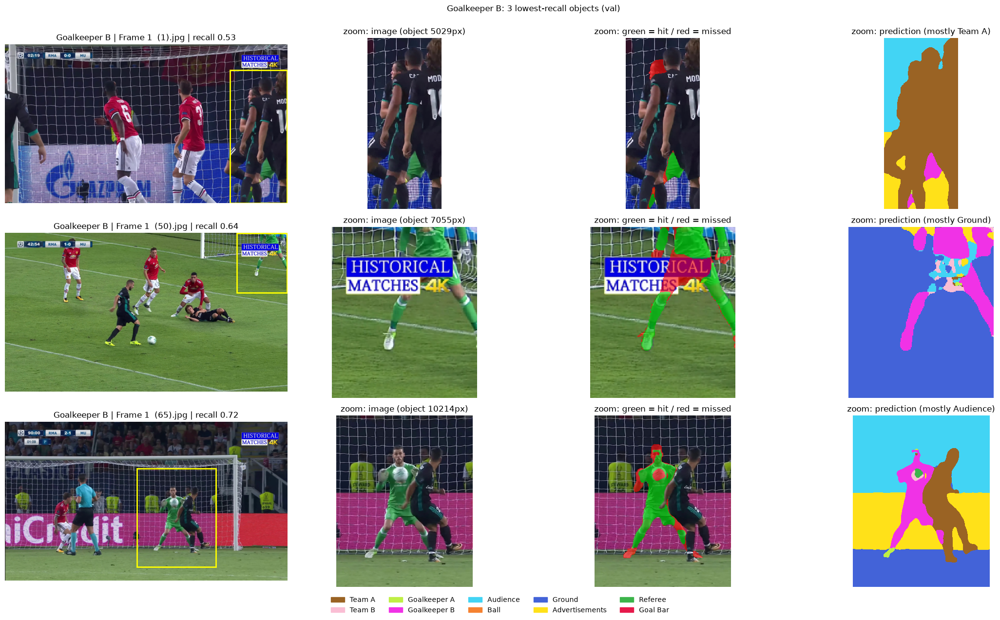

When overlapping with other players or hidden behind the broadcast logo, they were absorbed into another player class.

### 4.5. Forming hypotheses

I considered two reasons why small classes split between 0 and 0.8 depending on the fold.

1. **Different train composition per fold** – some folds lack small-class examples in train
2. **Unstable learning of small classes** – their share of the loss is so small that they are learned late and unstably

Looking at the actual fold split, 35% of Referee was concentrated in fold 2 (target 20%), and only fold 1 had 7 images containing the ball (the others had 11–12), so hypothesis ① was quite plausible too.

## 5. LAB 2 – changing only the seed

The simplest way to tell the two hypotheses apart is to **keep the train composition the same and change only the seed**.

- Results are similar → hypothesis ① (a data composition problem)
- Results diverge a lot → hypothesis ② (training itself is unstable)

I retrained fold 2 (base mIoU 0.664) with seeds 42 / 43 / 44.

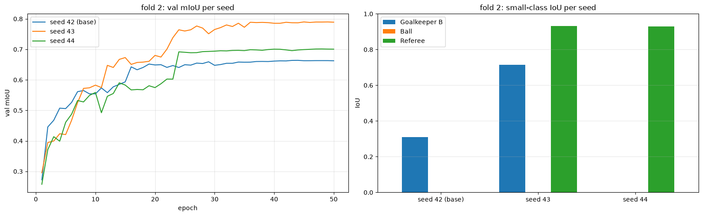

| Seed | mIoU | Goalkeeper B | Ball | Referee |
|---|---|---|---|---|
| 42 (base) | 0.664 | 0.309 | 0.000 | 0.000 |
| 43 | 0.790 | 0.713 | 0.000 | **0.933** |
| 44 | 0.701 | **0.002** | 0.000 | 0.930 |

**With the same data**, Goalkeeper B swings from 0.002 to 0.713 and Referee from 0 to 0.933.
→ **Hypothesis ②**. It is not the data split; the small classes are unstable in the training itself.
(Ball was 0 for all three seeds, so with this loss setup it was not being learned at all.)

## 6. LAB 3 – CE + Dice + class weights

If unstable training is the cause, **the loss function has to amplify the voice of the small classes**. I changed two things.

1. **BCE → CE (softmax)**
   BCE treats each class as an independent "present / absent" problem, which does not fit this data where each pixel has exactly one answer. CE makes the classes compete directly, so the training objective matches the argmax decision.
2. **Class weights** (inversely proportional to pixel frequency)

| Class | Weight |
|---|---|
| Ball | **3.36** |
| Referee | **1.78** |
| Goalkeeper B | **1.48** |
| Goalkeeper A | 1.02 |
| Team A / B | 0.41 / 0.39 |
| Audience | 0.22 |
| Ground | 0.17 |

All 5 folds were retrained with the same splits and the same seed. (Dashed = BCE + Dice, solid = CE + Dice + weights)

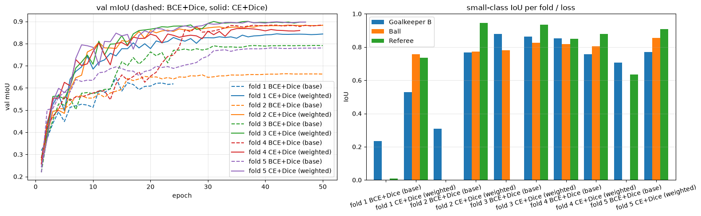

| fold | BCE+Dice mIoU | **CE+Dice(w) mIoU** | Ball | Referee | Goalkeeper B |
|---|---|---|---|---|---|
| 1 | 0.645 | **0.844** | 0 → 0.756 | 0.010 → 0.736 | 0.235 → 0.529 |
| 2 | 0.664 | **0.883** | 0 → 0.773 | 0 → 0.946 | 0.309 → 0.768 |
| 3 | 0.792 | **0.900** | 0.780 → 0.827 | 0 → 0.934 | 0.879 → 0.864 |
| 4 | 0.884 | 0.868 | 0.819 → 0.805 | 0.850 → 0.880 | 0.852 → 0.757 |
| 5 | 0.780 | **0.899** | 0 → 0.856 | 0.634 → 0.907 | 0.707 → 0.769 |
| **Mean** | 0.753 ± 0.099 | **0.879 ± 0.024** | | | |

- Mean mIoU **+0.126**
- Standard deviation across folds **0.099 → 0.024 (about 1/4)**
- Every cell that had IoU 0 disappeared
- Large classes (Ground, Audience, Advertisements) changed by only about ±0.01, nearly unchanged

> I left mAP out of this comparison. AP is computed from sigmoid(logit), and the logits of a CE model trained with softmax are not calibrated like sigmoid probabilities, so a fair comparison with the BCE model is difficult.

## 7. Final test evaluation

The 15 test images were never used for training or model selection, and were evaluated **exactly once**. For CE + Dice, I used the fold 3 model, which had the highest val mIoU.

**BCE + Dice (no weights)** – the Ball bar has only AP (green); IoU/Dice are 0

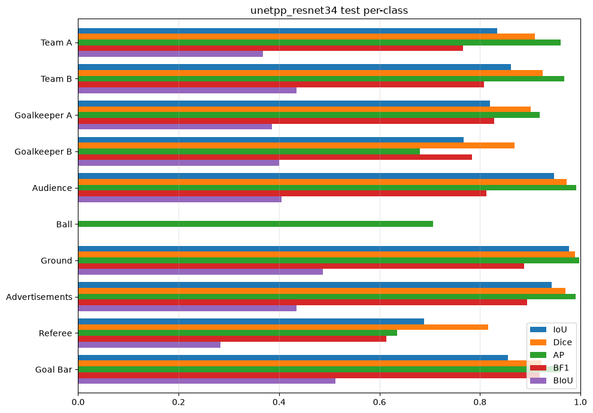

**CE + Dice + class weights** – all classes even

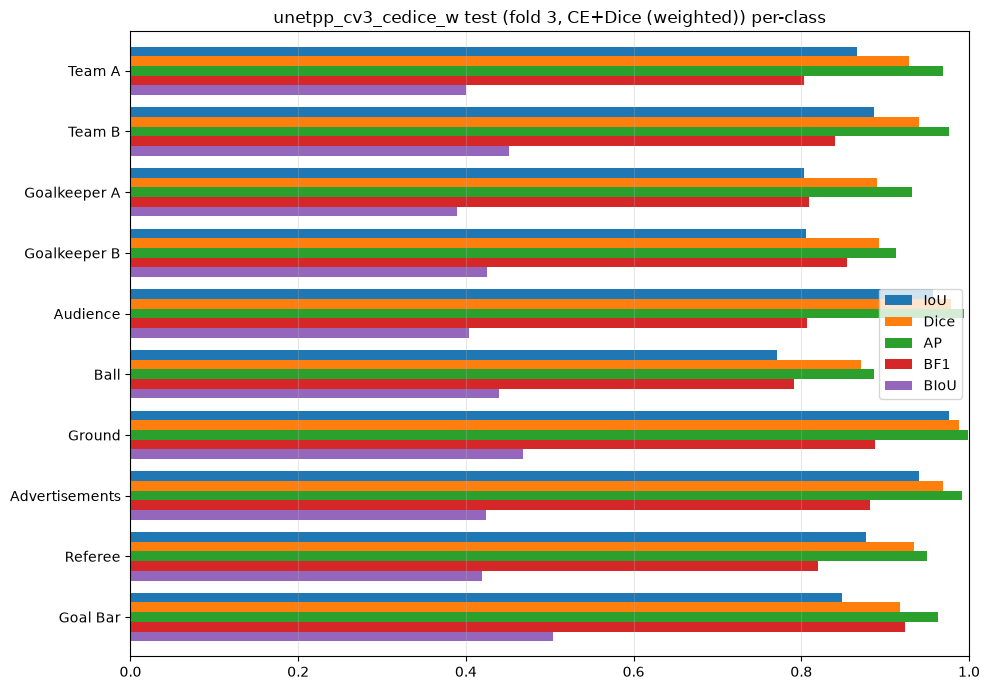

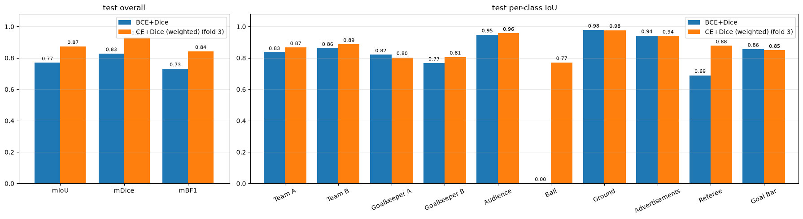

| Model | mIoU | mDice | mBF1 | Goalkeeper B | Ball | Referee |
|---|---|---|---|---|---|---|
| BCE + Dice | 0.770 | 0.828 | 0.731 | 0.767 | **0.000** | 0.689 |
| **CE + Dice + weights** | **0.873** | **0.931** | **0.842** | **0.806** | **0.771** | **0.878** |

- BCE + Dice **did not catch a single ball** on test either (AP 0.71 but IoU 0)
- CE + Dice + weights raised Ball IoU from **0 → 0.771** while keeping performance on the large classes
- Test IoU for the person classes (Team A/B, Goalkeeper A/B, Referee) came out evenly at **0.80 – 0.89**

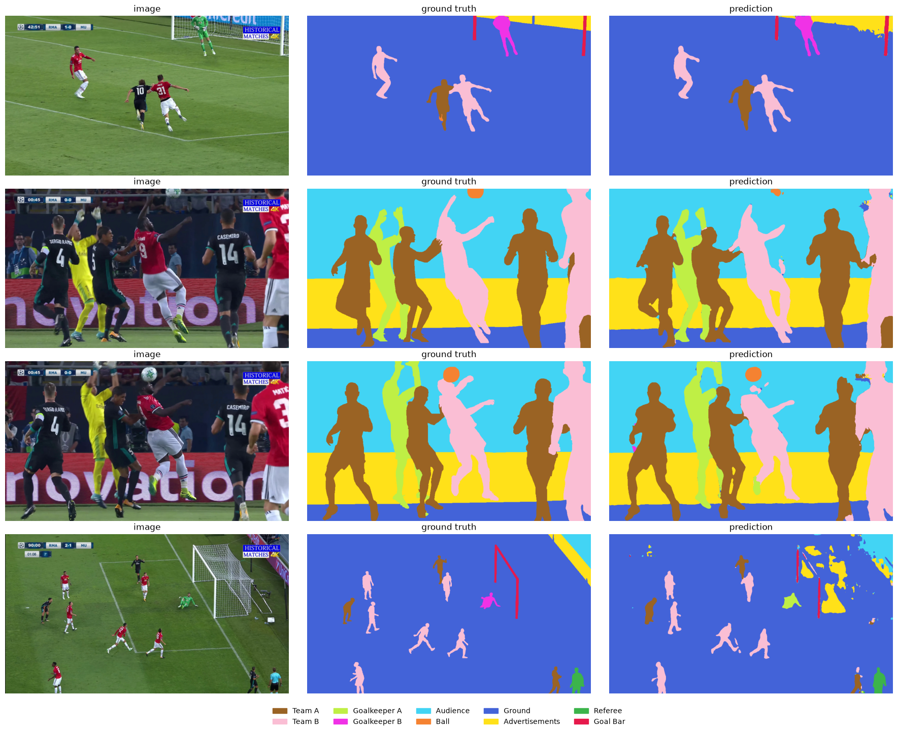

*From left: original / ground truth / prediction (CE + Dice + weights)*

## 8. Conclusion

- The reason small-class performance split between 0 and 0.8 across folds was **not the data split but unstable training, because small classes make up so little of the loss**. (Results diverged just by changing the seed.)
- The pattern **"high AP but IoU 0"** was the decisive clue. The model did not know nothing about the small classes; it was losing the argmax competition to the large ones.
- Switching the loss to **CE + Dice + class weights** raised the mean (+0.126) and cut the variance to 1/4.
- Looking at **pixel ratios rather than instance ratios** during the data check helped pinpoint the problem quickly.

## 9. Limitations and next steps

- **I changed two things at once.** LAB 3 switched BCE → CE and added class weights together, so the contribution of each could not be separated. → Plan to run CE + Dice (no weights) and BCE + Dice (with weights) separately and compare
- The two models in the test comparison were not trained on exactly the same data. (BCE: 70 train images / CE: 68 images from fold 3)
- With only 3 seeds compared and 15 test images, confidence intervals are wide. → More seeds and more data are needed
- The boundary metric mBIoU is still low at 0.43. If contours need to be precise, consider a boundary loss or higher-resolution input
- To use this for tracking with real broadcast cameras, stability across consecutive frames and inference speed also need to be checked.
