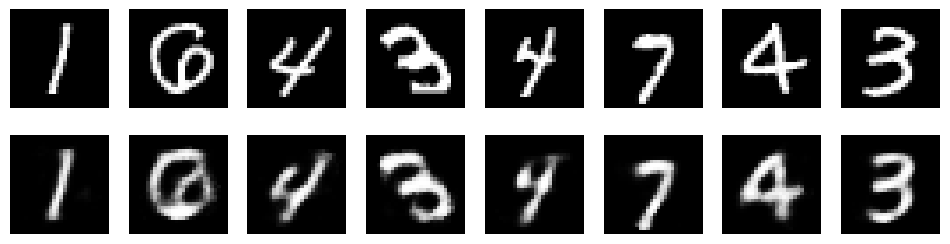
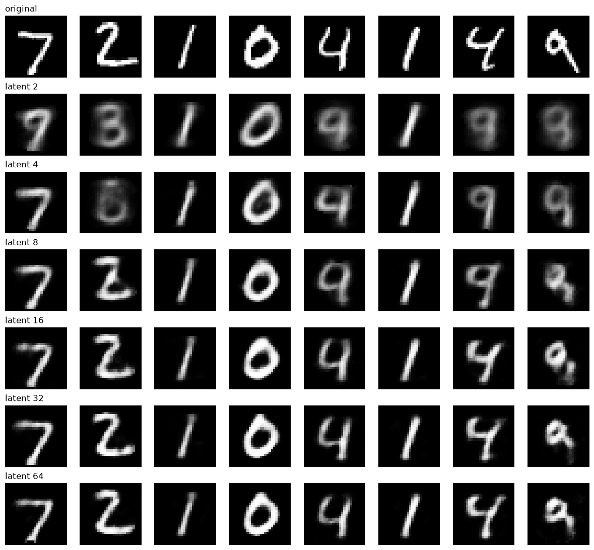
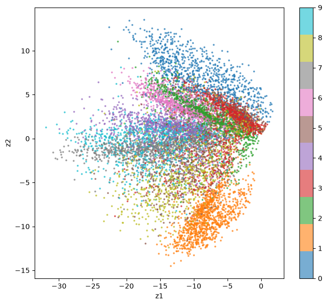
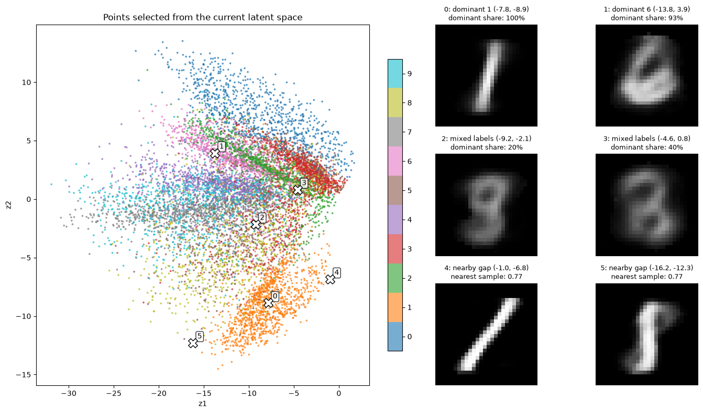
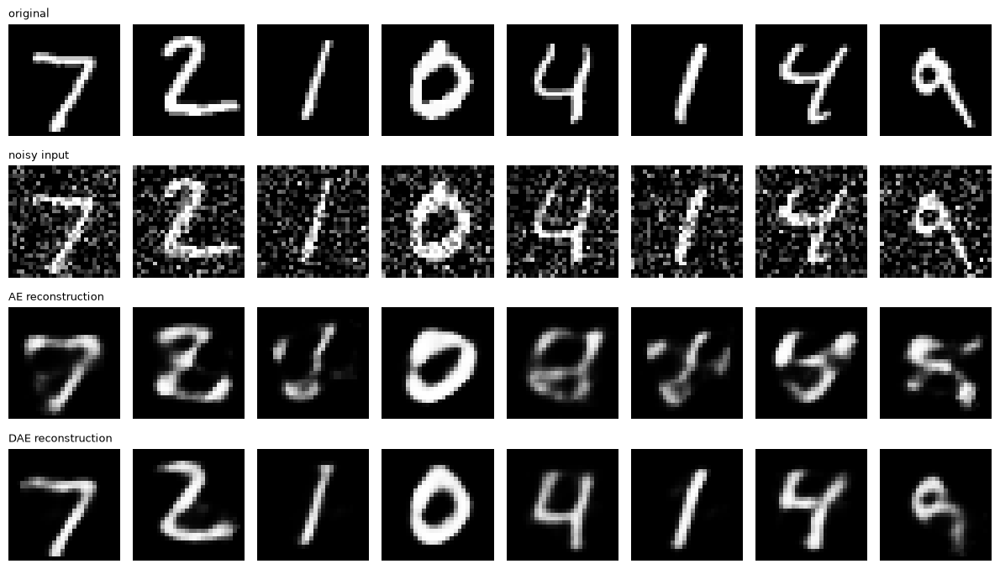
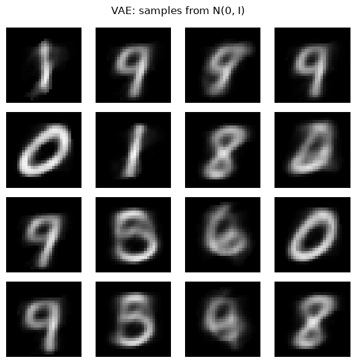
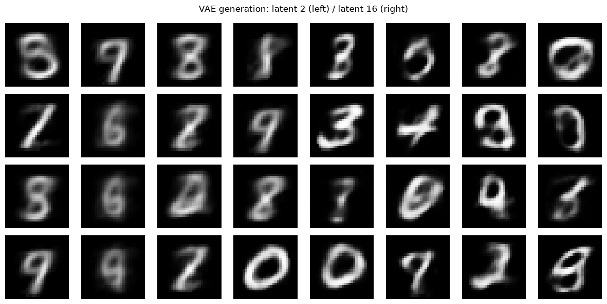
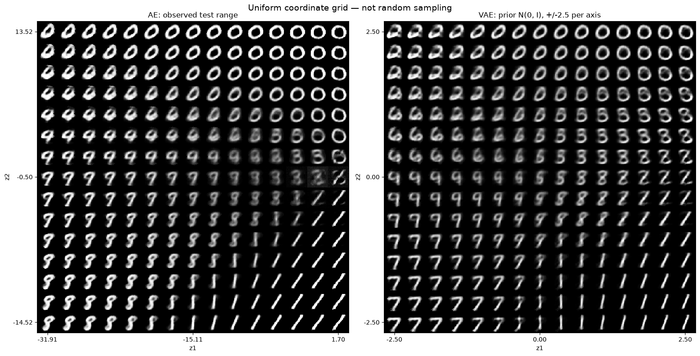
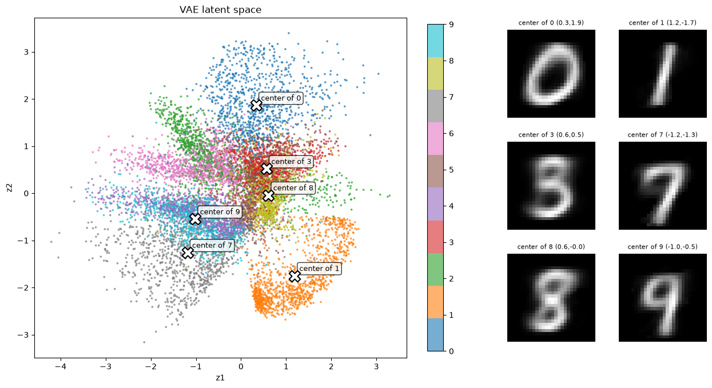

When you first meet autoencoders, even the goal feels strange. Training a model to output exactly the image it was given — wouldn't a single line of `return x` do the job?

But the story changes if the input has to pass through a narrow passage. To represent 784 pixels with fewer values and then restore them, the model has to learn which features to keep.

In this post we look at three models using MNIST handwritten digits.

| Model | How it learns | Question to explore |
|---|---|---|
| AE · Autoencoder | Compress the input, then restore it | What survives in a small latent vector? |
| DAE · Denoising Autoencoder | Restore the original from a corrupted input | What does it learn when we add noise? |
| VAE · Variational Autoencoder | Restore via a per-image latent distribution, pulled toward a reference distribution | Where do we sample coordinates to make new images? |

> The numbers and figures below are execution results saved in the practice notebook. Re-running may give different results depending on model initialization, random numbers and the environment. The main text has the key code; the longer comparison and visualization code is collected in the appendix at the end.

## 1. Setup: a 28×28 image as a 784-dimensional vector

MNIST images are 28×28 grayscale images. `ToTensor()` turns the pixels into a tensor in the 0–1 range, and they are flattened to 784 dimensions before going into fully connected layers.

Install the required packages as follows.

```bash
pip install torch torchvision matplotlib
```

Below is the environment setup from the original notebook. It uses MPS on Apple Silicon if available, and otherwise runs on the CPU.

```python
import torch
import torch.nn as nn
import torch.nn.functional as F
from torch.utils.data import DataLoader
from torchvision import datasets, transforms
import matplotlib.pyplot as plt

# 모델 초기화와 노이즈 생성 등에 사용할 공통 시드입니다.
SEED = 42
torch.manual_seed(SEED)

device = "mps" if torch.backends.mps.is_available() else "cpu"

train_set = datasets.MNIST("./data", train=True, download=True,
                           transform=transforms.ToTensor())
train_loader = DataLoader(train_set, batch_size=256, shuffle=True)
```

The `DataLoader` serves the training data in batches of 256 images. This is a choice to control how much is processed at once and how many updates happen.

`torch.flatten(images, start_dim=1)` merges only the image dimensions while keeping the batch dimension.

```text
[배치 크기, 1, 28, 28] → [배치 크기, 784]
```

## 2. AE: a bottleneck that forces it to learn reconstruction

An AE consists of an encoder and a decoder.

- **Encoder:** turns the input `x` into a latent vector `z`.
- **Decoder:** builds the reconstructed image `x̂` from the latent vector `z`.

The model's structure is as follows.

```text
입력 784 → 은닉층 128 → 잠재 벡터 32 → 은닉층 128 → 출력 784
```

The latent vector is a summary representation used to restore the image. The bottleneck makes it hard to pass information through unchanged, but it does not automatically guarantee the semantic features a person would want.

```python
class AutoEncoder(nn.Module):
    #잠재표현 층을 몇 차원으로 줄건지 latent_dim으로 받음.
    def __init__(self, latent_dim):
        super().__init__()
        #encoder
        self.encoder = nn.Sequential(
            nn.Linear(784, 128), 
            nn.ReLU(),
            nn.Linear(128, latent_dim)
        )
        #decoder
        self.decoder = nn.Sequential(
            nn.Linear(latent_dim, 128), 
            nn.ReLU(),
            nn.Linear(128, 784), 
            nn.Sigmoid()
        )
    #forward = 순전파
    def forward(self, x):
        z = self.encoder(x)
        return self.decoder(z)
```

The final `Sigmoid` limits output pixels to the 0–1 range. In `forward()`, the input is encoded and then immediately decoded.

### Using the input itself as the target instead of digit labels

The digit class labels are not used during training. Instead, it minimizes the MSE — the mean squared error per pixel — between the reconstruction and the input image.

Here, "not using labels" does not mean "there is no learning target". **The input image itself is the reconstruction target.** MSE is the reconstruction loss chosen for this exercise; the fact that pixels are continuous does not mean MSE is the only option.

```python
model = AutoEncoder(latent_dim=32).to(device)
criterion = nn.MSELoss()
optimizer = torch.optim.Adam(model.parameters(), lr=1e-3)

for epoch in range(5):
    total = 0
    for images, _ in train_loader:
        #start_dim=1: 1번 차원부터 합치기를 시작합니다. (보통 0번 차원은 배치 크기(Batch Size)이므로 유지합니다.)
        x = torch.flatten(images, start_dim=1).to(device)

        output = model(x)
        loss = criterion(output, x)

        optimizer.zero_grad()
        loss.backward()
        optimizer.step()

        total += loss.item()
    print(f"epoch {epoch+1}: {total/len(train_loader):.4f}")
```

The saved training log is below. These values are a training metric: the average of each epoch's per-batch mean losses.

```text
epoch 1: 0.0645
epoch 2: 0.0304
epoch 3: 0.0210
epoch 4: 0.0172
epoch 5: 0.0151
```

The loss went down. Let's check the actual reconstructions too.




*Top: original images · Bottom: reconstructions from an AE with latent dimension 32. Examples drawn from the training data.*

### If we raise the latent dimension to 784, does it copy perfectly?

In the current model, raising only the latent dimension gives this structure.

```text
784 → 128 → 784 → 128 → 784
```

There is still a 128-dimensional layer. So you cannot say the bottleneck is gone just because the latent dimension equals the input's.

If the intermediate layers are widened too and the structure and activation functions allow it, the network can represent the identity function, but whether training actually reaches that solution is a separate matter. You also need to distinguish an identity function that returns even unseen inputs unchanged from overfitting that just memorizes the training data.

The key point is that **reconstructing well and learning representations that are useful for other tasks are different things to evaluate.**

## 3. What do we lose when we shrink the latent dimension?

I compared latent dimensions of `2, 4, 8, 16, 32, 64`. Every model was trained for 5 epochs on training batches in the same order. Evaluation used the per-pixel mean MSE over all 10,000 test images.

```python
# 모든 잠재 차원을 동일한 테스트 데이터로 평가합니다.
test_set = datasets.MNIST("./data", train=False, download=True,
                          transform=transforms.ToTensor())
test_loader = DataLoader(test_set, batch_size=1000, shuffle=False)
latent_dims = [2, 4, 8, 16, 32, 64]


def evaluate_mse(model, loader):
    model.eval()
    squared_error = 0.0
    pixel_count = 0
    with torch.no_grad():
        for images, _ in loader:
            x = torch.flatten(images, start_dim=1).to(device)
            recon = model(x)
            squared_error += F.mse_loss(
                recon, x, reduction="sum"
            ).item()
            pixel_count += x.numel()
    return squared_error / pixel_count


results = {}

for d in latent_dims:
    model = AutoEncoder(latent_dim=d).to(device)
    criterion = nn.MSELoss()
    optimizer = torch.optim.Adam(model.parameters(), lr=1e-3)
    # 모델 크기별 초기화 난수 소비량과 무관하게 같은 배치 순서를 사용합니다.
    comparison_loader = DataLoader(
        train_set, batch_size=256, shuffle=True,
        generator=torch.Generator().manual_seed(SEED)
    )

    for epoch in range(5):
        model.train()
        for images, _ in comparison_loader:
            x = torch.flatten(images, start_dim=1).to(device)
            loss = criterion(model(x), x)
            optimizer.zero_grad()
            loss.backward()
            optimizer.step()

    test_mse = evaluate_mse(model, test_loader)
    results[d] = {"model": model, "test_mse": test_mse}
    print(f"latent {d:>2}: test MSE {test_mse:.4f}")
```

| Latent dimension | Test MSE |
|---:|---:|
| 2 | 0.0488 |
| 4 | 0.0357 |
| 8 | 0.0249 |
| 16 | 0.0188 |
| 32 | 0.0135 |
| 64 | 0.0125 |

In this run, test MSE decreased as the dimension grew. Going from 32 to 64 still improved it, but only by 0.0010.




*The same 8 test images reconstructed at each latent dimension.*

At first I expected that recognizing the digits would need something like 64 dimensions. But in the figure, some examples are readable as a 1 or a 0 even at 2 dimensions, and at 8–16 dimensions the shapes of more digits emerge. With more dimensions, the strokes and handwriting also get closer to the original.

Two questions should be kept apart, though.

1. Can a person tell which digit it is?
2. Does it preserve the original's stroke thickness, slant and handwriting?

MSE measures pixel error, so it does not necessarily match human readability. Increasing the dimension also changes the number of parameters and how training behaves. From a single initialization and 5 epochs, you cannot interpret any particular dimension as MNIST's "effective amount of information".

## 4. Looking directly into a 2D latent space

With a latent dimension of 2, each image can be shown as a single point on a plane. I fed the test images to the encoder to get `z1` and `z2`, and colored them by digit label for interpretation.

```python
test_set = datasets.MNIST("./data", train=False, download=True,
                          transform=transforms.ToTensor())
test_loader = DataLoader(test_set, batch_size=1000)

model2 = results[2]["model"]
model2.eval()

zs, ys = [], []
with torch.no_grad():
    for images, labels in test_loader:
        x = torch.flatten(images, start_dim=1).to(device)
        zs.append(model2.encoder(x).cpu())
        ys.append(labels)

z = torch.cat(zs); y = torch.cat(ys)

plt.figure(figsize=(8, 7))
sc = plt.scatter(z[:, 0], z[:, 1], c=y, cmap="tab10", s=3, alpha=0.6)
plt.colorbar(sc, ticks=range(10))
plt.xlabel("z1"); plt.ylabel("z2")
plt.show()
```





*Latent vectors of the 2D AE. Colors are digit labels that were not used in training.*

Images of the same digit partly cluster together, but there are also regions where different digits overlap. The most you can say is that the shape features learned for reconstruction are partly connected to telling digits apart. This result alone does not show that the model understands what the digits mean.

### What if we decode a place with no observed points?

I picked locations in the latent space where one digit dominates, where labels are mixed, and away from the observed points, and fed them to the decoder.




*The X coordinates on the left are decoded into the results shown on the right.*

Read the labels in the figure as follows.

- `dominant share`: the share of the most common digit among the 30 nearest points. It is not a classification probability from the decoder.
- `mixed labels`: candidate locations where the digit labels of nearby points are mixed.
- `nearby gap`: candidate locations away from the observed test latent vectors. It does not mean there was no training data there at all.

In the original notebook, outputs that looked like a 9 and a 1 appeared even at the empty-space candidates. So the explanation that "no digits come out of the empty space of an AE" is not accurate.

The remaining question is a different one: **to generate new images, where, and with what probability, should we sample coordinates?** The reconstruction objective of a plain AE does not define that distribution. This question leads to the VAE later on.

## 5. DAE: estimating the original from a corrupted input

Now let's add noise to the input. The difference between a plain AE and a DAE lies less in the model architecture than in the relationship between the input and the target.

| Model | Training input | Reconstruction target |
|---|---|---|
| AE | Clean original `x` | Clean original `x` |
| DAE | Noisy input `x̃` | Clean original `x` |

The key code is simple.

```python
def add_noise(x, factor=0.3):
    return torch.clamp(x + factor * torch.randn_like(x), 0., 1.)

loss = criterion(dae(add_noise(x)), x)
```

Only the input has noise; the target of the loss is still the clean original. Instead of copying the corrupted input, the model has to estimate the original.

### Comparing AE and DAE on the same noisy input

Both models used latent dimension 16, the same initial weights, the same batch order and the same 50 epochs of training. At evaluation, both received the same noisy test images.

| Evaluated | Test MSE against the original |
|---|---:|
| The noisy input itself | 0.0467 |
| Plain AE output | 0.0514 |
| DAE output | 0.0146 |

All three values are the per-pixel mean squared error over all 10,000 test images.




*From the top: original, noisy input, plain AE output, DAE output.*

In this result, the plain AE had a higher MSE than the noisy input itself. It is an example showing that learning to reconstruct from clean inputs does not mean reconstructing well from corrupted ones.

The DAE, on the other hand, reduced the noise and restored the digit shapes better. It did not perfectly preserve the strokes and handwriting, though. **You need to check both how much noise was removed and how much of the original's character was kept.**

This comparison is for the current noise type and strength. It does not mean the same performance holds for every kind of corruption.

## 6. VAE: defining the distribution for sampling new coordinates

In the AE, each input became a single latent vector. In this VAE, the **mean and log-variance** of the latent vector are computed for each input.

```text
입력 이미지 → 인코더 → mu, logvar → 잠재 벡터 z 샘플링 → 디코더 → 복원
```

It learns to reconstruct the original using a per-image latent distribution, while keeping that distribution from drifting too far from the reference distribution, a standard normal.

$$
q_\phi(z\mid x)=\mathcal{N}\left(\mu_\phi(x),\operatorname{diag}(\sigma_\phi^2(x))\right),\qquad p(z)=\mathcal{N}(0,I)
$$

A distribution is created **for each input image**, not one per digit class. When generating, `z` is drawn from the reference distribution with no input image and fed to the decoder.

### Reparameterization trick

The `logvar` output by the encoder is the log-variance. It is converted to a standard deviation and combined with standard normal noise.

$$
\sigma=\exp\left(\frac{1}{2}\operatorname{logvar}\right),\qquad
\epsilon\sim\mathcal{N}(0,I),\qquad
z=\mu+\sigma\odot\epsilon
$$

The randomness is drawn in `eps`, and differentiable operations are applied to `mu` and `std`. Through this path, the gradient of the reconstruction loss reaches the encoder.

```python
class VAE(nn.Module):
    def __init__(self, latent_dim=2):
        super().__init__()
        self.fc = nn.Sequential(nn.Linear(784, 128), nn.ReLU())
        # 이미지마다 잠재 좌표의 중심 mu를 계산
        # latent_dim=2라면 [mu1, mu2]처럼 숫자 2개를 출력
        self.fc_mu = nn.Linear(128, latent_dim)
        # 로그 연산을 하는 층이 아니라, 출력값을 로그 분산으로 사용하는 층
        # 아래 표준편차 계산과 KL 손실에서 이 의미로 사용함
        self.fc_logvar = nn.Linear(128, latent_dim)
        self.decoder = nn.Sequential(
            nn.Linear(latent_dim, 128), nn.ReLU(),
            nn.Linear(128, 784), nn.Sigmoid()
        )

    def encode(self, x):
        h = self.fc(x)
        return self.fc_mu(h), self.fc_logvar(h)

    def reparameterize(self, mu, logvar):
        # 로그 분산을 표준편차로 변환: std = exp(logvar / 2)
        std = torch.exp(0.5 * logvar)
        # 평균 0, 표준편차 1인 정규분포 난수
        # 각 좌표에서 중심으로부터 표준편차의 몇 배만큼 이동할지 정함
        eps = torch.randn_like(std)
        # 중심 + 이동량으로 잠재 좌표 계산
        return mu + eps * std

    def forward(self, x):
        mu, logvar = self.encode(x)
        z = self.reparameterize(mu, logvar)
        return self.decoder(z), mu, logvar
```

### Reconstruction loss and the KL term

The loss in this exercise is the reconstruction error plus the KL term.

$$
\mathcal{L}=\mathcal{L}_{\mathrm{reconstruction}}+D_{\mathrm{KL}}\left(q_\phi(z\mid x)\Vert p(z)\right)
$$

The reconstruction term pushes it to restore the original well, and the KL term pulls the mean and variance of each image's distribution toward the reference distribution.

```python
# reconstruction: 원본과 복원 이미지의 픽셀별 제곱 오차 합
# KL: 이미지별 잠재 분포가 기준 분포에서 벗어난 정도
# 로그에서는 두 항과 합계를 각각 이미지 수로 나눕니다.
# reconstruction은 픽셀 평균 MSE가 아니라 이미지당 픽셀 오차 합입니다.
def vae_loss(recon, x, mu, logvar, return_components=False):
    recon_loss = F.mse_loss(recon, x, reduction="sum")
    kl = -0.5 * torch.sum(1 + logvar - mu.pow(2) - logvar.exp())
    total = recon_loss + kl
    if return_components:
        return total, recon_loss, kl
    return total
```

Here the reconstruction term uses `reduction="sum"`. When logging, it is divided by the number of images, so **its units differ from the per-pixel mean MSE used earlier.** How the reconstruction and KL terms are summed also affects the relative size of the two objectives.

What happens if we remove the KL term? The model only has to reduce reconstruction error, so it may learn to make the standard deviation small and reduce the effect of the noise. There is also no reason left to fit each image's distribution to the reference distribution, so it becomes hard to expect coordinates drawn from a standard normal to produce good outputs at generation time.

That does not mean the KL term fills every empty space or always makes images sharp. A compromise forms between the reconstruction objective and the distribution constraint.

### Training a 2D VAE

```python
vae = VAE(latent_dim=2).to(device)
optimizer = torch.optim.Adam(vae.parameters(), lr=1e-3)

for epoch in range(20):
    vae.train()
    recon_total, kl_total, sample_count = 0.0, 0.0, 0
    for images, _ in train_loader:
        x = images.view(images.size(0), -1).to(device)
        recon, mu, logvar = vae(x)
        loss, recon_term, kl_term = vae_loss(
            recon, x, mu, logvar, return_components=True
        )
        optimizer.zero_grad(); loss.backward(); optimizer.step()
        recon_total += recon_term.item()
        kl_total += kl_term.item()
        sample_count += x.size(0)
    if (epoch+1) % 5 == 0:
        print(f"epoch {epoch+1} | per image: "
              f"reconstruction {recon_total/sample_count:.4f} | "
              f"KL {kl_total/sample_count:.4f} | "
              f"total {(recon_total+kl_total)/sample_count:.4f}")
```

| Epoch | Reconstruction / image | KL / image | Total / image |
|---:|---:|---:|---:|
| 5 | 39.5887 | 3.2838 | 42.8726 |
| 10 | 37.2238 | 3.6590 | 40.8828 |
| 15 | 36.0197 | 3.8960 | 39.9157 |
| 20 | 35.2477 | 4.0587 | 39.3064 |

During training the reconstruction term decreased and the KL term increased. The total decreased, so this can be read as a change that appears while optimizing the two terms together. Each term does not have to decrease at the same time every step.

## 7. Generating without an input image

Once training is done, latent vectors are drawn from the standard normal without going through the encoder.

```python
# 입력 이미지와 인코더 없이, 기준 분포 N(0, I)에서 생성합니다.
vae.eval()
with torch.no_grad():
    z_new = torch.randn(16, vae.fc_mu.out_features, device=device)
    generated = vae.decoder(z_new).cpu().view(16, 28, 28)

fig, axes = plt.subplots(4, 4, figsize=(6, 6))
for i, ax in enumerate(axes.flat):
    ax.imshow(generated[i], cmap="gray", vmin=0, vmax=1)
    ax.axis("off")
fig.suptitle("VAE: samples from N(0, I)")
plt.tight_layout()
plt.show()
```




*Images generated from 16 latent vectors drawn from the reference distribution of the 2D VAE.*

These are not reconstructions of given originals. They are generated by feeding new latent coordinates to the decoder. Digit shapes appear, but not every result is sharp or clear.

### What if we raise the latent dimension to 16?

With the same data, batch size, learning rate and loss function, I separately trained a 16-dimensional VAE for 20 epochs.




*Left: latent dimension 2 · Right: latent dimension 16. Each model's latent space is different.*

In this example, several digits on the right have sharper edges. But this is not a comparison where the same cell should show the same digit. The two models' latent coordinates do not correspond in meaning.

Comparing the 20-epoch training logs:

| Latent dimension | Reconstruction / image | KL / image | Total / image |
|---:|---:|---:|---:|
| 2 | 35.2477 | 4.0587 | 39.3064 |
| 16 | 20.1170 | 11.2927 | 31.4097 |

The 16-dimensional model had a smaller reconstruction term and a larger KL term. Increasing the dimension changes the number of parameters and the number of dimensions summed in the KL, and these two models also differed in initialization and training order. So rather than concluding that more dimensions always improve generation quality, it is better to take this as an exploratory comparison under the current settings.

### Moving the latent coordinates little by little




*Left: the AE's observed latent range · Right: the VAE's -2.5 to 2.5 range on each axis. Evenly spaced coordinate grids.*

Moving horizontally changes `z1`, and moving vertically changes `z2`. You can see how strokes and digit shapes change between neighboring coordinates.

This figure is **the result of sweeping coordinates at even intervals**, not random draws from a normal distribution. The AE and VAE also differ in search range, coordinate meaning and training length, so this one figure is not enough to judge which generates better.

## 8. Summary: the constraint you impose changes what is learned

The original question was "why train it if it is just going to output the input?" Following the experiments, we saw that what matters is the path through which you make it reconstruct.

| Model | Constraint in this exercise | What we found |
|---|---|---|
| AE | Reconstruct through a narrow latent space | Reconstruction error and preserved shape changed with the dimension. |
| DAE | Estimate the clean original from a corrupted input | Showed lower reconstruction error than a plain AE under this noise condition. |
| VAE | Pull per-image latent distributions toward a reference distribution | Generated images without input by sampling coordinates from the reference distribution. |

Some distinctions also remain.

- Low reconstruction loss alone cannot tell you how useful a latent representation is.
- Denoising performance and preservation of the original's fine details need to be checked together.
- A few plausible generated images are not the same as stable generation performance.

This comparison is based on a single saved run. If you want to choose the dimension or training length while repeatedly looking at results, you need a separate validation set.

What makes autoencoders interesting is that even with a similar goal of "reconstruction", the representations they learn and how they can be used change depending on the conditions you set: a bottleneck, corrupted inputs, or a probability distribution.

---

## Appendix: comparison experiments and visualization code

The code below continues to use the variables and models defined in the main text. DAE training and 16-dimensional VAE training may take a while depending on your environment.

<details>
<summary>AE reconstruction figure</summary>

```python
model.eval()
with torch.no_grad():
    images, _ = next(iter(train_loader))
    x = torch.flatten(images, start_dim=1).to(device)
    recon = model(x).cpu().view(-1, 28, 28)

fig, axes = plt.subplots(2, 8, figsize=(12, 3))
for i in range(8):
    # 원본
    axes[0, i].imshow(images[i].squeeze(), cmap="gray"); axes[0, i].axis("off")
    # 복원  
    axes[1, i].imshow(recon[i], cmap="gray"); axes[1, i].axis("off")
plt.show()
```

</details>

<details>
<summary>Reconstruction figure by latent dimension</summary>

```python
# 섞지 않은 테스트 데이터의 첫 8장을 모든 모델에 똑같이 사용합니다.
images, _ = next(iter(test_loader))
images = images[:8]
x = torch.flatten(images, start_dim=1).to(device)

fig, axes = plt.subplots(len(latent_dims) + 1, 8, figsize=(12, 11))
for i in range(8):
    axes[0, i].imshow(images[i].squeeze(), cmap="gray", vmin=0, vmax=1)
    axes[0, i].axis("off")
axes[0, 0].set_title("original", loc="left")

for row, d in enumerate(latent_dims, start=1):
    model_d = results[d]["model"]
    model_d.eval()
    with torch.no_grad():
        recon = model_d(x).cpu().view(-1, 28, 28)
    for i in range(8):
        axes[row, i].imshow(recon[i], cmap="gray", vmin=0, vmax=1)
        axes[row, i].axis("off")
    axes[row, 0].set_title(f"latent {d}", loc="left")
plt.tight_layout()
plt.show()
```

</details>

<details>
<summary>Choosing and decoding AE latent coordinates</summary>

```python
model2 = results[2]["model"]
model2.eval()


def select_latent_points(z, y, neighbors=30):
    # CPU에서 현재 산점도의 이웃을 조사합니다. 레이블은 위치 해석에만 씁니다.
    coords = z.detach().cpu().float()
    labels = y.detach().cpu().long()
    k = min(neighbors, len(coords))
    candidates = coords[torch.linspace(0, len(coords) - 1,
                                       min(600, len(coords))).long()]
    distances, indices = torch.cdist(candidates, coords, compute_mode="donot_use_mm_for_euclid_dist").topk(k, largest=False)
    proportions = F.one_hot(labels[indices], num_classes=10).float().mean(1)
    purity, dominant = proportions.max(1)
    entropy = -(proportions * proportions.clamp_min(1e-12).log()).sum(1)
    radius = distances[:, -1]
    dense = radius <= torch.quantile(radius, 0.6)
    typical_radius = radius.median().clamp_min(1e-6)
    separation = (coords.max(0).values - coords.min(0).values).norm() * 0.12

    def pick_spaced(order, pool, count=2):
        chosen = []
        for index in order.tolist():
            if not chosen or torch.cdist(pool[index:index+1], pool[chosen]).min() >= separation:
                chosen.append(index)
            if len(chosen) == count:
                break
        # 분포가 좁아도 같은 후보를 중복 선택하지 않습니다.
        for index in order.tolist():
            if len(chosen) == count:
                break
            if index not in chosen:
                chosen.append(index)
        return chosen

    # 밀집한 후보에서 서로 다른 숫자가 우세한 위치를 고릅니다.
    dense_indices = torch.where(dense)[0]
    pure_order = dense_indices[torch.argsort(purity[dense_indices], descending=True)]
    first = pure_order[0].item()
    other_classes = pure_order[dominant[pure_order] != dominant[first]]
    second = other_classes[0].item() if len(other_classes) else pure_order[1].item()
    pure_indices = [first, second]

    # 밀집한 후보 중 주변 레이블이 많이 섞인 위치를 고릅니다.
    mixed_order = dense_indices[torch.argsort(entropy[dense_indices], descending=True)]
    mixed_order = mixed_order[(mixed_order != first) & (mixed_order != second)]
    high_entropy = mixed_order[entropy[mixed_order] >= 0.5 * entropy[mixed_order].max()]
    if len(high_entropy) >= 2:
        mixed_order = high_entropy
    mixed_indices = pick_spaced(mixed_order, candidates)

    # 관측 범위보다 조금 넓은 격자에서 실제 점과 적당히 떨어진 위치를 찾습니다.
    lower, upper = coords.min(0).values, coords.max(0).values
    padding = (upper - lower).clamp_min(1e-6) * 0.05
    gx = torch.linspace(lower[0] - padding[0], upper[0] + padding[0], 35)
    gy = torch.linspace(lower[1] - padding[1], upper[1] + padding[1], 35)
    xx, yy = torch.meshgrid(gx, gy, indexing="ij")
    grid = torch.stack([xx.flatten(), yy.flatten()], dim=1)
    nearest = torch.cat([
        torch.cdist(chunk, coords, compute_mode="donot_use_mm_for_euclid_dist").min(1).values
        for chunk in grid.split(128)
    ])
    # 가장 가까운 실제 점까지의 거리가 대표적인 이웃 반경의 1.5배에 가까운 후보를 고릅니다.
    gap_order = torch.argsort((nearest - 1.5 * typical_radius).abs())
    gap_indices = pick_spaced(gap_order, grid)

    points = torch.cat([candidates[pure_indices], candidates[mixed_indices], grid[gap_indices]])
    names = [f"dominant {dominant[j].item()}" for j in pure_indices]
    names += ["mixed labels" if entropy[j] > 0.1 else "low mixing" for j in mixed_indices]
    names += ["nearby gap", "nearby gap"]
    notes = [f"dominant share: {purity[j]:.0%}" for j in pure_indices + mixed_indices]
    notes += [f"nearest sample: {nearest[j]:.2f}" for j in gap_indices]
    return points, names, notes


points, point_names, point_notes = select_latent_points(z, y)
with torch.no_grad():
    images = model2.decoder(points.to(device)).cpu().view(-1, 28, 28).numpy()

fig = plt.figure(figsize=(14, 8))
gs = fig.add_gridspec(3, 4, width_ratios=[1, 1, 0.85, 0.85])
ax = fig.add_subplot(gs[:, :2])
sc = ax.scatter(z[:, 0], z[:, 1], c=y, cmap="tab10", s=3, alpha=0.6,
                vmin=-0.5, vmax=9.5)
fig.colorbar(sc, ax=ax, ticks=range(10), fraction=0.04)
for i, p in enumerate(points):
    ax.scatter(*p.tolist(), s=160, marker="X", c="white", edgecolors="black", zorder=5)
    ax.annotate(str(i), p.tolist(), xytext=(6, 6), textcoords="offset points",
                bbox=dict(boxstyle="round,pad=0.2", fc="white", alpha=0.8))
ax.set(xlabel="z1", ylabel="z2", title="Points selected from the current latent space")
for i in range(6):
    row, col = divmod(i, 2)
    im_ax = fig.add_subplot(gs[row, col + 2])
    im_ax.imshow(images[i], cmap="gray", vmin=0, vmax=1)
    px, py = points[i].tolist()
    im_ax.set_title(f"{i}: {point_names[i]} ({px:.1f}, {py:.1f})\n{point_notes[i]}", fontsize=9)
    im_ax.axis("off")
plt.tight_layout()
plt.show()
```

</details>

<details>
<summary>Training and evaluating AE and DAE under the same conditions</summary>

```python
# 입력에만 노이즈를 더하고, 복원 목표는 원본으로 둡니다.
def add_noise(x, factor=0.3):
    return torch.clamp(x + factor * torch.randn_like(x), 0., 1.)


def evaluate_denoising(ae, dae, loader, factor, seed):
    ae.eval()
    dae.eval()
    # 평가할 때마다 같은 난수열로 각 이미지에 동일한 노이즈를 더합니다.
    noise_generator = torch.Generator().manual_seed(seed)
    totals = {"noisy input": 0.0, "AE": 0.0, "DAE": 0.0}
    pixels = 0
    with torch.no_grad():
        for images, _ in loader:
            clean_cpu = torch.flatten(images, start_dim=1)
            noise = torch.randn(clean_cpu.shape, generator=noise_generator)
            noisy = (clean_cpu + factor * noise).clamp(0, 1).to(device)
            clean = clean_cpu.to(device)
            outputs = {"noisy input": noisy, "AE": ae(noisy), "DAE": dae(noisy)}
            for name, output in outputs.items():
                totals[name] += F.mse_loss(output, clean, reduction="sum").item()
            pixels += clean.numel()
    return {name: total / pixels for name, total in totals.items()}


latent_dim = 16
epochs = 50
noise_factor = 0.3
torch.manual_seed(SEED)
ae_baseline = AutoEncoder(latent_dim=latent_dim).to(device)
dae = AutoEncoder(latent_dim=latent_dim).to(device)
# 동일한 초기 가중치에서 시작해 입력에 노이즈를 더하는 효과를 비교합니다.
dae.load_state_dict(ae_baseline.state_dict())
ae_optimizer = torch.optim.Adam(ae_baseline.parameters(), lr=1e-3)
dae_optimizer = torch.optim.Adam(dae.parameters(), lr=1e-3)
criterion = nn.MSELoss()
paired_loader = DataLoader(
    train_set, batch_size=256, shuffle=True,
    generator=torch.Generator().manual_seed(SEED)
)
test_loader_eval = DataLoader(test_set, batch_size=1000, shuffle=False)
train_hist, test_hist = [], []
ae_train_hist, ae_test_hist = [], []

for epoch in range(epochs):
    ae_baseline.train()
    dae.train()
    ae_total, dae_total, train_pixels = 0.0, 0.0, 0
    for images, _ in paired_loader:
        x = torch.flatten(images, start_dim=1).to(device)
        # 일반 AE: 원본 → 원본
        ae_loss = criterion(ae_baseline(x), x)
        ae_optimizer.zero_grad()
        ae_loss.backward()
        ae_optimizer.step()
        # DAE: 노이즈 입력 → 원본. 같은 미니배치로 같은 횟수만큼 업데이트합니다.
        dae_loss = criterion(dae(add_noise(x, noise_factor)), x)
        dae_optimizer.zero_grad()
        dae_loss.backward()
        dae_optimizer.step()
        ae_total += ae_loss.item() * x.numel()
        dae_total += dae_loss.item() * x.numel()
        train_pixels += x.numel()

    metrics = evaluate_denoising(ae_baseline, dae, test_loader_eval, noise_factor, SEED + 1)
    ae_train_hist.append(ae_total / train_pixels)
    train_hist.append(dae_total / train_pixels)
    ae_test_hist.append(metrics["AE"])
    test_hist.append(metrics["DAE"])
    if (epoch + 1) % 10 == 0 or epoch + 1 == epochs:
        print(f"epoch {epoch+1}: fixed noisy test MSE | "
              f"input {metrics['noisy input']:.4f} | "
              f"AE {metrics['AE']:.4f} | DAE {metrics['DAE']:.4f}")
```

```python
# 평가와 동일한 테스트 이미지와 노이즈에서 첫 8장을 표시합니다.
images, _ = next(iter(test_loader_eval))
clean_cpu = torch.flatten(images, start_dim=1)
noise_generator = torch.Generator().manual_seed(SEED + 1)
noise = torch.randn(clean_cpu.shape, generator=noise_generator)
noisy_cpu = (clean_cpu + noise_factor * noise).clamp(0, 1)
x = clean_cpu[:8].to(device)
noisy = noisy_cpu[:8].to(device)

ae_baseline.eval()
dae.eval()
with torch.no_grad():
    ae_out = ae_baseline(noisy).cpu().view(-1, 28, 28)
    out = dae(noisy).cpu().view(-1, 28, 28)

rows = [images[:8].squeeze(1), noisy.cpu().view(-1, 28, 28), ae_out, out]
names = ["original", "noisy input", "AE reconstruction", "DAE reconstruction"]
fig, axes = plt.subplots(4, 8, figsize=(12, 7))
for row, (batch, name) in enumerate(zip(rows, names)):
    for i in range(8):
        axes[row, i].imshow(batch[i], cmap="gray", vmin=0, vmax=1)
        axes[row, i].axis("off")
    axes[row, 0].set_title(name, loc="left", fontsize=9)
plt.tight_layout()
plt.show()

# 표시한 8장만이 아니라 테스트 세트 전체의 평균 MSE입니다.
comparison_mse = evaluate_denoising(
    ae_baseline, dae, test_loader_eval, noise_factor, SEED + 1
)
print(f"Test samples: {len(test_set)} | latent dim: {latent_dim} | epochs: {epochs}")
for name, mse in comparison_mse.items():
    print(f"{name:>11}: MSE {mse:.4f}")
```

</details>

<details>
<summary>Training a 16-dimensional VAE and comparing generations</summary>

```python
# 기존 vae(2차원)는 유지하고 16차원 모델을 별도로 학습합니다.
torch.manual_seed(SEED)
vae16 = VAE(latent_dim=16).to(device)
optimizer16 = torch.optim.Adam(vae16.parameters(), lr=1e-3)
comparison_epochs = 20  # 위 2차원 VAE와 같은 학습 횟수
vae16_loader = DataLoader(
    train_set, batch_size=train_loader.batch_size, shuffle=True,
    generator=torch.Generator().manual_seed(SEED)
)

for epoch in range(comparison_epochs):
    vae16.train()
    recon_total16, kl_total16, sample_count16 = 0.0, 0.0, 0
    for images, _ in vae16_loader:
        x = torch.flatten(images, start_dim=1).to(device)
        recon, mu16, logvar16 = vae16(x)
        loss16, recon_term16, kl_term16 = vae_loss(
            recon, x, mu16, logvar16, return_components=True
        )
        optimizer16.zero_grad()
        loss16.backward()
        optimizer16.step()
        recon_total16 += recon_term16.item()
        kl_total16 += kl_term16.item()
        sample_count16 += x.size(0)
    if (epoch + 1) % 5 == 0 or epoch + 1 == comparison_epochs:
        print(f"latent 16 | epoch {epoch+1} | per image: "
              f"reconstruction {recon_total16/sample_count16:.4f} | "
              f"KL {kl_total16/sample_count16:.4f} | "
              f"total {(recon_total16+kl_total16)/sample_count16:.4f}")

# 고정된 난수로 생성 예시를 비교합니다. 각 모델의 z는 서로 다른 공간입니다.
sample_generator = torch.Generator().manual_seed(SEED + 2)
z16_compare = torch.randn(16, 16, generator=sample_generator)
z2_compare = z16_compare[:, :2]
vae.eval()
vae16.eval()
with torch.no_grad():
    samples2 = vae.decoder(z2_compare.to(device)).cpu().view(16, 28, 28)
    samples16 = vae16.decoder(z16_compare.to(device)).cpu().view(16, 28, 28)

fig, axes = plt.subplots(4, 8, figsize=(12, 6))
for i in range(16):
    row, col = divmod(i, 4)
    for offset, samples in [(0, samples2), (4, samples16)]:
        ax = axes[row, col + offset]
        ax.imshow(samples[i], cmap="gray", vmin=0, vmax=1)
        ax.axis("off")
fig.suptitle("VAE generation: latent 2 (left) / latent 16 (right)")
plt.tight_layout()
plt.show()
```

</details>

<details>
<summary>VAE mean coordinates and decoding per-digit centers</summary>

```python
vae.eval()
zs, ys = [], []
with torch.no_grad():
    for imgs_b, labels in test_loader:
        
        xb = imgs_b.view(imgs_b.size(0), -1).to(device)
        mu, _ = vae.encode(xb)
        zs.append(mu.cpu()); ys.append(labels)
z_vae = torch.cat(zs); y_vae = torch.cat(ys)

print("std:", z_vae.std(dim=0).tolist())

# 1) 좌표를 먼저 정한다 — 숫자별 군집 중심
targets = [0, 1, 3, 7, 8, 9]
points, labels_txt = [], []
for d in targets:
    c = z_vae[y_vae == d].mean(dim=0)
    points.append([c[0].item(), c[1].item()])
    labels_txt.append(f"center of {d}")

# 2) 그 좌표로 이미지를 만든다
with torch.no_grad():
    pts = torch.tensor(points, dtype=torch.float32).to(device)
    gen = vae.decoder(pts).cpu().view(-1, 28, 28).numpy()

# 3) 그린다
fig = plt.figure(figsize=(13, 7))
ax = fig.add_axes([0.05, 0.08, 0.55, 0.85])

sc = ax.scatter(z_vae[:, 0], z_vae[:, 1], c=y_vae, cmap="tab10", s=3, alpha=0.6)
fig.colorbar(sc, ax=ax, ticks=range(10), fraction=0.04)

for i, p in enumerate(points):
    ax.scatter(p[0], p[1], s=200, marker="X",
               c="white", edgecolors="black", linewidths=1.5, zorder=5)
    ax.annotate(labels_txt[i], p, xytext=(6, 6), textcoords="offset points",
                fontsize=9, bbox=dict(boxstyle="round,pad=0.3", fc="white", alpha=0.8))

ax.set_xlabel("z1"); ax.set_ylabel("z2"); ax.set_title("VAE latent space")

for i in range(6):
    row, col = divmod(i, 2)
    im_ax = fig.add_axes([0.68 + col * 0.15, 0.68 - row * 0.28, 0.13, 0.22])
    im_ax.imshow(gen[i], cmap="gray")
    im_ax.set_title(f"{labels_txt[i]} ({points[i][0]:.1f},{points[i][1]:.1f})",
                    fontsize=8)
    im_ax.axis("off")

plt.show()
```


</details>

<details>
<summary>Visualizing AE and VAE latent grids</summary>

```python
import numpy as np


def latent_grid(model_decoder, x_range, y_range, n=15, device=device):
    grid_x = np.linspace(*x_range, n)
    grid_y = np.linspace(*y_range, n)
    canvas = np.zeros((28*n, 28*n))
    with torch.no_grad():
        for i, yi in enumerate(grid_y[::-1]):
            pts = torch.tensor([[xj, yi] for xj in grid_x],
                               dtype=torch.float32, device=device)
            imgs = model_decoder(pts).cpu().view(-1, 28, 28).numpy()
            for j in range(n):
                canvas[i*28:(i+1)*28, j*28:(j+1)*28] = imgs[j]
    return canvas


ae2 = results[2]["model"]
ae2.eval()
vae.eval()
# 다른 셀의 z를 재사용하지 않고 현재 AE로 테스트 잠재 좌표를 계산합니다.
ae_grid_codes = []
with torch.no_grad():
    for images, _ in test_loader:
        x = torch.flatten(images, start_dim=1).to(device)
        ae_grid_codes.append(ae2.encoder(x).cpu())
ae_grid_codes = torch.cat(ae_grid_codes)
ae_lower = ae_grid_codes.min(dim=0).values
ae_upper = ae_grid_codes.max(dim=0).values
ae_x_range = (ae_lower[0].item(), ae_upper[0].item())
ae_y_range = (ae_lower[1].item(), ae_upper[1].item())

# VAE는 관측된 mu 범위가 아니라 기준 분포 N(0,I)의 중심 주변을 탐색합니다.
vae_x_range = (-2.5, 2.5)
vae_y_range = (-2.5, 2.5)
grid_n = 15
ae_canvas = latent_grid(ae2.decoder, ae_x_range, ae_y_range, n=grid_n)
vae_canvas = latent_grid(vae.decoder, vae_x_range, vae_y_range, n=grid_n)

fig, axes = plt.subplots(1, 2, figsize=(16, 8))
panels = [
    (ae_canvas, "AE: observed test range", ae_x_range, ae_y_range),
    (vae_canvas, "VAE: prior N(0, I), +/-2.5 per axis", vae_x_range, vae_y_range),
]
tick_indices = np.array([0, grid_n // 2, grid_n - 1])
# 각 타일의 중심에 실제 디코딩한 좌표를 표시합니다.
tick_positions = tick_indices * 28 + 13.5
for ax, (canvas, title, x_range, y_range) in zip(axes, panels):
    ax.imshow(canvas, cmap="gray", vmin=0, vmax=1, interpolation="nearest")
    ax.set_xticks(tick_positions, [f"{v:.2f}" for v in np.linspace(*x_range, grid_n)[tick_indices]])
    ax.set_yticks(tick_positions, [f"{v:.2f}" for v in np.linspace(*y_range, grid_n)[::-1][tick_indices]])
    ax.set_xlabel("z1")
    ax.set_ylabel("z2")
    ax.set_title(title, fontsize=12)
fig.suptitle("Uniform coordinate grid — not random sampling", fontsize=14)
plt.tight_layout()
plt.show()
```

</details>
