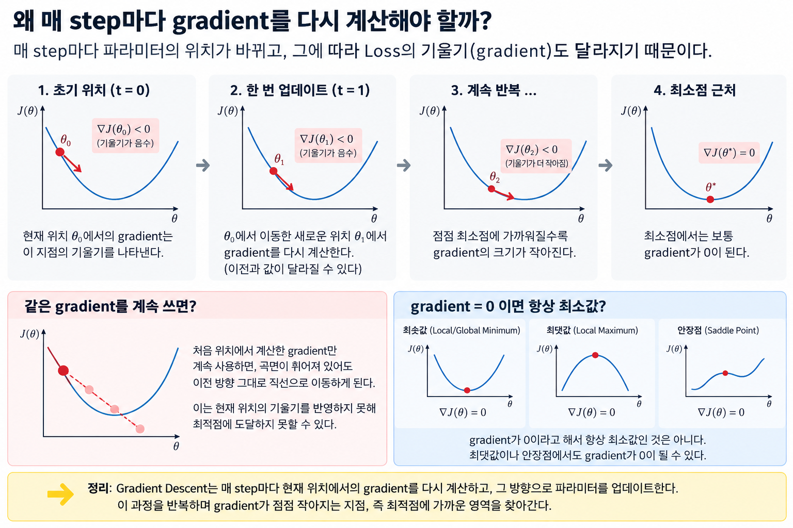

> ## 학습 목표
>
> 이 글을 읽고 나면 다음을 할 수 있다.
>
> 1. `loss.backward()`로 계산된 Gradient가 parameter update에 어떻게 쓰이는지 설명할 수 있다.
> 2. `batch_size`에 따라 Batch GD, SGD, Mini-batch GD를 코드로 구분할 수 있다.
> 3. Momentum, AdaGrad, RMSProp, Adadelta, Adam의 핵심 update를 직접 구현할 수 있다.
> 4. 같은 training loop에서 PyTorch Optimizer를 바꿔 가며 비교할 수 있다.

---

## 목차

1. 공통 실습 코드
2. Gradient Descent — Gradient로 parameter 직접 업데이트하기
3. Batch GD / SGD / Mini-batch — `batch_size`로 확인하기
4. 기본 Gradient Descent의 문제 — 코드로 재현하기
5. Momentum — 이전 방향을 저장하기
6. AdaGrad — parameter별 누적 보폭 만들기
7. RMSProp / Adadelta — 오래된 Gradient를 잊기
8. Adam — 방향과 크기를 함께 저장하기
9. `torch.optim`으로 같은 실험 실행하기
10. Trade-off와 전체 흐름 정리

<br>

<div align="center">
  <strong>
    Optimizer의 차이는 결국<br>
    어떤 상태값을 저장하고 parameter를 어떻게 업데이트하는가에 있다.
  </strong>
</div>

<br>

## 1. 공통 실습 코드

먼저 모든 Optimizer에서 함께 사용할 간단한 선형 회귀 데이터를 만든다.

정답 관계는 대략 $y=3x+2$이며, 모델은 이 관계의 weight와 bias를 학습한다.

```python
import torch
from torch import nn
from torch.utils.data import DataLoader, TensorDataset

torch.manual_seed(42)

# y = 3x + 2에 작은 noise를 추가한 데이터
X = torch.linspace(-2, 2, 256).unsqueeze(1)
y = 3 * X + 2 + 0.2 * torch.randn_like(X)

dataset = TensorDataset(X, y)


def make_model():
    torch.manual_seed(42)
    return nn.Linear(1, 1)


criterion = nn.MSELoss()
```

모델의 예측식은 다음과 같다.

$$
\hat{y}=wx+b
$$

학습해야 할 parameter는 `model.weight`와 `model.bias`다.

```python
model = make_model()

for name, parameter in model.named_parameters():
    print(name, parameter.shape)

# weight torch.Size([1, 1])
# bias   torch.Size([1])
```

이제 같은 모델과 데이터에서 update 코드만 바꾸며 Optimizer의 차이를 확인해 보자.

---

## 2. Gradient Descent — Gradient로 parameter 직접 업데이트하기

Gradient Descent의 update 식은 다음과 같다.

$$
\theta_{t+1}
=
\theta_t-\eta\nabla_\theta J(\theta_t)
$$

이 식은 PyTorch 코드로 거의 그대로 옮길 수 있다.

```python
model = make_model()

pred = model(X)
loss = criterion(pred, y)

# 각 parameter의 gradient를 계산해 .grad에 저장한다.
loss.backward()

learning_rate = 0.1

with torch.no_grad():
    for parameter in model.parameters():
        parameter -= learning_rate * parameter.grad

# 다음 step의 gradient가 누적되지 않도록 비운다.
model.zero_grad()
```

핵심은 세 줄이다.

```python
loss.backward()                              # gradient 계산
parameter -= learning_rate * parameter.grad # gradient 반대 방향으로 이동
model.zero_grad()                            # 이전 gradient 제거
```

### `parameter.grad`에는 무엇이 들어 있을까?

`loss.backward()`를 호출하면 각 parameter를 Loss에 대해 편미분한 값이 `.grad`에 저장된다.

```python
model = make_model()
loss = criterion(model(X), y)
loss.backward()

print(model.weight.grad)  # ∂J / ∂w
print(model.bias.grad)    # ∂J / ∂b
```

두 값을 하나의 벡터로 모으면 Gradient가 된다.

$$
\nabla J(w,b)
=
\begin{bmatrix}
\frac{\partial J}{\partial w}\\
\frac{\partial J}{\partial b}
\end{bmatrix}
$$

> **Gradient는 현재 위치에서 목적함수 $J$가 가장 빠르게 증가하는 방향이다.**

Loss를 줄이려면 반대 방향으로 이동해야 하므로 update 코드에 `-`가 들어간다.

```python
parameter -= learning_rate * parameter.grad
```

### 왜 매 step마다 Gradient를 다시 계산할까?

parameter가 바뀌면 모델의 예측값과 Loss가 달라지고, 새로운 위치에서의 Gradient도 달라진다.

그래서 학습 코드는 다음 과정을 반복한다.

```python
for step in range(100):
    pred = model(X)               # 현재 parameter로 예측
    loss = criterion(pred, y)     # 현재 위치의 Loss

    loss.backward()               # 현재 위치의 Gradient

    with torch.no_grad():
        for parameter in model.parameters():
            parameter -= 0.1 * parameter.grad

    model.zero_grad()             # 다음 step을 위해 초기화
```



---

## 3. Batch GD / SGD / Mini-batch — `batch_size`로 확인하기

Batch GD, SGD, Mini-batch의 update 원리는 같다. 코드에서 가장 눈에 띄는 차이는 `DataLoader`의 `batch_size`다.

```python
# Batch Gradient Descent: 전체 데이터로 1번 update
batch_loader = DataLoader(
    dataset,
    batch_size=len(dataset),
    shuffle=True,
)

# Stochastic Gradient Descent: 데이터 1개마다 update
sgd_loader = DataLoader(
    dataset,
    batch_size=1,
    shuffle=True,
)

# Mini-batch Gradient Descent: 32개마다 update
mini_batch_loader = DataLoader(
    dataset,
    batch_size=32,
    shuffle=True,
)
```

한 epoch의 update 횟수도 바로 확인할 수 있다.

```python
print(len(batch_loader))       # 1
print(len(sgd_loader))         # 256
print(len(mini_batch_loader))  # 8
```

training loop은 세 경우 모두 같다.

```python
def train_one_epoch(model, loader, optimizer):
    model.train()

    for x_batch, y_batch in loader:
        optimizer.zero_grad()

        pred = model(x_batch)
        loss = criterion(pred, y_batch)

        loss.backward()
        optimizer.step()
```

차이는 한 번의 `optimizer.step()`이 어떤 데이터를 보고 계산된 Gradient를 사용하는가다.

| 방식 | `batch_size` | 한 번의 update에 쓰는 데이터 | 특징 |
| --- | ---: | ---: | --- |
| Batch GD | 전체 데이터 수 | 전체 | 안정적이지만 update 비용이 큼 |
| SGD | `1` | 1개 | 자주 update하지만 매우 noisy함 |
| Mini-batch | `32`, `64`, `128` 등 | 일부 | 안정성과 계산 효율성의 절충 |

### Mini-batch Gradient는 어떻게 만들어질까?

batch에 데이터가 $B$개 있다면 각 sample의 Gradient를 평균낸 값이 사용된다.

$$
g_B=\frac{1}{B}\sum_{i=1}^{B}g_i
$$

PyTorch에서는 loss를 평균내는 `nn.MSELoss()`의 기본 설정과 `backward()`가 이 계산을 처리한다.

```python
x_batch, y_batch = next(iter(mini_batch_loader))

pred = model(x_batch)
loss = criterion(pred, y_batch)  # batch의 평균 MSE
loss.backward()                  # 평균 Loss에 대한 Gradient
```

Mini-batch는 여러 sample을 평균내 순수한 SGD보다 안정적이며, 행렬 연산을 통해 GPU를 효율적으로 사용할 수 있다.

반면 batch가 너무 크면 메모리 사용량이 증가하고 한 epoch의 update 횟수가 감소한다. 너무 작으면 Gradient noise가 커진다.

> **Batch Size 역시 계산 효율성과 Gradient 안정성 사이의 trade-off다.**

---

## 4. 기본 Gradient Descent의 문제 — 코드로 재현하기

### 4.1 Learning Rate가 너무 작거나 큰 경우

간단한 함수에서 Learning Rate만 바꿔 보자.

$$
J(w)=(w-3)^2
$$

이 함수의 minimum은 $w=3$이다.

```python
def run_gradient_descent(lr, steps=10):
    w = torch.tensor(0.0, requires_grad=True)
    history = []

    for step in range(steps):
        loss = (w - 3) ** 2
        loss.backward()

        with torch.no_grad():
            w -= lr * w.grad

        history.append({
            "step": step,
            "w": w.item(),
            "loss": loss.item(),
        })

        w.grad.zero_()

    return history


slow = run_gradient_descent(lr=0.05)      # 조금씩 이동
oscillating = run_gradient_descent(lr=0.8) # minimum 양쪽을 오가며 수렴
diverging = run_gradient_descent(lr=1.1)   # 진폭이 커지며 발산
```

Gradient가 방향을 알려줘도 실제 이동량은 `lr`이 결정한다.

```python
update = learning_rate * gradient
```

- `lr`이 너무 작으면 학습이 느리다.
- `lr`이 너무 크면 minimum을 지나쳐 진동하거나 발산할 수 있다.

### 4.2 Gradient가 0이면 항상 minimum일까?

Saddle Point는 한 방향에서는 minimum, 다른 방향에서는 maximum처럼 보이는 지점이다.

$$
f(x,y)=x^2-y^2
$$

원점에서 Gradient를 코드로 계산하면 두 성분이 모두 0이다.

```python
point = torch.tensor([0.0, 0.0], requires_grad=True)
x, y = point[0], point[1]

value = x**2 - y**2
value.backward()

print(point.grad)  # tensor([0., 0.])
```

하지만 $x$ 방향으로는 값이 증가하고 $y$ 방향으로는 감소하므로 원점은 minimum이 아니다.

### 4.3 모든 parameter에 같은 Learning Rate를 적용한다

기본 SGD의 코드를 보면 모든 parameter에 동일한 `lr`을 곱한다.

```python
for parameter in model.parameters():
    parameter -= lr * parameter.grad
```

그러나 각 parameter의 Gradient 크기와 update 빈도는 다를 수 있다. 이후 AdaGrad, RMSProp, Adam은 parameter마다 다른 실제 보폭을 만들기 위해 별도의 상태값을 저장한다.

---

## 5. Momentum — 이전 방향을 저장하기

Mini-batch SGD는 batch마다 Gradient가 달라져 좁고 긴 Loss Surface에서 지그재그로 움직일 수 있다.

기본 SGD는 현재 Gradient만 사용한다.

```python
parameter -= lr * parameter.grad
```

Momentum은 이전까지의 이동 방향을 `velocity`에 저장한다.

$$
v_t=\beta v_{t-1}+g_t
$$

$$
\theta_{t+1}=\theta_t-\eta v_t
$$

이를 직접 구현하면 다음과 같다.

```python
model = make_model()
parameters = list(model.parameters())

# parameter마다 같은 모양의 velocity를 하나씩 만든다.
velocity = {
    parameter: torch.zeros_like(parameter)
    for parameter in parameters
}


@torch.no_grad()
def momentum_step(parameters, velocity, lr=0.01, beta=0.9):
    for parameter in parameters:
        velocity[parameter].mul_(beta).add_(parameter.grad)
        parameter.add_(velocity[parameter], alpha=-lr)
```

training loop에서는 직접 만든 `momentum_step()`을 `optimizer.step()` 자리에 호출한다.

```python
for x_batch, y_batch in mini_batch_loader:
    model.zero_grad()

    loss = criterion(model(x_batch), y_batch)
    loss.backward()

    momentum_step(parameters, velocity, lr=0.01, beta=0.9)
```

코드의 핵심은 이 부분이다.

```python
velocity[parameter].mul_(beta).add_(parameter.grad)
```

- Gradient가 같은 방향으로 반복되면 `velocity`에 누적된다.
- Gradient가 반대 방향으로 바뀌면 이전 값과 일부 상쇄된다.

> **Momentum은 일관된 방향의 이동은 강화하고, 반복되는 진동은 줄인다.**

다만 `beta`가 너무 크면 관성이 강해져 minimum을 지나치는 overshooting이 발생할 수 있다.

PyTorch에서는 같은 동작을 다음처럼 사용한다.

```python
optimizer = torch.optim.SGD(
    model.parameters(),
    lr=0.01,
    momentum=0.9,
)
```

---

## 6. AdaGrad — parameter별 누적 보폭 만들기

AdaGrad의 출발점은 간단하다.

> **자주 크게 움직인 parameter는 천천히, 드물게 움직인 parameter는 상대적으로 크게 움직이자.**

이를 위해 parameter마다 과거 Gradient 제곱의 누적값을 저장한다.

$$
G_t=G_{t-1}+g_t^2
$$

$$
\theta_{t+1}
=
\theta_t-\frac{\eta}{\sqrt{G_t}+\epsilon}g_t
$$

```python
model = make_model()
parameters = list(model.parameters())

squared_grad_sum = {
    parameter: torch.zeros_like(parameter)
    for parameter in parameters
}


@torch.no_grad()
def adagrad_step(parameters, squared_grad_sum, lr=0.01, eps=1e-10):
    for parameter in parameters:
        grad = parameter.grad

        # G_t = G_{t-1} + g_t²
        squared_grad_sum[parameter].addcmul_(grad, grad)

        # parameter마다 서로 다른 실제 보폭
        denominator = squared_grad_sum[parameter].sqrt().add_(eps)
        parameter.addcdiv_(grad, denominator, value=-lr)
```

핵심은 `denominator`가 parameter별로 다르다는 점이다.

```python
denominator = squared_grad_sum[parameter].sqrt() + eps
effective_lr = lr / denominator
```

Gradient가 계속 컸던 parameter는 `squared_grad_sum`이 커지고 실제 Learning Rate는 작아진다.

문제는 이 값이 계속 더해지기만 한다는 것이다.

```python
squared_grad_sum[parameter] += grad * grad
```

Gradient 제곱은 음수가 아니므로 누적값은 줄어들지 않는다. 학습이 길어지면 실제 Learning Rate가 거의 0에 가까워질 수 있다.

> **AdaGrad는 과거를 너무 오래 기억하기 때문에 학습이 지나치게 빨리 느려질 수 있다.**

PyTorch에서는 다음과 같이 사용한다.

```python
optimizer = torch.optim.Adagrad(
    model.parameters(),
    lr=0.01,
)
```

---

## 7. RMSProp / Adadelta — 오래된 Gradient를 잊기

AdaGrad가 과거 Gradient를 모두 더하는 것이 문제라면, 오래된 정보의 영향력을 줄이면 된다.

### RMSProp

RMSProp은 단순 누적합 대신 Gradient 제곱의 지수 이동 평균을 저장한다.

$$
v_t=\beta v_{t-1}+(1-\beta)g_t^2
$$

```python
model = make_model()
parameters = list(model.parameters())

square_avg = {
    parameter: torch.zeros_like(parameter)
    for parameter in parameters
}


@torch.no_grad()
def rmsprop_step(parameters, square_avg, lr=0.001, beta=0.9, eps=1e-8):
    for parameter in parameters:
        grad = parameter.grad

        # v_t = beta * v_{t-1} + (1 - beta) * g_t²
        square_avg[parameter].mul_(beta).addcmul_(
            grad,
            grad,
            value=1 - beta,
        )

        denominator = square_avg[parameter].sqrt().add_(eps)
        parameter.addcdiv_(grad, denominator, value=-lr)
```

AdaGrad와 비교하면 한 줄의 차이가 핵심이다.

```python
# AdaGrad: 과거 값을 그대로 유지하며 계속 더한다.
accumulator += grad**2

# RMSProp: 과거 값은 beta만큼만 남긴다.
square_avg = beta * square_avg + (1 - beta) * grad**2
```

예를 들어 `beta=0.9`라면 오래된 Gradient의 영향은 시간이 지나며 다음처럼 작아진다.

$$
1\rightarrow0.9\rightarrow0.9^2\rightarrow0.9^3\rightarrow\cdots
$$

> **RMSProp은 최근 Gradient의 크기를 더 중요하게 보면서 parameter별 보폭을 조절한다.**

PyTorch 코드는 다음과 같다.

```python
optimizer = torch.optim.RMSprop(
    model.parameters(),
    lr=0.001,
    alpha=0.9,
)
```

### Adadelta

Adadelta도 Gradient 제곱의 지수 이동 평균을 사용한다. 여기에 최근 parameter update의 제곱 평균도 함께 저장한다.

```python
model = make_model()
parameters = list(model.parameters())

square_avg = {
    parameter: torch.zeros_like(parameter)
    for parameter in parameters
}
acc_delta = {
    parameter: torch.zeros_like(parameter)
    for parameter in parameters
}


@torch.no_grad()
def adadelta_step(parameters, square_avg, acc_delta, rho=0.9, eps=1e-6):
    for parameter in parameters:
        grad = parameter.grad

        # 최근 Gradient²의 이동 평균
        square_avg[parameter].mul_(rho).addcmul_(
            grad,
            grad,
            value=1 - rho,
        )

        # 최근 update²와 Gradient²를 이용해 update 크기 결정
        std = square_avg[parameter].add(eps).sqrt()
        delta = acc_delta[parameter].add(eps).sqrt().div(std).mul(grad)

        parameter.sub_(delta)

        # 방금 적용한 update²의 이동 평균
        acc_delta[parameter].mul_(rho).addcmul_(
            delta,
            delta,
            value=1 - rho,
        )
```

RMSProp이 `square_avg` 하나를 중심으로 보폭을 조절한다면, Adadelta는 `square_avg`와 `acc_delta`를 함께 사용한다.

```python
optimizer = torch.optim.Adadelta(
    model.parameters(),
    rho=0.9,
)
```

| AdaGrad | RMSProp / Adadelta |
| --- | --- |
| Gradient²를 계속 누적 | 오래된 Gradient의 영향 감소 |
| 실제 Learning Rate가 계속 감소 | 최근 정보를 중심으로 보폭 조절 |
| 장기 학습에서 지나치게 느려질 수 있음 | AdaGrad의 감소 문제 완화 |

---

## 8. Adam — 방향과 크기를 함께 저장하기

지금까지 코드에서 저장한 상태값을 다시 보자.

```python
# Momentum
velocity       # Gradient 방향을 누적

# RMSProp
square_avg     # Gradient²의 이동 평균
```

Adam은 두 아이디어를 함께 사용한다.

```python
first_moment   # Gradient의 지수 이동 평균
second_moment  # Gradient²의 지수 이동 평균
```

### First Moment

$$
m_t=\beta_1m_{t-1}+(1-\beta_1)g_t
$$

Momentum과 비슷하게 Gradient의 방향을 안정화한다.

### Second Moment

$$
v_t=\beta_2v_{t-1}+(1-\beta_2)g_t^2
$$

RMSProp과 비슷하게 parameter별 보폭을 조절한다.

### Bias Correction까지 직접 구현하기

두 moment는 0으로 초기화되므로 학습 초반에는 0에 가깝게 편향된다.

$$
\hat{m}_t=\frac{m_t}{1-\beta_1^t},\qquad
\hat{v}_t=\frac{v_t}{1-\beta_2^t}
$$

보정한 값을 사용하는 전체 update 코드는 다음과 같다.

```python
model = make_model()
parameters = list(model.parameters())

first_moment = {
    parameter: torch.zeros_like(parameter)
    for parameter in parameters
}
second_moment = {
    parameter: torch.zeros_like(parameter)
    for parameter in parameters
}


@torch.no_grad()
def adam_step(
    parameters,
    first_moment,
    second_moment,
    step,
    lr=0.001,
    beta1=0.9,
    beta2=0.999,
    eps=1e-8,
):
    for parameter in parameters:
        grad = parameter.grad

        # 1차 모멘트: Gradient의 이동 평균
        first_moment[parameter].mul_(beta1).add_(
            grad,
            alpha=1 - beta1,
        )

        # 2차 모멘트: Gradient²의 이동 평균
        second_moment[parameter].mul_(beta2).addcmul_(
            grad,
            grad,
            value=1 - beta2,
        )

        # 0으로 초기화되어 생기는 초반 편향 보정
        m_hat = first_moment[parameter] / (1 - beta1**step)
        v_hat = second_moment[parameter] / (1 - beta2**step)

        parameter.addcdiv_(
            m_hat,
            v_hat.sqrt().add_(eps),
            value=-lr,
        )
```

training loop에서는 `step`을 1부터 증가시킨다.

```python
step = 0

for x_batch, y_batch in mini_batch_loader:
    model.zero_grad()

    loss = criterion(model(x_batch), y_batch)
    loss.backward()

    step += 1
    adam_step(
        parameters,
        first_moment,
        second_moment,
        step,
    )
```

코드와 역할을 연결하면 다음과 같다.

| 코드의 상태값 | 수식 | 기억하는 것 | 역할 |
| --- | --- | --- | --- |
| `first_moment` | $m_t$ | Gradient | 방향 안정화 |
| `second_moment` | $v_t$ | Gradient² | parameter별 보폭 조절 |
| `m_hat`, `v_hat` | $\hat{m}_t$, $\hat{v}_t$ | 보정된 moment | 초기 0 편향 보정 |

PyTorch에서는 다음 한 줄로 같은 핵심 로직을 사용한다.

```python
optimizer = torch.optim.Adam(
    model.parameters(),
    lr=0.001,
    betas=(0.9, 0.999),
)
```

> **Adam은 Gradient의 방향과 크기를 모두 추적하고, parameter마다 adaptive한 update를 수행한다.**

---

## 9. `torch.optim`으로 같은 실험 실행하기

직접 구현한 update 식은 서로 다르지만 PyTorch의 training loop는 거의 같다.

```python
def train(model, loader, optimizer, epochs=100):
    losses = []

    for epoch in range(epochs):
        model.train()
        epoch_loss = 0.0

        for x_batch, y_batch in loader:
            optimizer.zero_grad()

            pred = model(x_batch)
            loss = criterion(pred, y_batch)

            loss.backward()
            optimizer.step()

            epoch_loss += loss.item() * len(x_batch)

        losses.append(epoch_loss / len(loader.dataset))

    return losses
```

Optimizer 생성 부분만 함수로 분리해 바꿔 가며 실행할 수 있다.

```python
def make_optimizer(name, model):
    if name == "sgd":
        return torch.optim.SGD(model.parameters(), lr=0.01)

    if name == "momentum":
        return torch.optim.SGD(
            model.parameters(),
            lr=0.01,
            momentum=0.9,
        )

    if name == "adagrad":
        return torch.optim.Adagrad(model.parameters(), lr=0.01)

    if name == "rmsprop":
        return torch.optim.RMSprop(
            model.parameters(),
            lr=0.001,
            alpha=0.9,
        )

    if name == "adadelta":
        return torch.optim.Adadelta(
            model.parameters(),
            rho=0.9,
        )

    if name == "adam":
        return torch.optim.Adam(
            model.parameters(),
            lr=0.001,
            betas=(0.9, 0.999),
        )

    raise ValueError(f"Unknown optimizer: {name}")
```

같은 초기 parameter와 같은 Mini-batch 조건에서 비교한다.

```python
results = {}

for name in [
    "sgd",
    "momentum",
    "adagrad",
    "rmsprop",
    "adadelta",
    "adam",
]:
    model = make_model()
    loader = DataLoader(
        dataset,
        batch_size=32,
        shuffle=True,
        generator=torch.Generator().manual_seed(42),
    )
    optimizer = make_optimizer(name, model)

    losses = train(model, loader, optimizer, epochs=100)

    results[name] = {
        "final_loss": losses[-1],
        "weight": model.weight.item(),
        "bias": model.bias.item(),
    }

for name, result in results.items():
    print(name, result)
```

이 실험에서 중요한 것은 순위를 한 번 정하는 것이 아니다. Optimizer마다 Learning Rate의 적절한 범위가 다르므로 값 하나만으로 공정한 우열을 결정할 수 없다.

대신 다음을 확인하는 코드로 사용하면 좋다.

- 초기 Loss가 얼마나 빠르게 감소하는가?
- Loss가 크게 진동하는가?
- 같은 epoch 이후 $w\approx3$, $b\approx2$에 얼마나 가까운가?
- Learning Rate를 바꾸면 결과가 얼마나 민감하게 변하는가?

### Optimizer가 실제로 저장하는 상태 확인하기

`optimizer.state`를 보면 각 알고리즘이 무엇을 기억하는지 확인할 수 있다. 최소 한 번 `optimizer.step()`을 실행한 뒤 확인해야 한다.

```python
parameter = next(model.parameters())
state = optimizer.state[parameter]

print(state.keys())
```

대표적인 state는 다음과 같다.

| Optimizer | 주요 state | 의미 |
| --- | --- | --- |
| SGD | 없음 | 현재 Gradient만 사용 |
| SGD + Momentum | `momentum_buffer` | 이전 방향 누적 |
| AdaGrad | `sum` | Gradient² 누적합 |
| RMSProp | `square_avg` | Gradient² 이동 평균 |
| Adadelta | `square_avg`, `acc_delta` | Gradient²와 update² 이동 평균 |
| Adam | `exp_avg`, `exp_avg_sq`, `step` | 1차·2차 모멘트와 step |

결국 같은 `optimizer.step()` 안에서 Optimizer마다 서로 다른 state를 읽고 갱신한다.

---

## 10. Trade-off와 전체 흐름 정리

Adam의 코드가 가장 많은 정보를 사용한다고 해서 모든 문제에서 항상 가장 좋은 것은 아니다.

| Optimizer | 추가 상태값 | 얻는 것 | 주의할 점 |
| --- | ---: | --- | --- |
| SGD | 0개 | 단순한 update, 적은 메모리 | Learning Rate와 진동에 민감 |
| Momentum SGD | parameter당 1개 | 방향 누적, 진동 감소 | 강한 관성은 overshooting 가능 |
| AdaGrad | parameter당 1개 | parameter별 Learning Rate | 보폭이 계속 작아질 수 있음 |
| RMSProp | parameter당 1개 | 최근 Gradient 중심의 보폭 | decay rate 설정 필요 |
| Adadelta | parameter당 2개 | Gradient와 update 크기 반영 | 더 많은 state 필요 |
| Adam | parameter당 2개 이상 | 방향과 보폭을 함께 조절 | 메모리 증가, 항상 최고는 아님 |

Optimizer의 발전을 코드의 state 변화로 연결하면 다음과 같다.

```text
Gradient Descent / SGD
└─ parameter.grad만 사용
   │
   │ Mini-batch Gradient가 noisy하고 진동한다.
   ▼
Momentum
└─ velocity 추가
   │
   │ 모든 parameter에 같은 Learning Rate를 사용한다.
   ▼
AdaGrad
└─ squared_grad_sum 추가
   │
   │ 과거 Gradient²가 끝없이 누적된다.
   ▼
RMSProp / Adadelta
└─ square_avg, acc_delta로 오래된 정보의 영향 감소
   │
   │ 방향 정보도 함께 사용하면 어떨까?
   ▼
Adam
├─ first_moment: Gradient 방향의 이동 평균
└─ second_moment: Gradient²의 이동 평균
```

코드에서 다시 보면 차이는 더욱 선명하다.

```python
# SGD
parameter -= lr * grad

# Momentum
velocity = beta * velocity + grad
parameter -= lr * velocity

# AdaGrad
grad_sum += grad**2
parameter -= lr * grad / (sqrt(grad_sum) + eps)

# RMSProp
square_avg = beta * square_avg + (1 - beta) * grad**2
parameter -= lr * grad / (sqrt(square_avg) + eps)

# Adam
first_moment = beta1 * first_moment + (1 - beta1) * grad
second_moment = beta2 * second_moment + (1 - beta2) * grad**2
parameter -= lr * m_hat / (sqrt(v_hat) + eps)
```

> **Optimizer의 발전은 단순히 더 빠르게 내려가기 위한 경쟁이 아니다.**  
> **학습 과정에서 만나는 문제에 따라 어떤 정보를 추가로 저장하고 update에 반영할지 발전시켜 온 과정이다.**

---

## Reference

- Sebastian Ruder, *An overview of gradient descent optimization algorithms*, [arXiv:1609.04747](https://arxiv.org/abs/1609.04747).
- [PyTorch Optimizer documentation](https://pytorch.org/docs/stable/optim.html)
