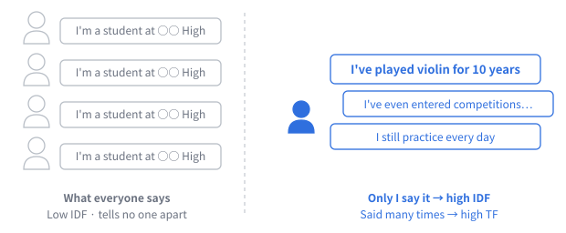
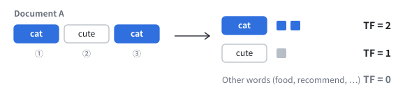
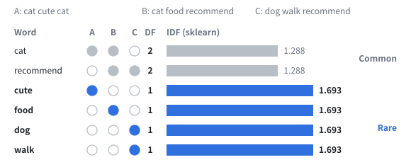
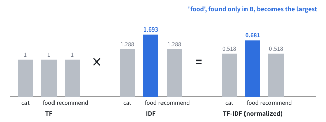
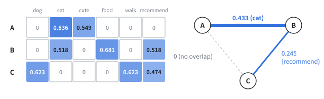
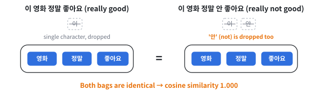

## Introduction

I learned TF-IDF in a text embedding class. The formula was easy to memorize, but when I tried the quiz I kept getting things wrong. Asked "why is this word's value larger?", I gave an answer that missed the point, and I also miscalculated the IDF of a word that appears in every document. On top of that, I couldn't figure out why my hand calculations didn't match what sklearn produced.

So I made a tiny example with three documents and worked through everything by hand, from TF all the way to similarity. I'm writing down the parts I got wrong, too.

## Is the most frequent word the most important one?

Say you have 10,000 blog posts and need to summarize each one in a few words. The first idea that comes to mind is to pick the words that appear most often in each post.

But when you actually count, the winners are usually words like "and", "really", and "thing". They do show up a lot, but they show up a lot in every post, so they tell you nothing about this particular one.

What you want is a word that appears often in this post but rarely in the others. TF-IDF turns that idea into a number.

### Thinking of it as a class introduction

What made it click for me was the first day of a new school year. Thirty students take turns introducing themselves, and everyone starts with "I'm a student at ○○ High." Since all thirty say it, it doesn't help you tell anyone apart.

Then one student says "I've played violin for 10 years," and goes on about competitions and still practicing every day, bringing up the violin three times. You remember that student right away. It's something only they said, and they said it several times.



That gives two criteria. How often someone said it is TF (Term Frequency), and how rarely everyone else says it is IDF (Inverse Document Frequency). TF-IDF is **the product of the two**.

## TF: just count

Now let's compute with three documents.

| Document | Content |
| --- | --- |
| A | cat cute cat |
| B | cat food recommend |
| C | dog walk recommend |

TF is how many times a word appears within one document. Reading document A from the start: cat 1, cute 1, then cat again, so cat 2. So A's TF is cat 2, cute 1, and every word not in A is 0.



Counting all three documents gives this.

| Document | dog | cat | cute | food | walk | recommend |
| --- | --- | --- | --- | --- | --- | --- |
| A | 0 | 2 | 1 | 0 | 0 | 0 |
| B | 0 | 1 | 0 | 1 | 0 | 1 |
| C | 1 | 0 | 0 | 0 | 1 | 1 |

This table is BoW (Bag of Words). At this stage we don't look at the other documents at all. That's why cat, food, and recommend are all 1 in B, and there's no way to tell which of them matters in B.

## IDF: discount the common words

Now we look at all the documents instead of just one. First, count how many documents each word appears in. That's DF (Document Frequency). Even though cat appears twice in A, A is counted only once. DF is a count of documents, not of occurrences.

IDF flips DF around. The textbook formula is (N is the total number of documents):

$$
\text{IDF}(t) = \log\frac{N}{\text{DF}(t)}
$$

### What about a word that appears in every document?

This is where I first went wrong. Asked for the IDF of a word that appears in every document, I answered 1. N/DF = N/N = 1, so I assumed it was just 1. But 1 is what goes inside the log, and log 1 = 0.

If IDF is 0, the product is 0 no matter how large TF is. The word disappears from the vector entirely. It's the same as "I'm a student at ○○ High", which all thirty students say, scoring zero. It isn't a calculation slip; the formula was built that way on purpose.

### Why take the log?

Say there are a million documents. A word that appears in only one document has N/DF of 1,000,000, and a word in 10 documents has 100,000. Without the log, the two differ by a factor of 10, and a word that appears exactly once, like a typo, takes over the score.

With the log they become about 13.8 and 11.5. The order (rarer means larger) stays the same, and only the gap gets flattened.

### sklearn's formula is a little different

When I compared my hand calculations with sklearn's TfidfVectorizer, they didn't match. By default, sklearn uses this formula:

$$
\text{IDF}(t) = \ln\frac{1 + N}{1 + \text{DF}(t)} + 1
$$

The +1 in the numerator and denominator prevents division by zero, and the +1 at the very end keeps the IDF of a word that appears in every document from becoming 0. In a small experiment with only a few documents, an important word can happen to appear in every document and vanish; this prevents that.

(At first I only answered "add +1 to prevent it", but there are three +1s in the formula, so which one matters. If you add 1 only to the numerator and denominator, the fraction is still 1 when DF = N, so the log is still 0. The one that prevents the zero is the +1 at the end.)

The calculations in this post follow sklearn's formula so they match the code. Comparing the two formulas on the example words:

| Word | DF | Textbook log(N/DF) | sklearn |
| --- | --- | --- | --- |
| cat, recommend | 2 | 0.405 | 1.288 |
| cute, food, dog, walk | 1 | 1.099 | 1.693 |

The values differ, but the order (rarer words are larger) is the same.



## What happens when you multiply

Multiply each cell of the TF table by that word's IDF. A's cat becomes 2 × 1.288 = 2.575, and cute becomes 1 × 1.693 = 1.693.

| Document | dog | cat | cute | food | walk | recommend |
| --- | --- | --- | --- | --- | --- | --- |
| A | 0 | 2.575 | 1.693 | 0 | 0 | 0 |
| B | 0 | 1.288 | 0 | 1.693 | 0 | 1.288 |
| C | 1.693 | 0 | 0 | 0 | 1.693 | 1.288 |

Look at B and a difference has appeared. All three had a TF of 1, but "food", which appears only in B (1.693), is now larger than "cat" and "recommend" (1.288), which also appear in other documents.



I got this one wrong once, too. Asked why food is larger, I first answered "because of frequency and cosine similarity." Frequency was only half right. Within B, the frequencies (TF) of the three words are identical, so the difference comes from how many documents each word appears in (DF). Cosine similarity is for comparing two documents, so it had nothing to do with this question, which compares words inside a single document.

In A, the common word "cat" is actually larger than cute. That's because it appears twice. Think of it as the result of a tug-of-war between TF and IDF.

## Why scale the length to 1

At the end, sklearn scales each document vector to length 1 (L2 normalization). Otherwise longer documents have more words and larger values, and long documents look similar to each other regardless of what they say.

The length of A's vector is √(2.575² + 1.693²) ≈ 3.082. Dividing each value by it gives cat 0.836 and cute 0.549. Doing this for all three documents gives the final vectors.

| Document | dog | cat | cute | food | walk | recommend |
| --- | --- | --- | --- | --- | --- | --- |
| A | 0 | 0.836 | 0.549 | 0 | 0 | 0 |
| B | 0 | 0.518 | 0 | 0.681 | 0 | 0.518 |
| C | 0.623 | 0 | 0 | 0 | 0.623 | 0.474 |

Some sources define TF as "count ÷ number of words in the document." For A's cat that would be 2 ÷ 3 ≈ 0.667. I worried this would change the values yet again, but after normalization the result is the same. Dividing every value in a document by the same number is a difference that disappears once the length is scaled to 1.

Running the code gives the same values as the table.

```py
from sklearn.feature_extraction.text import TfidfVectorizer

docs = ["cat cute cat", "cat food recommend", "dog walk recommend"]

vec = TfidfVectorizer()
X = vec.fit_transform(docs)

print(vec.get_feature_names_out())   # ['cat' 'cute' 'dog' 'food' 'recommend' 'walk']
print(X.toarray().round(3))          # same values as the table above (columns in alphabetical order)
print((X @ X.T).toarray().round(3))  # cosine similarity between documents
```

In practice you fit on the training data to build the vocabulary and IDF, and only transform the test data. If you fit again on the test data, the IDF changes, which is like measuring with a different ruler than the one you trained with.

## Comparing documents with these vectors

For vectors of length 1, multiplying matching positions and adding them up gives the cosine similarity.

- A and B: they share cat. 0.836 × 0.518 ≈ 0.433
- B and C: they share recommend. 0.518 × 0.474 ≈ 0.245
- A and C: no shared words, so 0



B and C also share one word, yet their similarity is lower than A and B. That's because "recommend" carries little weight in both documents. You only get similarity when words overlap, and the more weight the shared word carries in both documents, the more similar they are.

## Opposite sentences become the same vector

The limitation of TF-IDF really sank in with an example from the course material. Vectorize the Korean sentences "이 영화 정말 좋아요" ("This movie is really good") and "이 영화 정말 안 좋아요" ("This movie is really not good") with sklearn's default settings, and the cosine similarity comes out as 1.000. They mean the opposite, yet the vectors are identical.



The default settings drop single-character tokens. So '이' (this) and '안' (not) both disappear, and both sentences are left with just 영화 (movie), 정말 (really), and 좋아요 (good). Keeping single-character tokens still gives 0.818, and adding two-word chunks (ngrams) still gives 0.615. TF-IDF sees a sentence only as "which words, how many of each" and throws away word order, so it can't know that '안' flips the '좋아요' right after it.

It doesn't understand similar meanings either. "Fast" and "quick" sit in different positions, so their similarity is 0. With 10,000 words the vector has 10,000 positions, and most of them are 0.

Even so, putting logistic regression on top of TF-IDF trains in a few seconds, and you can see from the coefficients which words drove the decision. That's why people lay it down first as a baseline when building a new model. Embeddings like Word2Vec, and then RNNs and Transformers, came along to capture order and meaning.

## Wrapping up

Once I'd sorted it out, TF-IDF also turned out to be a story of asking a few questions in order.

1. Is the most frequent word the important one? It might be a word like "and" that appears everywhere.
2. How many times does it appear in this document? Just count (TF).
3. Does it appear in other documents too? Count the documents it appears in (DF), and discount it the more common it is (IDF).
4. What if it appears in every document? With the textbook formula, log 1 = 0 and it disappears. sklearn adds +1 at the end to keep it.
5. What happens when you multiply them? Words that appear often in this document but rarely in others get larger.
6. Don't long documents get an advantage? Scale the length to 1 (L2 normalization).
7. How do you compare documents? Multiply matching positions and add them up: that's cosine similarity.
8. What about word order? It doesn't know. "Good" and "not good" end up the same.

When I tried to memorize it as formulas, TF and DF kept getting mixed up, but remembering it as a class introduction makes it much less confusing. In the end, TF-IDF is "how much you said the thing only you say."

Reference: course material "Text Data and Embeddings", Section 6 (statistical vectorization); scikit-learn TfidfVectorizer documentation
