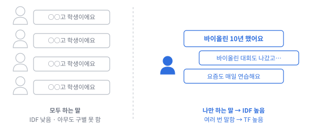
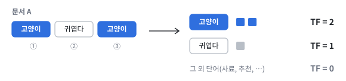
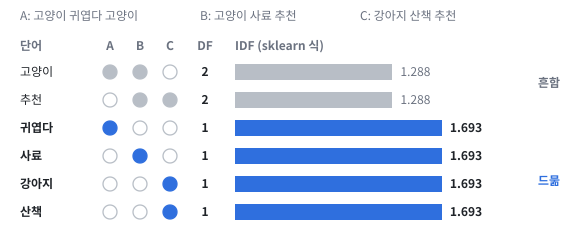
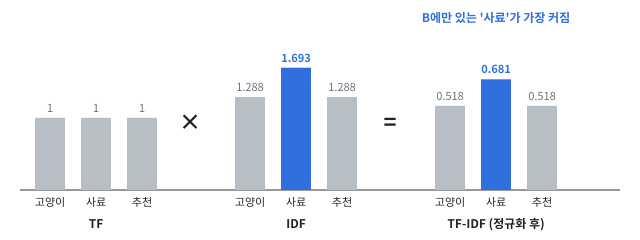
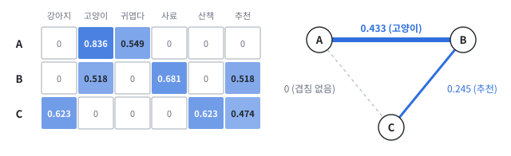
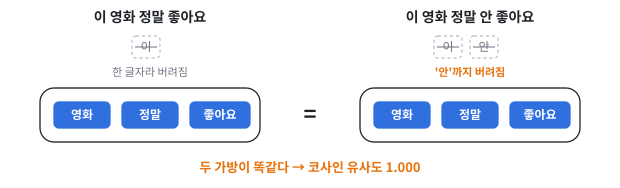

## 들어가며

텍스트 임베딩 수업에서 TF-IDF를 배웠다. 공식은 금방 외웠는데 퀴즈를 풀어보니 계속 틀렸다. "왜 이 단어 값이 더 크냐"는 질문에 엉뚱한 답을 했고, 모든 문서에 나오는 단어의 IDF도 틀리게 계산했다. 손으로 계산한 값이랑 sklearn이 내놓는 값이 다른 것도 이해가 안 됐다.

그래서 문서 3개짜리 작은 예시를 하나 만들어서 TF부터 유사도까지 직접 계산해보면서 다시 정리했다. 틀렸던 부분도 그대로 같이 적어둔다.

## 많이 나온 단어가 중요한 단어일까

블로그 글이 1만 개 있고, 글마다 내용을 단어 몇 개로 요약해야 한다고 해보자. 제일 먼저 떠오르는 방법은 그 글에서 가장 많이 나온 단어를 고르는 거다.

근데 실제로 세어보면 1등은 대개 "그리고", "정말", "것" 같은 단어다. 많이 나오긴 하는데 어느 글에나 많이 나오니까, 이 글에 대해서는 아무것도 알려주지 않는다.

필요한 건 이 글에서는 자주 나오는데 다른 글에서는 잘 안 나오는 단어다. TF-IDF는 이 생각을 숫자로 옮긴 거다.

### 자기소개로 생각해보기

제일 와닿았던 건 새 학기 자기소개였다. 30명이 돌아가며 자기소개를 하는데 다들 "○○고 학생이에요"로 시작한다. 30명 모두 하는 말이라 이 말로는 아무도 구별이 안 된다.

그런데 한 명이 "바이올린 10년 했어요"라고 하더니 대회 얘기, 요즘도 매일 연습한다는 얘기까지 바이올린 얘기만 세 번 한다. 이 친구는 바로 기억에 남는다. 나만 하는 말이고, 그걸 여러 번 했기 때문이다.



여기서 기준이 두 개 나온다. 그 말을 얼마나 자주 했나가 TF(Term Frequency)이고, 남들은 그 말을 얼마나 안 하나가 IDF(Inverse Document Frequency)다. TF-IDF는 **이 둘을 곱한 값**이다.

## TF: 일단 세기만 한다

이제 문서 3개로 직접 계산해본다.

| 문서 | 내용 |
| --- | --- |
| A | 고양이 귀엽다 고양이 |
| B | 고양이 사료 추천 |
| C | 강아지 산책 추천 |

TF는 한 문서 안에서 단어가 몇 번 나왔는지다. 문서 A를 앞에서부터 읽으면 고양이 1, 귀엽다 1, 다시 고양이가 나와서 고양이 2가 된다. 그래서 A의 TF는 고양이 2, 귀엽다 1이고, A에 없는 단어는 전부 0이다.



세 문서를 다 세면 이렇다.

| 문서 | 강아지 | 고양이 | 귀엽다 | 사료 | 산책 | 추천 |
| --- | --- | --- | --- | --- | --- | --- |
| A | 0 | 2 | 1 | 0 | 0 | 0 |
| B | 0 | 1 | 0 | 1 | 0 | 1 |
| C | 1 | 0 | 0 | 0 | 1 | 1 |

이 표가 BoW(Bag of Words)다. 이 단계에선 다른 문서를 전혀 안 본다. 그래서 B의 고양이, 사료, 추천이 모두 1이고, B에서 뭐가 중요한지 알 수가 없다.

## IDF: 흔한 단어는 깎는다

이번엔 문서 하나가 아니라 전체 문서를 본다. 먼저 단어가 몇 개의 문서에 나왔는지 센다. 이게 DF(Document Frequency)다. A에 고양이가 두 번 나와도 A는 한 번만 센다. DF는 등장 횟수가 아니라 문서 수다.

IDF는 DF를 뒤집은 값이다. 교과서 식은 이렇다(N은 전체 문서 수).

$$
\text{IDF}(t) = \log\frac{N}{\text{DF}(t)}
$$

### 모든 문서에 나오는 단어는?

여기서 처음에 틀렸다. 모든 문서에 나오는 단어의 IDF를 묻는 질문에 1이라고 답했다. N/DF = N/N = 1이니까 그냥 1인 줄 알았다. 근데 1은 log 안에 들어가는 값이고, log 1 = 0이다.

IDF가 0이면 TF가 아무리 커도 곱하면 0이 된다. 그 단어는 벡터에서 아예 사라진다. 30명 모두 하는 "○○고 학생이에요"가 0점인 것과 같다. 계산 실수가 아니라 원래 그렇게 만든 식이었다.

### log는 왜 씌울까

문서가 100만 개라고 해보자. 한 문서에만 나오는 단어는 N/DF가 100만이고, 10개 문서에 나오는 단어는 10만이다. log 없이 쓰면 두 단어가 10배 차이가 나서, 오타처럼 딱 한 번 나온 단어가 점수를 독차지한다.

log를 씌우면 각각 약 13.8, 11.5가 된다. 드물수록 크다는 순서는 그대로 두고 차이만 완만하게 눌러주는 거다.

### sklearn은 식이 조금 다르다

손으로 계산한 값을 sklearn의 TfidfVectorizer와 비교했더니 안 맞았다. sklearn은 기본으로 이 식을 쓴다.

$$
\text{IDF}(t) = \ln\frac{1 + N}{1 + \text{DF}(t)} + 1
$$

분자·분모의 +1은 0으로 나누는 걸 막는 장치고, 맨 끝의 +1은 모든 문서에 나오는 단어도 IDF가 0이 되지 않게 한다. 문서가 몇 개 안 되는 작은 실험에서는 중요한 단어가 우연히 모든 문서에 나와서 사라질 수 있는데, 그걸 막는 거다.

(처음엔 "+1을 해서 막는다"고만 답했는데, 식에 +1이 세 군데라 어느 +1인지가 중요했다. 분자·분모에만 1을 더하면 DF = N일 때 분수가 여전히 1이라 log는 그대로 0이다. 0을 막는 건 맨 끝의 +1이다.)

이 글의 계산은 코드랑 맞춰보려고 sklearn 식을 따른다. 예시의 단어들로 두 식을 비교하면 이렇다.

| 단어 | DF | 교과서 log(N/DF) | sklearn |
| --- | --- | --- | --- |
| 고양이, 추천 | 2 | 0.405 | 1.288 |
| 귀엽다, 사료, 강아지, 산책 | 1 | 1.099 | 1.693 |

값은 달라도 드문 단어가 더 크다는 순서는 같다.



## 곱하면 무슨 일이 생기나

TF 표의 각 칸에 그 단어의 IDF를 곱한다. A의 고양이는 2 × 1.288 = 2.575, 귀엽다는 1 × 1.693 = 1.693이다.

| 문서 | 강아지 | 고양이 | 귀엽다 | 사료 | 산책 | 추천 |
| --- | --- | --- | --- | --- | --- | --- |
| A | 0 | 2.575 | 1.693 | 0 | 0 | 0 |
| B | 0 | 1.288 | 0 | 1.693 | 0 | 1.288 |
| C | 1.693 | 0 | 0 | 0 | 1.693 | 1.288 |

B를 보면 차이가 생겼다. TF는 셋 다 1이었는데, B에만 나오는 "사료"(1.693)가 다른 문서에도 나오는 "고양이", "추천"(1.288)보다 커졌다.



여기서도 한 번 틀렸다. 사료가 왜 더 크냐는 질문에 처음엔 "빈도랑 코사인 유사도를 봐서"라고 답했다. 빈도는 반만 맞았다. B 안에서의 빈도(TF)는 셋이 똑같으니, 차이를 만든 건 몇 개의 문서에 나왔나(DF) 쪽이다. 코사인 유사도는 문서 두 개를 비교할 때 쓰는 거라 한 문서 안에서 단어끼리 비교하는 이 질문과는 상관이 없었다.

A에서는 오히려 흔한 "고양이"가 귀엽다보다 크다. 두 번 나왔기 때문이다. TF와 IDF가 줄다리기를 한 결과라고 보면 된다.

## 길이를 1로 맞추는 이유

sklearn은 마지막에 문서마다 벡터 길이를 1로 맞춘다(L2 정규화). 안 그러면 긴 문서일수록 단어가 많아서 값이 커지고, 내용과 상관없이 긴 문서끼리 비슷해 보인다.

A의 벡터 길이는 √(2.575² + 1.693²) ≈ 3.082다. 각 값을 이걸로 나누면 고양이 0.836, 귀엽다 0.549가 된다. 세 문서 모두 하면 최종 벡터가 나온다.

| 문서 | 강아지 | 고양이 | 귀엽다 | 사료 | 산책 | 추천 |
| --- | --- | --- | --- | --- | --- | --- |
| A | 0 | 0.836 | 0.549 | 0 | 0 | 0 |
| B | 0 | 0.518 | 0 | 0.681 | 0 | 0.518 |
| C | 0.623 | 0 | 0 | 0 | 0.623 | 0.474 |

TF를 "횟수 ÷ 문서의 단어 수"로 정의하는 자료도 있다. A의 고양이라면 2 ÷ 3 ≈ 0.667이다. 이것 때문에 값이 또 달라지나 했는데, 정규화를 하면 결과는 같다. 한 문서의 값을 전부 같은 수로 나눈 차이는 길이를 1로 맞추면서 사라진다.

코드로 돌리면 표와 같은 값이 나온다.

```py
from sklearn.feature_extraction.text import TfidfVectorizer

docs = ["고양이 귀엽다 고양이", "고양이 사료 추천", "강아지 산책 추천"]

vec = TfidfVectorizer()
X = vec.fit_transform(docs)

print(vec.get_feature_names_out())   # ['강아지' '고양이' '귀엽다' '사료' '산책' '추천']
print(X.toarray().round(3))          # 위 표와 같은 값
print((X @ X.T).toarray().round(3))  # 문서 간 코사인 유사도
```

실제로 쓸 때는 학습 데이터로 fit해서 사전과 IDF를 만들고, 테스트 데이터에는 transform만 한다. 테스트 데이터로 다시 fit하면 IDF가 바뀌어서 학습 때와 다른 자로 재는 셈이 된다.

## 이 벡터로 문서를 비교하면

길이가 1인 벡터끼리는 같은 칸끼리 곱해서 더하기만 하면 코사인 유사도가 된다.

- A와 B: 고양이가 겹친다. 0.836 × 0.518 ≈ 0.433
- B와 C: 추천이 겹친다. 0.518 × 0.474 ≈ 0.245
- A와 C: 겹치는 단어가 없어서 0



B와 C도 한 단어가 겹치는데 A·B보다 낮다. "추천"이 두 문서에서 비중이 작은 단어라서다. 겹치는 단어가 있어야 유사도가 생기고, 그 단어가 두 문서에서 비중이 클수록 더 비슷해진다.

## 정반대 문장이 같은 벡터가 된다

TF-IDF의 한계는 강의 자료 예시를 보고 확 와닿았다. "이 영화 정말 좋아요"와 "이 영화 정말 안 좋아요"를 sklearn 기본 설정으로 벡터화하면 코사인 유사도가 1.000이 나온다. 정반대 뜻인데 완전히 같은 벡터다.



기본 설정은 한 글자 토큰을 버린다. 그래서 '이'와 '안'이 같이 사라지고 두 문장 모두 영화, 정말, 좋아요만 남는다. 한 글자 토큰을 살려도 0.818, 두 단어 묶음(ngram)까지 넣어도 0.615로 여전히 높다. TF-IDF는 문장을 "어떤 단어가 몇 개 들었나"로만 보고 순서를 버리기 때문에, '안'이 바로 뒤의 '좋아요'를 뒤집는다는 걸 알 수가 없다.

비슷한 뜻도 모른다. "빠르다"와 "신속하다"는 서로 다른 칸이라 유사도가 0이다. 단어가 1만 개면 벡터도 1만 칸이고 대부분이 0이다.

그래도 TF-IDF에 로지스틱 회귀를 붙이면 몇 초 만에 학습되고, 어떤 단어가 판단에 영향을 줬는지 계수로 바로 볼 수 있다. 그래서 새 모델을 만들 때 기준점(베이스라인)으로 먼저 깔아둔다고 한다. 순서와 뜻을 담으려고 나온 게 Word2Vec 같은 임베딩, 그리고 RNN과 Transformer다.

## 마치며

정리하고 나니 TF-IDF도 질문 몇 개를 순서대로 던지는 이야기였다.

1. 많이 나온 단어가 중요한 단어야? "그리고"처럼 어디에나 나오는 단어일 수도 있다.
2. 이 문서에서 몇 번 나왔지? 일단 세기만 한다(TF).
3. 다른 문서에도 나와? 나온 문서 수를 세고(DF), 흔할수록 깎는다(IDF).
4. 모든 문서에 나오면? 교과서 식에선 log 1 = 0이라 사라진다. sklearn은 끝에 +1을 붙여 남겨둔다.
5. 둘을 곱하면? 이 문서에선 자주, 다른 문서에선 드물게 나오는 단어가 커진다.
6. 긴 문서가 유리하지 않나? 길이를 1로 맞춘다(L2 정규화).
7. 문서끼리는 어떻게 비교하지? 같은 칸끼리 곱해서 더하면 코사인 유사도다.
8. 순서는? 모른다. "좋아요"와 "안 좋아요"가 같아진다.

공식으로만 외우려니 TF랑 DF가 계속 섞였는데, 자기소개로 기억하니까 덜 헷갈린다. TF-IDF는 결국 "나만 하는 말을 여러 번 한 정도"다.

참고: 「텍스트 데이터와 임베딩」 강의 자료 6절(통계 기반 벡터화), scikit-learn TfidfVectorizer 문서
