## Exploring the data distribution
### Percentiles and boxplots
- #### Percentiles
**Percentiles** are what we usually use to understand the whole distribution. The most common are quartiles (the 25th, 50th and 75th percentiles) and deciles (the 10th, 20th, 30th, ..., 90th percentiles). They are good for describing the **tails** (the outer range).
- #### Boxplots
An easy way to visualize the spread of data using percentiles.
```python
import matplotlib.pyplot as plt
import numpy as np

# 가상 데이터 생성
data = np.random.randn(100)

# 박스 플롯 그리기
plt.figure(figsize=(6, 4))
plt.boxplot(data)
plt.title("Basic Box Plot")
plt.show()
```

| 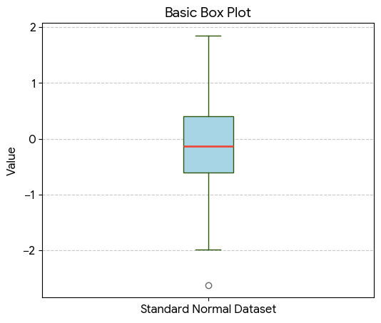 |
|--|
|<center>**The boxplot generated by the code above**</center>|

The T-shaped lines above and below are the **whiskers**, which show the range of the data.
Data that falls outside the whiskers is shown as circles.
### Frequency tables and histograms
- #### Frequency tables
Used to divide a variable's range into equal-sized intervals and show how many values fall into each interval.

(1) Frequency table of a categorical variable (species)
```python
import seaborn as sb
import pandas as pd

# Iris 데이터셋 불러오기
iris = sb.load_dataset('iris')

# species 컬럼의 도수분포표
freq_table = iris['species'].value_counts()
print(freq_table)

# 상대도수(비율) 구하기
prop_table = iris['species'].value_counts(normalize=True)
print(prop_table)
```
##### output

|class|counts|
|---|---|
|setosa       | 50|
|versicolor|    50|
|virginica|     50|

(2) Frequency table of a continuous variable (sepal_length)
```python
# sepal_length를 5개의 구간으로 나누어 도수분포표 작성
iris['sepal_length_binned'] = pd.cut(iris['sepal_length'], bins=5)
print(iris['sepal_length_binned'].value_counts().sort_index())
```
##### output

|section|counts|
|---|---|
|(4.296, 5.02]    |32|
|(5.02, 5.74]     |41|
|(5.74, 6.46]     |42|
|(6.46, 7.18]     |24|
|(7.18, 7.9]      |11|

##### What the interval brackets mean: a parenthesis ( means "greater than" and a square bracket ] means "less than or equal to". For example, the interval (4.296, 5.02] means there are 32 data points greater than 4.296cm and at most 5.02cm

The table above shows that there is little data between 7.18cm and 7.9cm.
- #### Histograms
A way to visualize a frequency table.
Categorical data is not continuous, so a histogram is not appropriate for it.

|Frequency table of a continuous variable (sepal_length)|
|---|
| 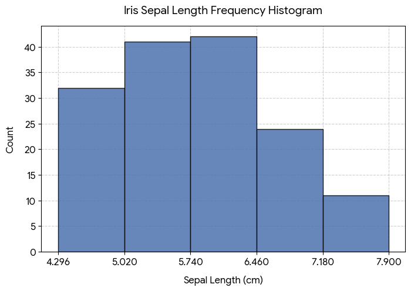 |

>#### Memorize
Statistics uses the concept of **moments**. Location and variability are called the first and second **moments** of a distribution. The third and fourth moments are called **skewness** and **kurtosis**. Skewness indicates how much the data leans toward larger or smaller values, and kurtosis indicates the tendency of the data to have extreme values. Usually, rather than computing these values directly, we check them visually with plots.

### Density plots and estimation
- #### Density plots
Computed directly from the data through **kernel density estimation**, usually shown as a continuous line over a histogram. In other words, it can be called a smoothed histogram. Unlike a histogram, the y-axis shows proportions rather than counts. The total area under the density curve is 1, and instead of counts per interval you compute the area under the curve between two points on the x-axis, which corresponds to the proportion of the distribution between those points.
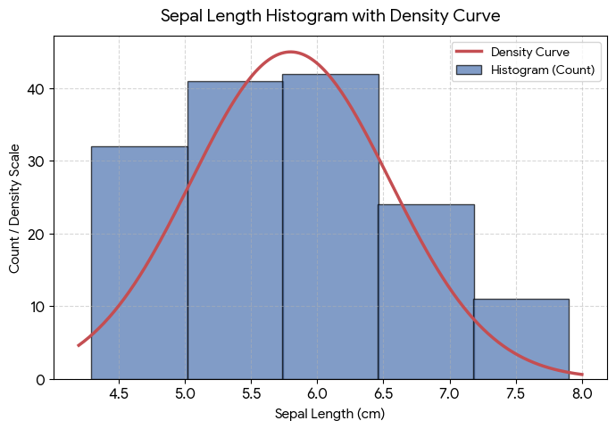

## Exploring binary and categorical data
For binary variables, or categorical variables with only a few categories, you only need to look at the proportions of the important categories, so the analysis is not difficult.
The bar chart is the most common way to show categorical data.
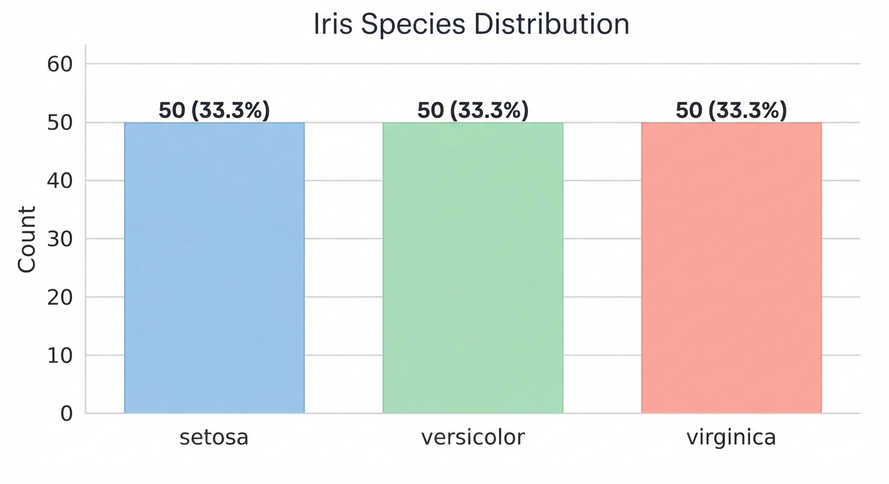
A bar chart is very similar to a histogram. The difference is the x-axis. In a bar chart it represents the different categories of a factor variable, while in a histogram it represents the values of a single numeric variable. The visible difference is that bars are separated while histogram bins touch.
Pie charts are sometimes used instead of bar charts, but they are rarely used because they are visually less effective.
### Mode
The category or value that appears most often in the data.
### Expected value
When categories have numeric values attached, the average weighted by the probability of each category occurring.
The expected value is a weighted mean whose weights are those probabilities. In this sense, the expected value has the same form as a weighted mean.

```python
import matplotlib.pyplot as plt
import seaborn as sns

# 1. 데이터 로드
df = sns.load_dataset('iris')

# 2. 품종별 평균 및 전체 평균(기준값) 계산
species_mean = df.groupby('species')['sepal_length'].mean()
overall_mean = df['sepal_length'].mean() # 5.8433...

# 3. 그래프 그리기
plt.figure(figsize=(7, 5))
bars = plt.bar(species_mean.index, species_mean.values, color=['#9ecae1', '#a1d99b', '#fcae91'], edgecolor='gray', width=0.6)

# 4. 기준값(전체 평균) 선 추가
plt.axhline(overall_mean, color='red', linestyle='--', linewidth=1.5, label=f'Overall Mean ({overall_mean:.2f} cm)')

# 5. 수치 라벨링 및 꾸미기
for bar in bars:
    height = bar.get_height()
    plt.text(bar.get_x() + bar.get_width()/2., height + 0.1, f'{height:.2f} cm', ha='center', va='bottom', fontsize=10, fontweight='bold')

plt.title('Iris Mean Sepal Length by Species', fontsize=14, pad=15)
plt.xlabel('Species', fontsize=12)
plt.ylabel('Sepal Length (cm)', fontsize=12)
plt.ylim(0, 8)
plt.legend(loc='upper left')
plt.grid(axis='y', linestyle=':', alpha=0.6)

plt.tight_layout()
plt.show()
```
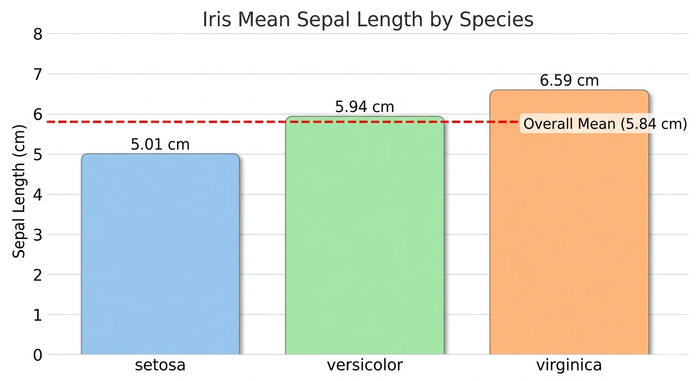

### Misleading graph
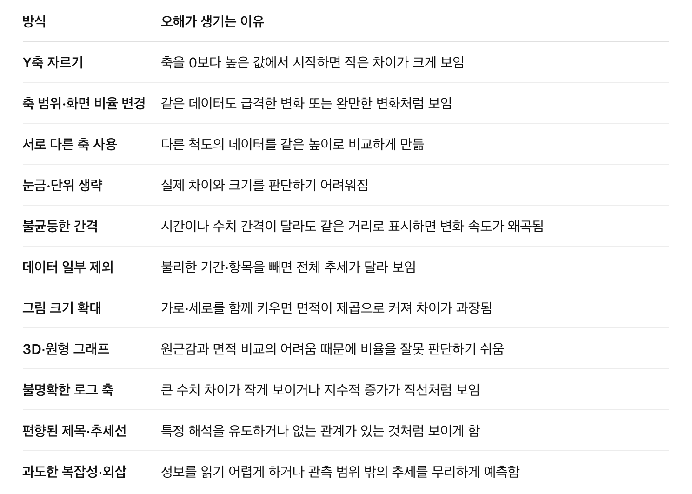
The representative measure of how much a graph distorts is the **Lie factor**.
$$\text{Lie factor}=\frac{\text{그래프에 표현된 변화율}}{\text{실제 데이터의 변화율}}$$
### Probability
The probability of an event is the proportion of times the event would occur if the situation were repeated countless times.
##### *How to define it inevitably leads to philosophical debate, but this book defines it as above.
## Correlation
During **exploratory data analysis (EDA)**, you need to examine the correlation between predictors and the target. When $Y$ tends to be large when $X$ is large, and small when $X$ is small, they have a **positive correlation**. Conversely, when $Y$ tends to be small when $X$ is large, they have a **negative correlation**.

- Correlation coefficient: a metric used to show how numeric variables relate to each other (ranging from -1 to +1)
- Correlation matrix: a table whose rows and columns are variables, where each cell is the correlation between the variables of that row and column.

For the variables below, the sum of the element-wise products is 32.
- **v1**: {1, 2, 3}
- **v2**: {4, 5, 6}

No matter how you shuffle the order of the vectors before multiplying and summing, you cannot exceed 32. So you could compare the sum of 32 against the values you get from random shuffles. But such values only serve as a reference for a resampling distribution.
- **Resampling distribution**: the probability distribution of a statistic (mean, median, difference, etc.) built by repeatedly drawing data (with or without replacement) from the observed data or sample

A standardized measure called the correlation coefficient (also known as Pearson's correlation coefficient) is far more useful than this approach.
$$
r = \frac{\sum_{i=1}^{n}(x_i-\bar{x})(y_i-\bar{y})}{(n-1)s_x s_y}
$$
#### Meaning

| Symbol | Meaning |
|---|---|
| $(n)$ | Number of data pairs |
| $(x_i,\ y_i)$ | The $(i)$-th data pair |
| $(\bar{x},\ \bar{y})$ | Mean of each variable |
| $(s_x,\ s_y)$ | Sample standard deviation of each variable |

#### Interpretation

| Value of $r$ | Interpretation |
|---|---|
| Close to $1$ | A strong linear relationship where $y$ increases as $x$ increases |
| Close to $0$ | A weak linear relationship |
| Close to $-1$ | A strong linear relationship where $y$ decreases as $x$ increases |

When two variables do not have a linear relationship, the correlation coefficient is not a useful metric.
```python
import matplotlib.pyplot as plt
import seaborn as sns
import pandas as pd
from sklearn.datasets import load_iris

# 1. 데이터 불러오기 및 깔끔한 변수명 설정
iris = load_iris()
df = pd.DataFrame(iris.data, columns=['Sepal Length', 'Sepal Width', 'Petal Length', 'Petal Width'])
corr_matrix = df.corr()

# 2. 히트맵 시각화
plt.figure(figsize=(8, 6))
sns.heatmap(
    corr_matrix, 
    annot=True,          # 수치 표시
    cmap='RdBu_r',       # 양수: 빨강, 음수: 파랑 (0: 흰색)
    vmin=-1,             # 최소-최대 고정으로 0의 기준점 유지
    vmax=1,              
    center=0,            
    fmt='.2f',           # 소수점 둘째 자리
    linewidths=0.5,      # 셀 사이 선 두께
    cbar_kws={"shrink": 0.8}
)

plt.title('Iris Feature Correlation Heatmap', fontsize=14, pad=15)
plt.tight_layout()

# 3. PNG 파일로 저장 (고해상도 150 DPI)
plt.savefig('iris_heatmap.png', dpi=150)
plt.show()
```
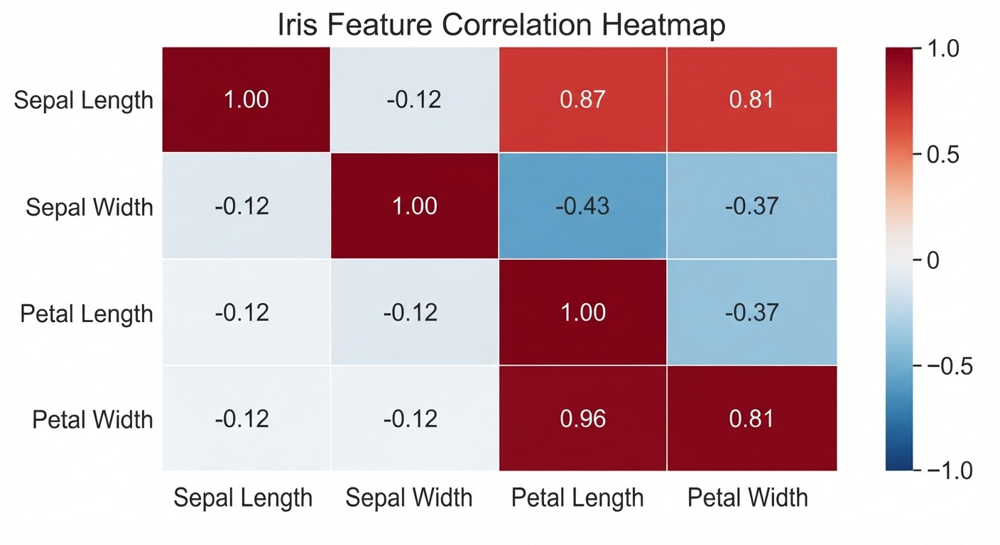
##### \*The correlation coefficient is sensitive to outliers.
### Scatterplots
A plot whose $x$-axis and $y$-axis represent two different variables
The most basic way to visualize the relationship between two variables is to draw a scatterplot.
```python
import matplotlib.pyplot as plt
from sklearn.datasets import load_iris

iris = load_iris()

for i, species in enumerate(iris.target_names):
    mask = iris.target == i
    plt.scatter(
        iris.data[mask, 2],
        iris.data[mask, 3],
        label=species,
        alpha=0.8
    )

plt.xlabel("Petal Length (cm)")
plt.ylabel("Petal Width (cm)")
plt.title("Iris: Petal Length vs. Petal Width")
plt.legend(title="Species")
plt.grid(alpha=0.2)
plt.tight_layout()
plt.savefig("petal_scatter.png", dpi=200)
plt.show()
```
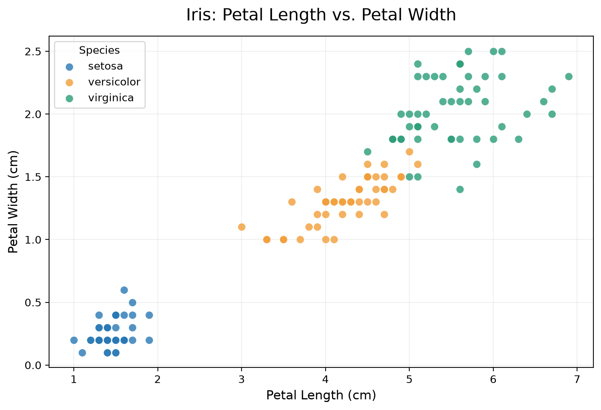

## Exploring two or more variables
Familiar estimates like the mean and variance are **univariate analysis** (one variable at a time), correlation analysis is **bivariate analysis**, and analyzing three or more variables is called **multivariate analysis**.

- **Contingency table**: a table recording the counts of two or more categorical variables
- **Hexagonal binning**: a plot that divides two variables into hexagon-shaped bins
- **Contour plot**: a plot that shows the density of two variables with contour lines, like a map showing points of equal elevation with contour lines
- **Violin plot**: similar to a boxplot, but also shows a density estimate.


### Hexagonal binning and contours (numeric vs numeric)
Scatterplots work when there are relatively few data points, but for millions of records the points are too dense to read. In that case, hexagonal binning like the one below

```python
import matplotlib.pyplot as plt
import seaborn as sns

# 1. 붓꽃(Iris) 내장 데이터셋 로드
iris = sns.load_dataset('iris')

# 데이터 추출
x = iris['petal_length']
y = iris['petal_width']

# 2. 그래프 크기 설정 및 hexbin 플롯 그리기
plt.figure(figsize=(9, 6))

# gridsize: 육각형의 크기/조밀도 조정
# cmap: 'viridis' 컬러맵 적용 (기본값)
# mincnt: 데이터가 1개 이상 있는 빈(bin)만 표시하여 빈 곳을 흰색으로 처리
hb = plt.hexbin(x, y, gridsize=20, cmap='viridis', mincnt=1)

# 3. 우측 컬러바(Colorbar) 추가 및 라벨 설정
cb = plt.colorbar(hb)
cb.set_label('Number of samples')

# 4. 타이틀 및 축 라벨 설정
plt.title('Iris: Petal Length vs. Petal Width (Hexbin)', fontsize=14, pad=15)
plt.xlabel('Petal Length (cm)', fontsize=12)
plt.ylabel('Petal Width (cm)', fontsize=12)

# 5. 축 눈금 및 범위 세부 조정 (이미지와 일치하도록 설정)
plt.xlim(0.5, 7.5)
plt.ylim(-0.1, 2.6)

# 그래프 표시
plt.tight_layout()
plt.show()
```

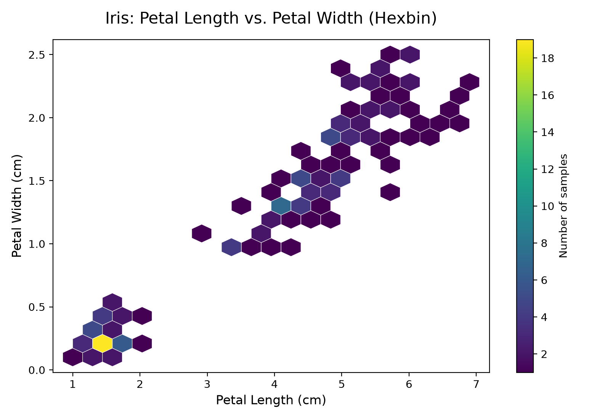

In a contour plot, density increases toward the peaks.
```python
import matplotlib.pyplot as plt
import seaborn as sns

# 1. 붓꽃(Iris) 데이터셋 로드
iris = sns.load_dataset('iris')

plt.figure(figsize=(9, 6))

# 2. 등고선 그래프(KDE Plot) 그리기
# fill=True를 주면 등고선 사이가 색상으로 채워집니다.
sns.kdeplot(
    data=iris, 
    x='petal_length', 
    y='petal_width', 
    cmap='viridis',    # 육각형 그래프와 동일한 컬러맵 적용
    fill=True,         # 등고선 내부 채우기 (선만 그리려면 False)
    thresh=0.05,       # 밀도가 아주 낮은 외곽 영역 제거
    levels=10          # 등고선 층의 개수
)

# 3. 타이틀 및 축 라벨 설정
plt.title('Iris: Petal Length vs. Petal Width (Contour/KDE)', fontsize=14, pad=15)
plt.xlabel('Petal Length (cm)', fontsize=12)
plt.ylabel('Petal Width (cm)', fontsize=12)

# 4. 축 범위 조정
plt.xlim(0.5, 7.5)
plt.ylim(-0.1, 2.6)

plt.tight_layout()
plt.show()
```
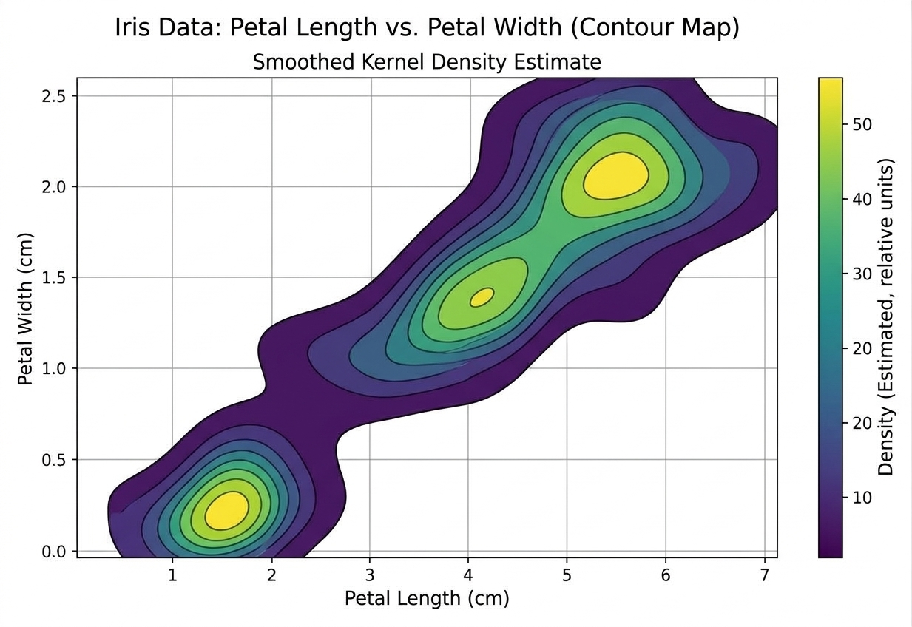

Another plot that shows the relationship between two numeric variables is the heatmap.
```python
import matplotlib.pyplot as plt
import numpy as np

# 색상 값과 셀에 표시할 문구를 별도로 지정
colors = np.array([
    [0.09, 0.60, 0.00, 0.13],
    [0.44, 0.67, 0.16, 0.59],
    [0.92, 1.00, 0.20, 0.96],
])

labels = [
    ["1.46 cm", "1.46 cm", "0.69 cm", "0.78 Corr"],
    ["11.37 cm", "12.25 cm", "1.03 cm", "0.79 Corr"],
    ["1.46 cm", "0.78 Corr", "1.01 cm", "0.73 Corr"],
]

species = ["Setosa", "Versicolor", "Virginica"]
variables = [
    "Petal Length [Low]",
    "Petal Length [High]",
    "Petal Width [Low]",
    "Petal Width [High]",
]

fig, ax = plt.subplots(figsize=(14, 9))

heatmap = ax.imshow(
    colors,
    cmap="viridis",
    vmin=0,
    vmax=1,
    aspect="auto",
    interpolation="nearest",
)

ax.set_xticks(np.arange(len(variables)), labels=variables)
ax.set_yticks(np.arange(len(species)), labels=species)
ax.tick_params(axis="both", labelsize=14)

ax.set_xlabel("Variable Group", fontsize=20)
ax.set_ylabel("Species", fontsize=20)
ax.set_title(
    "Iris Data Analysis (Heatmap)\n"
    "Correlation and Mean Values Matrix",
    fontsize=25,
    pad=12,
)

# 셀 사이 흰색 구분선
ax.set_xticks(np.arange(0.5, 3.5, 1), minor=True)
ax.set_yticks(np.arange(0.5, 2.5, 1), minor=True)
ax.grid(which="minor", color="white", linewidth=2)
ax.tick_params(which="minor", bottom=False, left=False)

# 셀 내부 문구
for row in range(len(species)):
    for col in range(len(variables)):
        ax.text(
            col,
            row,
            labels[row][col],
            ha="center",
            va="center",
            fontsize=21,
            color="#171717" if colors[row, col] > 0.8 else "#eeeeee",
        )

colorbar = fig.colorbar(
    heatmap,
    ax=ax,
    ticks=np.linspace(0, 1, 6),
    fraction=0.04,
    pad=0.07,
)
colorbar.ax.tick_params(labelsize=16)
colorbar.set_label(
    "Normalized Mean or Correlation Value\n(Arbitrary Units)",
    fontsize=20,
)

plt.tight_layout()
plt.show()
```
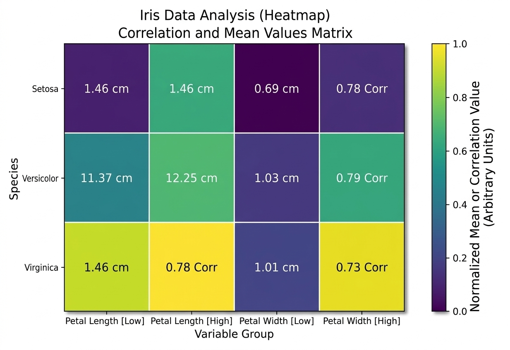


### Categorical vs categorical
A **contingency table** is an effective way to summarize two categorical variables: a table that records the counts for each combination of categories.

**Contingency table of sepal length (split at the median)**
```python
import pandas as pd
from sklearn.datasets import load_iris

# 1. 아이리스 데이터셋 로드
iris = load_iris()
df = pd.DataFrame(iris.data, columns=iris.feature_names)

# 타겟(품종) 데이터 추가 및 문자열 이름 매핑 ('setosa', 'versicolor', 'virginica')
df['species'] = [iris.target_names[t] for t in iris.target]

# 2. 연속형 변수 하나를 범주형 변수로 변환 (예: 꽃받침 길이를 중간값 기준으로 Short/Long 분할)
df['sepal_length_cat'] = pd.qcut(df['sepal length (cm)'], q=2, labels=['Short', 'Long'])

# 3. 두 범주형 변수('sepal_length_cat'과 'species')로 분할표 생성
contingency_table = pd.crosstab(index=df['sepal_length_cat'], columns=df['species'])

# 결과 출력
print(contingency_table)
```
**Output**

| sepal_length_cat | setosa | versicolor | virginica |
|---|---|---|---|
| Short | 47 | 24 | 10 |
| Long | 3 | 26 | 40 |

### Categorical vs numeric
A boxplot is a simple way to visually compare the distribution of a numeric variable grouped by a categorical variable.
```python
import matplotlib.pyplot as plt
import seaborn as sns

# 1. Seaborn의 내장 내장 iris 데이터셋 로드
iris = sns.load_dataset("iris")

# 한글 깨짐 방지 설정 (필요한 경우 주석 해제 후 사용)
# plt.rc('font', family='Malgun Gothic') # Windows
# plt.rc('font', family='AppleGothic') # Mac
# plt.rcParams['axes.unicode_minus'] = False

# 2. 그래프 크기 설정
plt.figure(figsize=(8, 6))

# 3. 클래스(species)별 꽃잎 길이(petal_length) 상자그림 그리기
sns.boxplot(x="species", y="petal_length", data=iris, palette="Set2")

# 4. 그래프 제목 및 축 레이블 설정
plt.title("Boxplot of Petal Length by Iris Species", fontsize=14)
plt.xlabel("Species (품종)", fontsize=12)
plt.ylabel("Petal Length (꽃잎 길이)", fontsize=12)

# 5. 그래프 출력
plt.show()
```
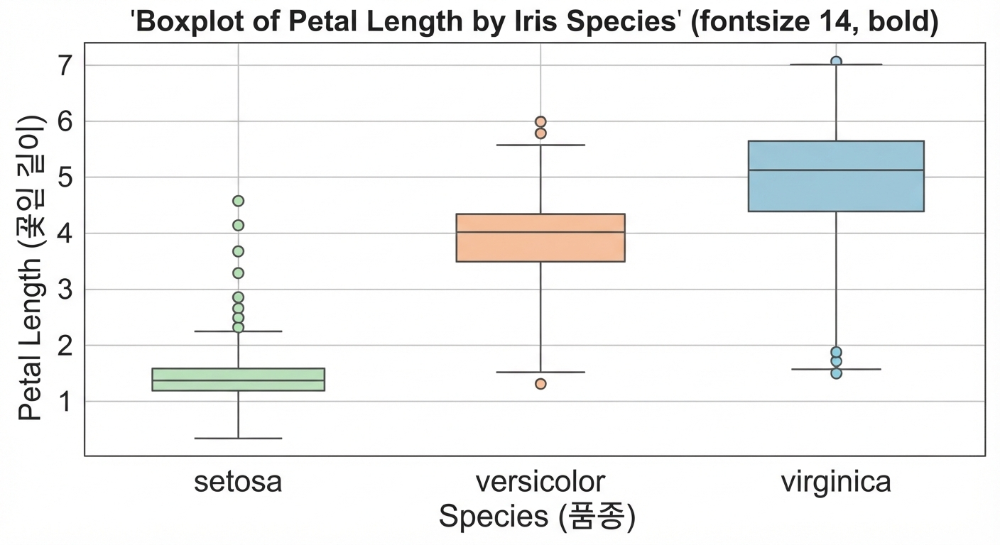

```python
import matplotlib.pyplot as plt
import seaborn as sns

# 1. Seaborn의 내장 iris 데이터셋 로드
iris = sns.load_dataset("iris")

# 한글 깨짐 방지 설정 (필요한 경우 주석 해제 후 사용)
# plt.rc('font', family='Malgun Gothic') # Windows
# plt.rc('font', family='AppleGothic') # Mac
# plt.rcParams['axes.unicode_minus'] = False

# 2. 그래프 크기 설정
plt.figure(figsize=(8, 6))

# 3. 클래스(species)별 꽃잎 길이(petal_length) 바이올린 도표 그리기
# inner="box"를 설정하면 바이올린 내부에 작은 상자그림이 함께 그려집니다.
sns.violinplot(x="species", y="petal_length", data=iris, palette="Set2", inner="box")

# 4. 그래프 제목 및 축 레이블 설정
plt.title("Violin Plot of Petal Length by Iris Species", fontsize=14)
plt.xlabel("Species (품종)", fontsize=12)
plt.ylabel("Petal Length (꽃잎 길이)", fontsize=12)

# 5. 그래프 출력
plt.show()
```
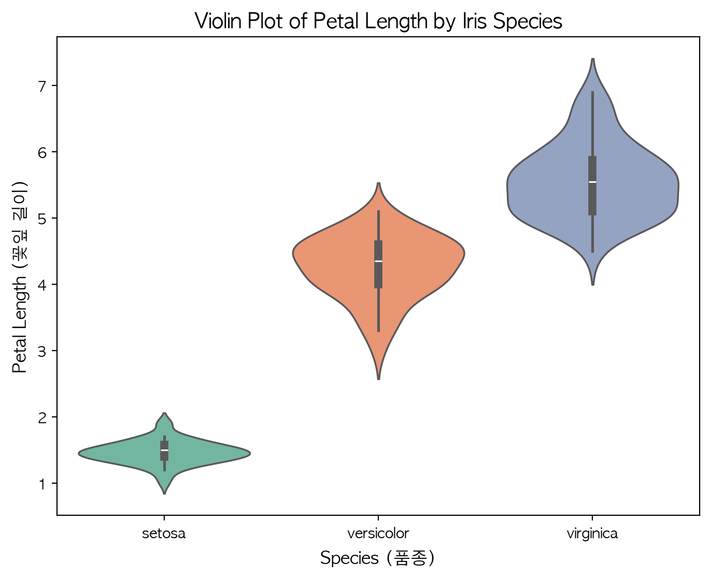


### Visualizing multiple variables
Through the concept of **conditioning**, plots for comparing two variables can be extended to compare more variables.
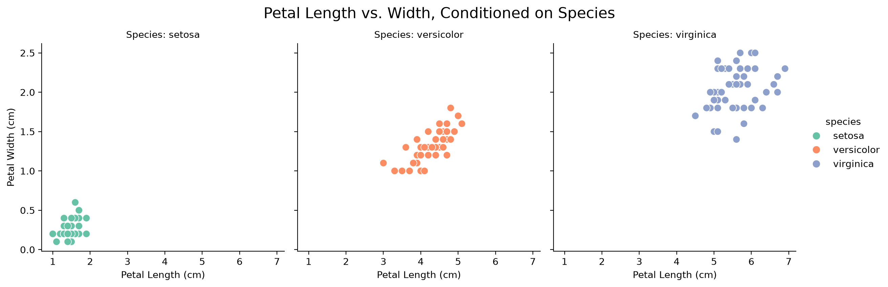
