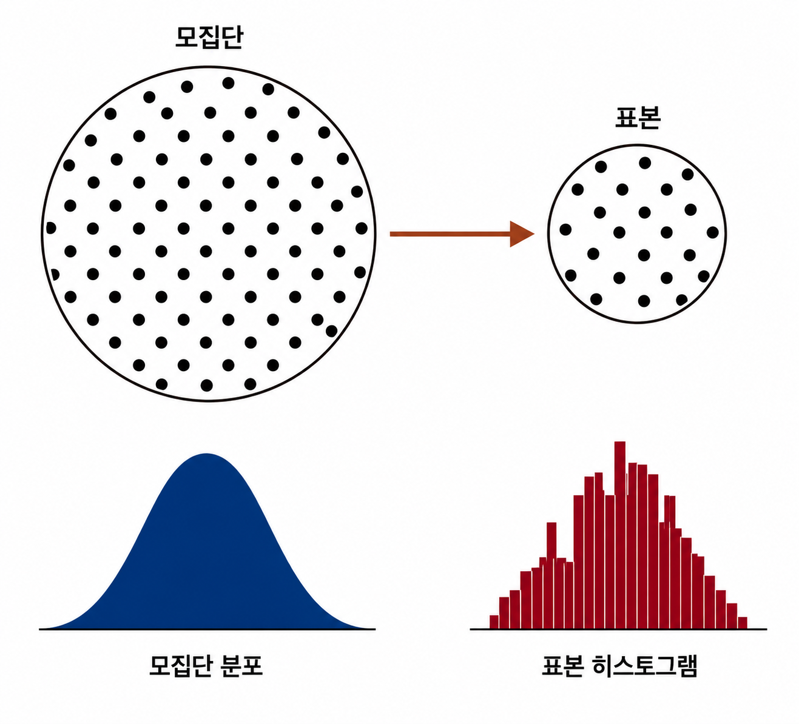

## Data and sampling distributions

With the era of big data, many people mistakenly believe sampling is no longer necessary. Today's situation is that data keeps growing in size while its quality and relevance cannot be guaranteed to any reliable degree. If anything, the need for sampling as a way to handle data effectively and minimize bias is growing.

The left side of the figure below represents the unknown population that statistics assumes a sample is drawn from. But all we can actually use is the sample data shown on the right and the distribution we get empirically from it.
Getting from the left (population) to the right (sample) is the **sampling** procedure.

### Random sampling and sample bias
- **Sample**: a subset of data obtained from a **larger data set (the population)**
- **Population**: the entire set of subjects or the full set that makes up a data set
- **N(n)**: the size of the population (sample)
- **Random sampling**: drawing a sample at random
- **Stratified sampling**: dividing the population into strata and drawing randomly from each stratum
- **Stratum**: a homogeneous subgroup of a population that shares common characteristics (plural: strata)
- **Simple random sample**: a sample obtained by random sampling without stratifying the population
- **Bias**: systematic error
- **Sample bias**: a sample that misrepresents the population

A statistical population differs a little from a biological one. Sometimes, as in biology, it is clearly defined as a large but finite set, but sometimes it means a theoretical, hypothetical set.

- **Random sampling**: the process of drawing at random from the eligible elements of the target population, where every element has the same probability of being drawn on each draw. The resulting sample is a **simple random sample**.
- **Sampling with replacement**: putting each drawn observation back into the population before the next draw
- **Sampling without replacement**: drawn observations are not used again

Data quality (completeness, consistency of format, cleanliness and accuracy of individual data values) matters more than the quantity of data. Statistics adds the concept of **representativeness** to this.
##### \*In statistics, representativeness means how accurately the drawn sample, or the metric used, reflects the characteristics of the whole population.

### A case of sample bias
The classic case is the Literary Digest's 1936 poll, which predicted that Alfred Landon would beat Franklin Roosevelt in the presidential election. It surveyed more than 10 million people (Literary Digest subscribers plus additional lists) and predicted a Landon victory. Gallup, by contrast, ran a biweekly poll of only 2,000 people and correctly predicted Roosevelt's victory.

The Literary Digest surveyed people of relatively high socioeconomic status, which created **sample bias**. The sample was drawn in a **non-random** way. **Non-random** here means that, even with a random sample, no sample can represent the population exactly.

### Bias
Statistical bias means systematic error that arises in the measurement or sampling process. Errors due to random sampling and errors due to bias should be distinguished carefully.

### Random selection
To avoid cases like the Literary Digest, **random sampling** is needed. Defining the population properly is crucial for doing random sampling well.
You can also do **stratified sampling**; if one stratum has too few samples, you can oversample that stratum with higher weight to get equal sample sizes for each stratum.

### Size versus quality: when does size matter?
Even in the era of big data, there are surprisingly cases where fewer data points are better. The more time and effort you put into random sampling, the more you can reduce bias and focus on data exploration and data quality. For example, you can get useful information out of missing values and outliers.

#### So when is a large amount of data needed?
When the data is both large and sparse. Google search queries are one example.

### Sample mean versus population mean
• **Symbol for the sample mean**: $\bar{x}$ (x-bar)
• **Symbol for the population mean**: $\mu$ (mu, the lowercase Greek letter) or in some cases $m$

The reason to distinguish them is that information about a sample is obtained by observation, while information about a population is mostly inferred from small samples.

### Selection bias
Selection bias refers to the practice of selectively choosing data, whether consciously or unconsciously.

- **Selection bias**: bias resulting from the way observations are selected
- **Data snooping**: extensively hunting through data for something interesting
- **Vast search effect**: bias or non-reproducibility resulting from repeated data modeling or modeling with too many predictor variables

If you form a hypothesis and run a well-designed experiment to test it, you can be highly confident in the result. That is rare, though; usually we look for patterns in the data we have, and then we cannot tell whether a pattern is real or a product of data snooping.

To validate a model's performance while guarding against the vast search effect, a form of selection bias, you can use two or more holdout sets. Target shuffling (essentially a permutation test) is also recommended.

### Regression to the mean
**Regression to the mean** is a phenomenon that appears when a given variable is measured repeatedly. An extreme observation tends to be followed by a more moderate one. So attaching too much special meaning to an extreme case can lead to selection bias. **Regression to the mean** is a consequence of a kind of selection bias.

### Sampling distributions in statistics
The term **sampling distribution** of a statistic refers to the distribution of a sample statistic over many samples drawn from the same population. Much of classical statistics is concerned with making inferences about (very large) populations from (small) samples.

- **Sample statistic**: a metric computed from sample data drawn from a larger population
- **Data distribution**: the frequency distribution of individual values in a data set
- **Sampling distribution**: the frequency distribution of a sample statistic over many samples or resamples
- **Central limit theorem**: the tendency of the sampling distribution to take on a normal shape as the sample size grows
- **Standard error**: the variability of a **sample statistic** over many samples (not to be confused with the standard deviation, which means the variability of individual data values)

Typically we draw a sample in order to measure or model something with a sample statistic. This approach can contain error. So we are interested in how much the result would vary from sample to sample (sampling variability).

The distribution of a sample statistic like the mean is likely to be more regular and bell-shaped than the distribution of the data itself. The larger the sample the statistic is based on, the more likely this is. Also, the larger the sample, the narrower the distribution of the sample statistic.

### Central limit theorem
The phenomenon described above is called the **central limit theorem**. Even if the population is not normally distributed, as long as the sample size is large enough and the data does not depart too far from normality, the means drawn from many samples follow a bell-shaped normal curve.

### Standard error
The **standard error** is a single metric that sums up the variability in the sampling distribution of a statistic. It can be estimated using a statistic based on the standard deviation $s$ of the sample values and the sample size $n$.

$$
\text{표준오차} = SE = \frac{s}{\sqrt{n}}
$$

As the sample size increases, the standard error decreases. The relationship between standard error and sample size is sometimes called the **square-root of n rule**.

To measure the standard error in practice, you would consider the following.

1. Collect many brand-new samples from the population.
2. Compute the statistic for each new sample.
3. Compute the standard deviation of the statistics from step 2 and use it as the estimate of the standard error.

Collecting new samples to estimate the standard error is usually not feasible. Instead, you can use **bootstrap** resamples.
### Bootstrap
The bootstrap is the procedure of drawing additional samples with replacement from the sample you already have, and recomputing the statistic or model for each sample.

- **Bootstrap sample**: a sample taken with replacement from an observed data set
- **Resampling**: the process of repeatedly drawing samples from observed data; includes both bootstrap and permutation (shuffling) procedures

#### Bagging
The process of building many trees from multiple bootstrap samples and then averaging the predictions from each tree (taking a majority vote for classification) is called **bagging**.

### Resampling versus bootstrapping
Resampling and the bootstrap are used with similar meanings. Resampling usually includes permutation procedures, where multiple samples are combined and drawn without replacement. The bootstrap always means drawing with replacement from the observed data.
