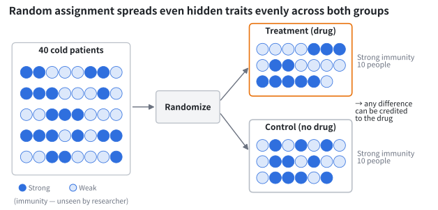
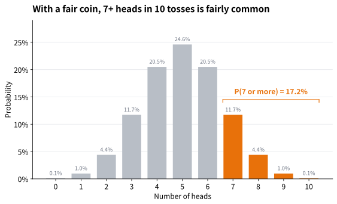
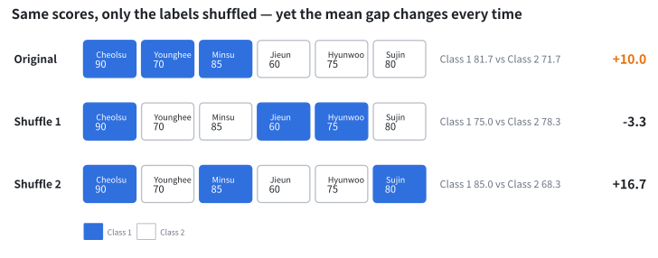
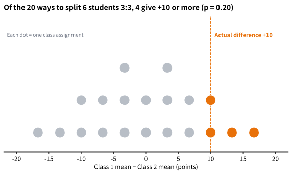
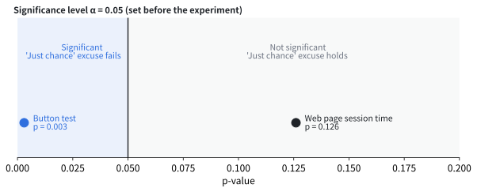
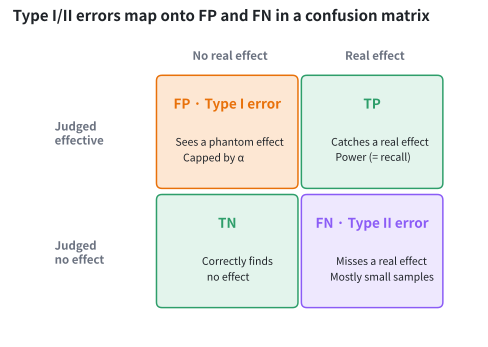
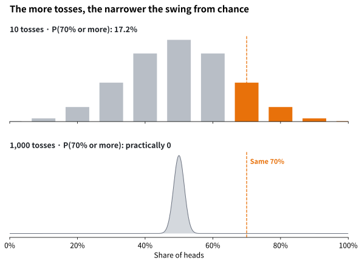

## Introduction

I read Chapter 3 once, and when I closed the book nothing had stuck. Null hypothesis, permutation test, p-value, Type I error… I had seen every term, but if someone had asked me "so what is a p-value?", I don't think I could have answered.

So this time I went back through it holding on to one example at a time and kept asking "why do we need this?". I got quite a few things wrong along the way, and I'm writing those down too instead of hiding them. There must be other people like me.

## Why do we need a control group?

Say you give a cold medicine to 100 patients and a week later 85 of them have recovered. At first it feels like "oh, it works", but if you think about it, a cold mostly clears up in a week even without medicine. There is no way to tell whether those 85 got better because of the drug or were going to get better anyway.

That's why you split people into a group that takes the drug (the treatment group) and a group that doesn't (the control group). If 70% of the control group also recovered, the drug's effect should be read as roughly 15 percentage points, not 85%. In the end, the control group's job is to subtract "every reason other than the drug".

On the web, the existing button A is the control and the new button B is the treatment. Honestly, at first I said it backwards and called B the control. I thought the control was the side being "checked against", but the control group is **the side where nothing was changed**.

### So who goes in which group?

You have to assign people at random. If the researcher picks "this person looks healthy, so drug group", you end up measuring the effect of people who were healthy to begin with, not the effect of the drug.

At first I thought, why not just split them so conditions like age match? But even if you can match age, you can't match conditions you never even thought of, like sleep habits or immunity. Splitting at random mixes even those evenly into both sides. That, I understood, is the real reason for random assignment.



One more thing the book stresses is that you must decide what to compare (clicks? time on page?) before the experiment. If you look at the results and then pick whichever metric looks good, you're just picking the answer you wanted.

## The null hypothesis: start by assuming "there's no difference"

You split people properly at random and run the experiment: 82% of the drug group recovered and 78% of the control group did. Can we now say the drug works?

Not yet. Even with random splitting, who ended up in which group is luck. A few more naturally resilient people may have landed in the drug group by chance. Run the same experiment again and you surely won't get 82 vs 78 again. So you need a way to check whether this 4-point gap is within the margin of chance.

Something I found interesting in the book is that people badly underestimate chance. If you toss a coin 50 times, getting the same side 5\~6 times in a row is common, yet when people actually see it they feel "something's going on".

### Thinking it through with a coin

A friend tosses a coin 10 times, gets 7 heads, and says "this coin is rigged". How do you judge that?

First assume it's a fair coin (50/50), then compute the probability of getting 7 or more heads out of 10 under that assumption. It's about 17%. Roughly one in six, so not very strange at all.



That default assumption — "it's a fair coin", i.e. "there's no difference, it's all chance" — is the **null hypothesis**, and its opposite is the **alternative hypothesis**. For the cold medicine experiment:

- Null hypothesis: there is no difference in recovery rate between the drug group and the control group
- Alternative hypothesis: there is a difference

(At first I wrote the null hypothesis as "78% means no effect" and then fixed it. A hypothesis isn't about one group's number; it's about the relationship between the two groups.)

### Why make "no effect" the default?

The analogy that convinced me most was a trial. The defendant is presumed innocent, and only becomes guilty if the prosecutor presents solid evidence. Researchers always hope their experiment works, so the default is put on the opposite side and they are asked to bring evidence strong enough to overturn it. You don't prove the alternative hypothesis directly; you go by breaking the null hypothesis.

## One-tailed vs. two-tailed

The alternative hypothesis can be written two ways: "B is different from A" (two-tailed) and "B is greater than A" (one-tailed).

Which one to use depends on the situation. For example, if a company's rule is "unless the new button B is clearly better, we just keep using A", then whether B is worse than A or the same, the outcome is the same. The only case you care about is B being better, so one-tailed is the right choice.

That said, R and scipy default to two-tailed, and since it's more conservative, apparently many people just use two-tailed. The book also moves on saying this isn't a big deal in data science.

## Permutation test: shuffle the labels

This was the most fun part of Chapter 3, and also the part I understood least at first.

The book's example goes like this. Session times (how long a visitor stayed) were measured for web pages A and B: 21 sessions for A, 15 for B, and B was 35.67 seconds longer on average. Is that really thanks to the design?

When I first heard "shuffle the A and B labels", I thought: the labels are the whole point, so if you change them, how can you test anything? It only clicked after I saw the class example.

### The class label example

Say there are Class 1 and Class 2 with exactly the same teacher, textbook and exam. The class name is just a split on the attendance sheet.

| Student | Score | Class |
| --- | --- | --- |
| Cheolsu | 90 | Class 1 |
| Younghee | 70 | Class 1 |
| Minsu | 85 | Class 1 |
| Jieun | 60 | Class 2 |
| Hyunwoo | 75 | Class 2 |
| Sujin | 80 | Class 2 |

Class 1 averages 81.7 and Class 2 averages 71.7, a 10-point gap. The class names mean nothing, yet there's a gap simply because Cheolsu and Minsu happened to land in the same class.

Erase the assignment and split them again at random: "Cheolsu, Jieun, Hyunwoo vs Younghee, Minsu, Sujin" gives −3.3 points, and "Cheolsu, Minsu, Sujin vs Younghee, Jieun, Hyunwoo" gives +16.7 points. Every shuffle changes the gap arbitrarily.



That was the key. If the null hypothesis is true (if the labels mean nothing), you're free to shuffle them, and **every difference you get from shuffling is a difference made purely by chance**. Collect many of these and you get a range of "this much difference can arise from chance alone"; then you just check whether the actual difference (the one in the original, unshuffled data) falls inside that range.

Going through all 20 ways to split the 6 students, 4 of them gave a difference of +10 points or more. So even if the class names mean nothing, 20% of the time you get a gap this large — and that 20% is exactly the p-value.



### Applying it to the web page example

Pool the 36 session times, shuffle them, split into 21 and 15, compute the mean difference, and repeat 1,000 times. In Python it looks roughly like this.

```py
import random
import numpy as np

def perm_fun(x, n_a, n_b):
    n = n_a + n_b
    idx_b = set(random.sample(range(n), n_b))
    idx_a = set(range(n)) - idx_b
    return x.loc[list(idx_b)].mean() - x.loc[list(idx_a)].mean()

perm_diffs = [perm_fun(session_times.Time, 21, 15) for _ in range(1000)]
np.mean(np.array(perm_diffs) > 35.67)
```

In about 12.6% of the 1,000 runs, the difference was 35.67 seconds or more (it varies a bit each run because it's random). That means a gap this size shows up fairly often from chance alone, so the conclusion is that "35 seconds longer" is not a statistically significant difference. Looking only at the numbers, B seemed clearly better, so finding out it wasn't was a bit of a shock.

The strength of the permutation test is that it needs no assumptions like normality; whether the data are numbers or 0/1 values, you just shuffle. The book's pricing experiment (conversion rates of 0.8425% vs 0.8057%) is tested the same way, by shuffling cards marked 0 and 1.

## The p-value: where I went wrong the most

The 12.6% we just got is the p-value. The definition is:

> The probability, assuming the null hypothesis is true, of getting a result as extreme as or more extreme than the one observed

I understood the definition when I read it, but I kept getting it wrong when I tried to interpret it. At first I took "a p-value of 0.126" to mean "a 12.6% chance that page B has no effect". Apparently that's the most common misconception.

Why it's wrong: think back to the permutation test — it starts by shuffling labels "assuming there's no effect". No effect is the starting point (the assumption) of the calculation, not its result. A number computed by already assuming there's no effect can't tell you the "probability that there's no effect".

It really clicks if you think of rain and the ground. "The probability the ground is wet given that it rained" is nearly 100%, but "the probability that it rained given that the ground is wet" isn't 100%. It could have been a sprinkler. The p-value answers the first kind of question (assumption → result), and my misconception was reading it backwards.

### When the direction gets confusing

My second mistake was saying "there's an effect" because the p-value of 0.126 is larger than the significance level of 0.05. It's exactly the opposite.

So I decided to remember the p-value as **the probability that the excuse "it was just chance" holds up**. If the p-value is large, the result shows up often by chance, so the excuse holds well and you can't claim an effect. If the p-value is small, the excuse doesn't hold, and only then can you claim an effect.



### Why "or more" is attached

There's also a reason the definition always includes "or more extreme". Even the probability of getting exactly 500 heads in 1,000 tosses of a fair coin is only about 2.5%. The probability of any single specific value is small by nature, so it only makes sense to look at the probability of that value or beyond.

So the correct way to state the coin example is: "if the coin is fair, the probability of getting 7 or more heads in 10 tosses is 17%".

By the way, p-value misuse got so bad that in 2016 the American Statistical Association issued a formal statement. The gist: a p-value is not the probability that a hypothesis is true, it doesn't tell you the size of an effect, and decisions shouldn't be made solely on whether it crosses a single threshold.

## Significance level and Type I/II errors

You need a cutoff for how small the p-value must be to call something "not chance"; that's the significance level (α), and 5% is the usual choice. The decision itself is simple: if the p-value is smaller than the significance level, the result is statistically significant.

What matters is that you have to set this **before** the experiment. If you look at the results and say "p is 0.07, let's use 10% this time", that's not a standard, it's a line drawn to fit the conclusion you wanted. It's the same reason the null hypothesis is the default. And the number 5% itself has no mathematical basis; it just became a convention because Fisher used it.

### A decision can go wrong in two directions

- Type I error: concluding there is an effect when there actually isn't (convicting an innocent person)
- Type II error: concluding there is no effect when there actually is (letting the real culprit go)

What the 5% significance level directly guards against is the Type I error. In a world with no effect, if you run the experiment 100 times you'll get p \< 0.05 about 5 times by chance, and the significance level means you allow that mistake only up to 5%.

Type II errors mostly happen when the sample is small. Even if the effect is real, with little data you can't tell it apart from chance. So a non-significant result should be read not as "there's no effect" but as "it hasn't been proven yet". The web page example, with only 36 sessions, is a case in point.

### Wait, isn't this just a confusion matrix?

A thought I had while writing this up: the structure is exactly the same as the confusion matrix used to evaluate classification models. If you treat "there is an effect" as positive, it looks like this.



So a Type I error is a false positive (FP), a Type II error is a false negative (FN), and the significance level α is effectively setting an upper bound on the false positive rate (FPR) in advance. Power (1 − β), the probability of catching a real effect, corresponds to recall.

If there's a difference, it's that a classification model has ground-truth labels so you can count each cell, whereas a hypothesis test is one decision per experiment and you never learn the true answer. So rather than filling in the cells, I understood it as reasoning about "the probability of landing in each cell if this experiment were repeated countless times".

## Significant doesn't mean important

Finally, say an online store with 10 million visitors changes the color of its checkout button, the conversion rate goes from 2.00% to 2.01%, and the p-value comes out at 0.001.

At first I answered this one with "the difference is too small, so it's not significant". But by the rule, 0.001 \< 0.05, so it is significant. Why such a tiny difference comes out significant made sense once I thought of coins.

7 heads in 10 tosses (70%) and 700 heads in 1,000 tosses (70%) are the same ratio, but the second is far more suspicious. The more you toss, the smaller the swing from chance, so the ratio sticks close to 50%. With 10 million people that swing is almost nothing, so even a difference as small as 0.01 percentage points falls outside the range of chance.



In the end, the p-value only tells you "it's not chance". Whether the difference is large enough to matter has to be judged separately. 0.01 percentage points of 10 million people is about 1,000 more purchases; if changing the button color costs almost nothing, it's worth doing, and if it means overhauling the whole system, you might not. That's the difference between statistical significance and practical significance.

The opposite also happens. The book's pricing experiment had over 46,000 data points, but the actual conversions were only around 200 each. Even if the data look plentiful, if the number of events that actually drive the decision is small, it's hard to detect a difference.

## Wrapping up

Having written it all up, Chapter 3 turned out to be a story of asking a few questions in order.

1. They took the drug and got better — was it the drug? They might have recovered anyway, so you need a control group.
2. Who goes where? If I choose, bias creeps in, so assign at random.
3. 82 vs 78 means it works, right? It could be luck, so first assume there's no difference (null hypothesis).
4. How big a difference can luck alone produce? Shuffle the labels and build it yourself (permutation test).
5. The share of shuffles that produced a difference at least as large as the actual one is the p-value.
6. The cutoff below which you call it "not chance" is set before the experiment (significance level).
7. You can still be wrong. Mistaking no effect for an effect is a Type I error.
8. With a large sample, even small differences come out significant. Whether they matter has to be judged separately.

When I tried to memorize the terms on their own they kept getting mixed up, but remembering them as "which question was this the answer to?" makes them much less confusing. I still read p-values backwards if I'm not careful, so every time I see one I try to recall "the probability that the excuse holds up".

Reference: Peter Bruce et al., *Practical Statistics for Data Scientists* (2nd ed.), Chapter 3
