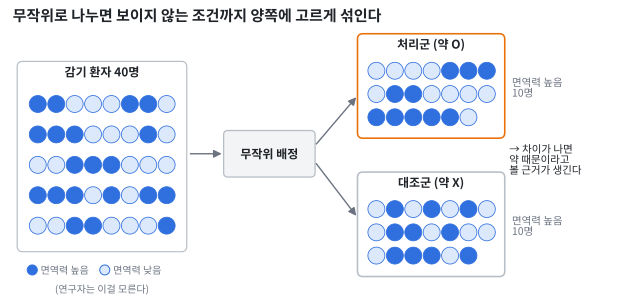
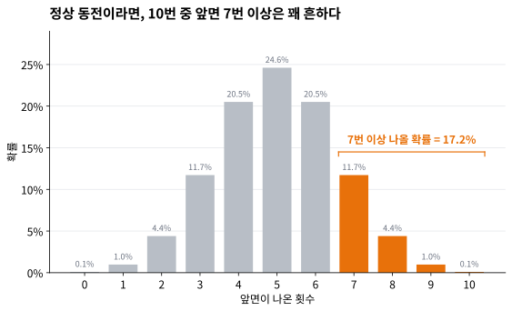
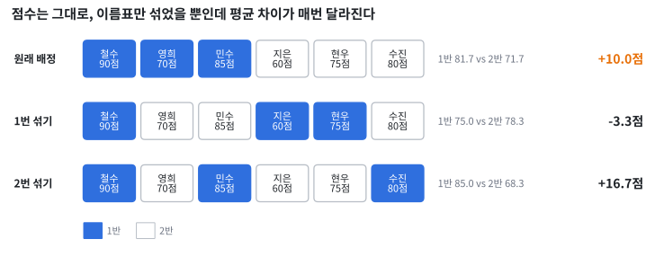
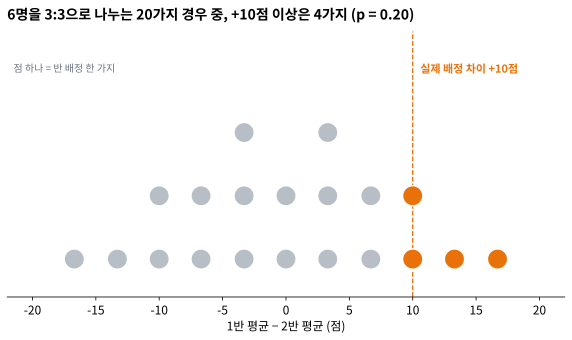
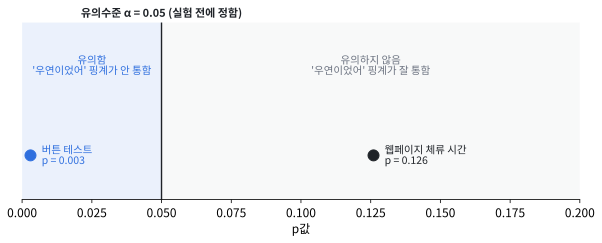
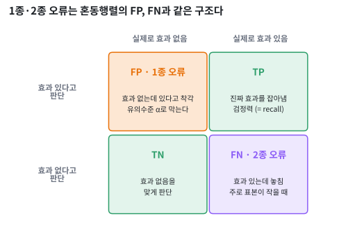
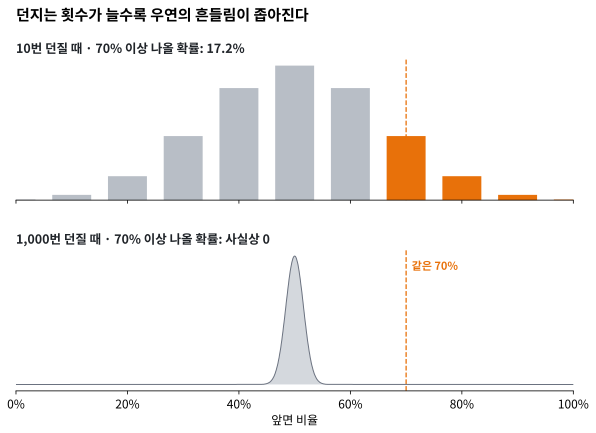

## 들어가며

3장을 한 번 읽었는데 덮고 나니 남는 게 없었다. 귀무가설, 순열검정, p값, 1종 오류… 단어는 다 봤는데 누가 "그래서 p값이 뭔데?" 하고 물으면 대답을 못 할 것 같았다.

그래서 이번엔 예시를 하나씩 붙잡고 "이건 왜 필요하지?"를 계속 물어가면서 다시 정리했다. 중간에 틀리게 이해했던 부분도 꽤 있어서, 그것도 숨기지 않고 같이 적어둔다. 나 같은 사람이 또 있을 테니까.

## 대조군은 왜 있어야 할까

감기약을 환자 100명에게 먹였더니 일주일 뒤 85명이 나았다고 해보자. 처음엔 "오 효과 있네" 싶은데, 생각해보면 감기는 약 안 먹어도 일주일이면 대충 낫는다. 85명이 약 덕분에 나은 건지, 원래 나을 사람이 나은 건지 알 방법이 없다.

그래서 약을 먹는 그룹(처리군)과 안 먹는 그룹(대조군)을 나눈다. 대조군도 70%가 나았다면 약 효과는 85%가 아니라 15%p 정도로 봐야 한다. 대조군은 결국 '약 말고 다른 이유'를 빼주는 역할이다.

웹에서는 기존 버튼 A가 대조군, 새 버튼 B가 처리군이 된다. 솔직히 처음엔 B를 대조군이라고 거꾸로 말했다. 새로운 걸 '대조해보는' 쪽이라고 생각했는데, 대조군은 **아무것도 안 바꾼 쪽**이다.

### 그럼 누굴 어느 그룹에 넣지?

무작위로 넣어야 한다. 연구자가 '이 사람은 건강해 보이니까 약 그룹' 하고 고르면, 약 효과가 아니라 원래 건강했던 사람 효과를 재게 된다.

처음엔 나이 같은 조건을 맞춰서 나누면 되지 않나 생각했다. 근데 나이는 맞출 수 있어도 수면 습관이나 면역력처럼 내가 생각조차 못 한 조건은 맞출 수가 없다. 랜덤으로 나누면 그런 것들까지 양쪽에 고르게 섞인다. 무작위 배정을 하는 진짜 이유가 이거라고 이해했다.



책에서 하나 더 강조하는 건, 뭘로 비교할지(클릭 수인지, 체류 시간인지)를 실험 전에 정해둬야 한다는 점이다. 결과 보고 유리한 지표를 고르면 그냥 내가 원하는 답을 고르는 거니까.

## 귀무가설: 일단 '아무 차이 없다'고 치고 시작한다

제대로 랜덤으로 나눠서 실험했더니 약 그룹은 82%, 대조군은 78%가 나았다. 이제 효과 있다고 해도 될까?

아직 아니다. 랜덤으로 나눠도 누가 어느 그룹에 들어갔는지는 운이다. 회복력 좋은 사람이 우연히 약 그룹에 몇 명 더 들어갔을 수도 있다. 같은 실험을 한 번 더 하면 82 대 78이 또 나올 리도 없고. 결국 이 4%p가 오차 범위 안인지 확인하는 과정이 필요하다.

책에서 재밌었던 얘기가, 사람은 우연을 너무 과소평가한다는 거다. 동전을 50번 던지면 같은 면이 5\~6번 연속 나오는 건 흔한데, 막상 그걸 보면 '뭔가 있다'고 느낀다고 한다.

### 동전으로 생각해보기

친구가 동전을 10번 던져서 앞면이 7번 나오니까 '이거 조작된 동전이야'라고 한다. 어떻게 판단할까?

일단 정상 동전(앞뒤 반반)이라고 가정하고, 그때 10번 중 7번 이상 앞면이 나올 확률을 계산해보면 된다. 약 17%다. 여섯 번에 한 번꼴이니 별로 이상한 일이 아니다.



여기서 '정상 동전이다', 즉 '차이 없다, 다 우연이다'라는 기본 가정이 **귀무가설**이고, 그 반대가 **대립가설**이다. 감기약 실험이면 이렇게 된다.

- 귀무가설: 약 그룹과 대조군의 회복률에 차이가 없다
- 대립가설: 차이가 있다

(처음엔 귀무가설을 '78%는 효과가 없다'라고 썼다가 고쳤다. 가설은 한 그룹의 숫자가 아니라 두 그룹 사이의 관계에 대한 거다.)

### 왜 굳이 '효과 없다'를 기본으로 둘까

제일 납득됐던 비유는 재판이다. 피고인은 일단 무죄로 보고, 검사가 확실한 증거를 내야 유죄가 된다. 연구자는 늘 자기 실험이 효과 있기를 바라니까, 기본값을 반대편에 두고 그걸 뒤집을 만큼 강한 증거를 내놓으라고 하는 거다. 대립가설을 직접 증명하는 게 아니라, 귀무가설을 깨는 식으로 간다.

## 한쪽 꼬리, 양쪽 꼬리

대립가설은 두 가지로 쓸 수 있다. 'B는 A와 다르다'(양쪽 꼬리)와 'B는 A보다 크다'(한쪽 꼬리).

어떤 걸 쓸지는 상황에 달렸다. 예를 들어 '새 버튼 B가 확실히 낫다고 나오지 않으면 그냥 A를 계속 쓴다'는 회사라면, B가 A보다 못하든 똑같든 결과는 어차피 같다. 신경 쓸 건 B가 더 나은 경우 하나뿐이니 한쪽 꼬리가 맞다.

다만 R이나 scipy는 기본값이 양쪽 꼬리고, 더 보수적이라 많이들 그냥 양쪽을 쓴다고 한다. 책에서도 데이터 과학에선 이게 그렇게 큰 문제는 아니라고 넘어간다.

## 순열검정: 이름표를 섞어본다

3장에서 제일 재밌었던 부분이자, 처음에 제일 이해 안 됐던 부분이다.

책 예제는 이렇다. 웹페이지 A와 B의 세션 시간(방문자가 머문 시간)을 쟀더니 A가 21개, B가 15개 세션이었고, B가 평균 35.67초 더 길었다. 이게 진짜 디자인 덕분일까?

처음에 'A, B 이름표를 섞는다'는 말을 들었을 때는, 이름표가 기준인데 그걸 바꾸면 검증이 안 되는 거 아닌가 싶었다. 이게 이해된 건 반 예시를 보고 나서다.

### 반 이름표 예시

선생님도 교재도 시험도 완전히 같은 1반, 2반이 있다고 하자. 반 이름은 그냥 출석부상 구분일 뿐이다.

| 학생 | 점수 | 반 |
| --- | --- | --- |
| 철수 | 90 | 1반 |
| 영희 | 70 | 1반 |
| 민수 | 85 | 1반 |
| 지은 | 60 | 2반 |
| 현우 | 75 | 2반 |
| 수진 | 80 | 2반 |

1반 평균 81.7, 2반 평균 71.7로 10점 차이가 난다. 반 이름에는 아무 의미가 없는데도 차이가 난 건, 그냥 철수랑 민수가 같은 반에 들어갔기 때문이다.

반 배정을 지우고 다시 랜덤으로 나눠보면, '철수·지은·현우 vs 영희·민수·수진'은 −3.3점, '철수·민수·수진 vs 영희·지은·현우'는 +16.7점이 된다. 섞을 때마다 차이가 제멋대로 바뀐다.



이게 포인트였다. 귀무가설이 맞다면(이름표가 아무 의미 없다면) 마음대로 섞어도 되고, **섞어서 나온 차이들은 전부 우연이 만든 차이**다. 이걸 많이 모으면 '우연만으로 이 정도 차이는 나올 수 있다'는 범위가 생기고, 실제 차이(섞기 전 원래 데이터의 차이)가 그 범위 안에 있는지만 보면 된다.

6명을 나누는 방법 20가지를 전부 따져보니 +10점 이상 차이가 나는 경우가 4가지였다. 즉 반 이름이 아무 의미 없어도 20%는 이 정도 차이가 난다는 거고, 이 20%가 바로 p값이다.



### 웹페이지 예제에 적용

36개 세션 시간을 합쳐서 섞고, 21개/15개로 나눠서 평균 차이를 구하는 걸 1,000번 반복한다. 파이썬으로 쓰면 대략 이렇다.

```py
import random
import numpy as np

def perm_fun(x, n_a, n_b):
    n = n_a + n_b
    idx_b = set(random.sample(range(n), n_b))
    idx_a = set(range(n)) - idx_b
    return x.loc[list(idx_b)].mean() - x.loc[list(idx_a)].mean()

perm_diffs = [perm_fun(session_times.Time, 21, 15) for _ in range(1000)]
np.mean(np.array(perm_diffs) > 35.67)
```

결과는 1,000번 중 약 12.6%에서 35.67초 이상 차이가 났다(난수라 돌릴 때마다 조금씩 다르다). 우연만으로도 이 정도 차이는 꽤 자주 나온다는 뜻이고, 그래서 '35초나 길다'는 통계적으로 의미 있는 차이가 아니라는 결론이 나온다. 숫자만 보면 B가 확실히 좋아 보였는데 아니라는 게 좀 충격이었다.

정규분포 같은 가정이 필요 없고, 숫자든 0/1 데이터든 그냥 섞으면 된다는 게 순열검정의 장점이다. 책의 가격 실험(전환율 0.8425% vs 0.8057%)도 0과 1이 적힌 카드를 섞는 똑같은 방식으로 검정한다.

## p값: 제일 많이 틀린 부분

방금 나온 12.6%가 p값이다. 정의는 이렇다.

> 귀무가설이 맞다고 가정했을 때, 관찰한 결과만큼 또는 그보다 더 극단적인 결과가 나올 확률

정의는 읽으면 아는데, 막상 해석하려니 계속 틀렸다. 처음엔 'p값이 0.126이면 페이지 B가 효과 없을 확률이 12.6%'라고 이해했다. 이게 제일 흔한 오해라고 한다.

왜 틀렸냐면, 순열검정을 다시 떠올려보면 '효과가 없다고 치고' 이름표를 섞는 데서 시작했다. 효과 없음은 계산의 출발점(가정)이지 결과가 아니다. 이미 없다고 치고 계산한 숫자가 '없을 확률'을 알려줄 수는 없다.

비랑 땅으로 생각하면 확 와닿는다. '비가 오면 땅이 젖어 있을 확률'은 거의 100%인데, '땅이 젖어 있으면 비가 왔을 확률'은 100%가 아니다. 스프링클러일 수도 있으니까. p값은 앞쪽(가정 → 결과) 질문이고, 내 오해는 그걸 뒤집어 읽은 거였다.

### 방향이 헷갈릴 때

두 번째로 틀린 건, p값 0.126이 유의수준 0.05보다 크니까 '효과가 있다'고 해버린 거다. 정반대다.

그래서 p값을 **'그냥 우연이었어'라는 핑계가 통할 확률**로 기억하기로 했다. p값이 크면 우연으로도 자주 나오니 핑계가 잘 통하고, 효과라고 주장할 수 없다. p값이 작으면 핑계가 안 통하니 그때서야 효과를 주장할 수 있다.



### '이상'이 붙는 이유

정의에 '그보다 더 극단적인'이 꼭 붙는 것도 이유가 있다. 정상 동전을 1,000번 던져서 정확히 500번 앞면이 나올 확률도 2.5% 정도밖에 안 된다. 특정한 값 하나가 나올 확률은 원래 다 작아서, 그 값 이상이 나올 확률로 따져야 의미가 있다.

그래서 동전 예시를 제대로 말하면 '동전이 정상이라면, 10번 중 앞면이 7번 이상 나올 확률이 17%'가 된다.

참고로 p값 오용이 워낙 심해서 2016년에 미국통계협회가 아예 성명을 냈다고 한다. 요지는 p값이 가설이 맞을 확률이 아니고, 효과 크기도 말해주지 않으며, 기준선 하나 넘었는지로만 결정을 내리면 안 된다는 것.

## 유의수준과 1종·2종 오류

p값이 몇 이하면 '우연 아님'으로 볼지 기준선이 필요한데, 이게 유의수준(α)이고 보통 5%를 쓴다. 판단은 간단하다. p값이 유의수준보다 작으면 통계적으로 유의하다.

중요한 건 이걸 실험 **전에** 정해야 한다는 거다. 결과를 보고 'p가 0.07이네, 이번엔 10%로 하자' 하면 그건 기준이 아니라 원하는 결론에 맞춘 선이다. 귀무가설을 기본으로 두는 것과 같은 이유다. 그리고 5%라는 숫자 자체엔 수학적 근거가 없다. 피셔가 쓰다 보니 관례가 된 것뿐이다.

### 판단은 두 방향으로 틀릴 수 있다

- 1종 오류: 실제로는 효과가 없는데 있다고 판단 (무고한 사람을 유죄로)
- 2종 오류: 실제로는 효과가 있는데 없다고 판단 (진짜 범인을 풀어줌)

유의수준 5%가 직접 막는 건 1종 오류다. 효과 없는 세계에서 실험을 100번 하면 우연히 p \< 0.05가 나오는 게 5번쯤인데, 그 착각을 5%까지만 허용하겠다는 뜻이다.

2종 오류는 주로 표본이 작을 때 생긴다. 효과가 진짜 있어도 데이터가 적으면 우연이랑 구분이 안 된다. 그래서 유의하지 않다는 결과는 '효과 없다'가 아니라 '아직 증명 못 했다'로 읽는 게 맞다. 세션이 36개뿐이었던 웹페이지 예제도 그렇다.

### 이거 혼동행렬이랑 똑같은데?

정리하다가 든 생각인데, 이 구조가 분류 모델 평가할 때 쓰는 혼동행렬이랑 똑같다. '효과 있음'을 양성으로 두면 이렇게 된다.



그러니까 1종 오류는 거짓 양성(FP), 2종 오류는 거짓 음성(FN)이고, 유의수준 α는 위양성률(FPR)의 상한을 미리 정해두는 셈이다. 실제 효과를 잡아낼 확률인 검정력(1 − β)은 재현율(recall)에 해당한다.

다른 점이 있다면, 분류 모델은 정답 라벨이 있어서 칸마다 개수를 셀 수 있지만 가설검정은 실험 한 번에 판단 한 번이고 진짜 정답은 끝까지 모른다는 거다. 그래서 칸을 채우는 게 아니라 '이 실험을 수없이 반복하면 각 칸에 떨어질 확률'을 따지는 거라고 이해했다.

## 유의하다고 다 중요한 건 아니다

마지막으로, 방문자 1,000만 명인 쇼핑몰이 결제 버튼 색을 바꿨더니 전환율이 2.00%에서 2.01%로 올랐고 p값이 0.001이 나왔다고 해보자.

처음엔 이것도 '차이가 너무 작으니 유의하지 않다'고 답했다. 그런데 규칙대로면 0.001 \< 0.05라서 유의한 게 맞다. 왜 이렇게 작은 차이가 유의하게 나오는지는 동전으로 생각하니 이해됐다.

10번 던져서 7번 앞면(70%)이랑 1,000번 던져서 700번 앞면(70%)은 비율이 같은데, 뒤쪽이 훨씬 수상하다. 많이 던질수록 우연에 의한 흔들림이 줄어들어서 50% 근처에 딱 붙기 때문이다. 1,000만 명이면 그 흔들림이 거의 없어서, 0.01%p 같은 작은 차이도 우연의 범위를 벗어난다.



결국 p값은 '우연은 아니다'까지만 말해준다. 그 차이가 의미 있는 크기인지는 따로 봐야 한다. 1,000만 명의 0.01%p면 결제가 1,000건쯤 늘어나는 건데, 버튼 색 바꾸는 데 비용이 거의 안 들면 해볼 만하고 시스템을 다 뜯어고쳐야 하면 안 할 수도 있다. 이게 통계적 유의성과 실질적 유의성의 차이다.

반대 경우도 있다. 책의 가격 실험은 데이터가 4만 6천 건이 넘었지만 실제 전환은 각각 200건 안팎이었다. 데이터가 많아 보여도 판단에 쓰이는 사건 수가 적으면 차이를 잡아내기 어렵다.

## 마치며

정리하고 나니 3장은 결국 질문 몇 개를 순서대로 던지는 이야기였다.

1. 약 먹고 나았대, 약 덕분이야? 원래 나을 사람일 수도 있으니 대조군이 필요하다.
2. 누굴 어디 넣지? 내가 고르면 편향이 생기니 무작위로.
3. 82 대 78이면 효과 있는 거지? 운일 수도 있으니 일단 차이 없다고 치자(귀무가설).
4. 운만으로 차이가 얼마나 날 수 있지? 이름표를 섞어서 직접 만들어본다(순열검정).
5. 섞은 것 중 실제 차이 이상이 나온 비율이 p값.
6. 몇 % 이하면 우연이 아니라고 할지는 실험 전에 정한다(유의수준).
7. 그래도 틀릴 수 있다. 효과 없는데 있다고 착각하면 1종 오류.
8. 표본이 크면 작은 차이도 유의하게 나온다. 중요한지는 따로 봐야 한다.

용어를 따로 외우려고 하면 계속 섞였는데, '이게 어떤 질문의 답이었지?'로 기억하니까 훨씬 덜 헷갈린다. p값은 아직도 방심하면 거꾸로 읽게 돼서, 볼 때마다 '핑계가 통할 확률'을 한 번씩 떠올리려고 한다.

참고: 피터 브루스 외, 『데이터 과학을 위한 통계』(2판) 3장
