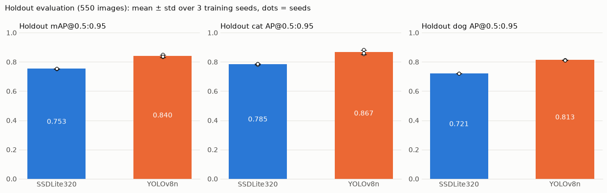

> **TL;DR**
> I compared two lightweight detectors, SSDLite320 and YOLOv8n, on Oxford-IIIT Pet face boxes. YOLOv8n's default-recipe score (0.8511) was not a fair comparison because its optimizer, EMA, and post-processing were different, so I **retrained it with matched training conditions**. YOLOv8n was still more accurate, with holdout mAP@0.5:0.95 **0.7533 → 0.8401**, and **about 10×** faster on CPU.

## 1. Problem: both models find the face

This is an object detection problem: find where the animal's face is in the photo, with two classes, `cat_face` and `dog_face`. The data is Oxford-IIIT Pet, 7,390 images (37 breeds).

There was a snag from the start: **the official test set had no face labels at all.** So I re-split the 3,671 labeled `trainval` images into train/validation/holdout (70:15:15), and decided to use the holdout exactly once, after every setting was fixed.

## 2. Approach: lay the groundwork for a fair comparison before training

- **Data checks**: Comparing the README with the actual files turned up a breed-ID typo, 41 images outside the list (30 of them copies), and 10 GIF/PNG files with only a `.jpg` extension. I excluded the out-of-list images since they could cross split boundaries.
- **Same inputs**: Both models got 320×320 letterboxed inputs, and I left out augmentations only one model is used to, like YOLO's Mosaic.
- **Same scoring**: Instead of each model's built-in evaluation, I built a **shared evaluator** and verified it with 30 hand-computed cases and a pycocotools cross-check (difference ≤ 6e-17).
- **Fixed budget**: 3 learning-rate candidates × 1 seed → 2 more seeds for the chosen rate. Set in advance so I would not add candidates after seeing results.

## 3. Experiments: doubting the better number

| Step | What I did | Result (validation mAP@0.5:0.95) |
|---|---|---|
| Exp. 1 | SSDLite320, learning-rate search with SGD | 0.7613 ± 0.0038 |
| Exp. 2 | YOLOv8n, Ultralytics default recipe (AdamW, EMA, NMS 0.7) | 0.8511 ± 0.0025 |
| Exp. 3 | YOLOv8n, **same optimizer, LR candidates, loss averaging, and NMS as SSDLite320, no EMA** | **0.8399 ± 0.0081** |

Experiment 2 had the best number, but I did not use it as is. With every part of the training recipe different, I could not tell whether the gap came from the model or from the training settings. Matching conditions narrowed the gap, and what remains is closer to a difference between the models.

The decisive clue was that **mAP@0.5 was similar for both models, 0.97–0.99**. Both find roughly where the face is. The gap opened at IoU 0.75 or 0.9, in **how tightly the box is drawn**. The left (SSDLite320) and right (YOLOv8n) halves of the cover image are the two models' predictions on the same photo.

## 4. Results

I evaluated each model's 3 seed checkpoints once on the 550 holdout images.

| Model | mAP@0.5:0.95 | mAP@0.5 | CPU inference (median) | Params |
|---|---|---|---|---|
| SSDLite320 | 0.7533 ± 0.0015 | 0.9872 | 108.1 ms | 2.22M |
| **YOLOv8n (matched)** | **0.8401 ± 0.0082** | 0.9895 | **11.0 ms** | 3.01M |

Despite having more parameters, YOLOv8n was about 1.6× faster on MPS and about 10× faster on CPU. With no trade-off between accuracy and speed, I picked **YOLOv8n** per the pre-set selection rule.

## 5. Lessons and limitations

- **Fairness comes before the number.** There was a better number (0.8511), but with different conditions it could not be called a "model comparison."
- **Looking at one metric can flip the conclusion.** Had I looked only at mAP@0.5, I would have judged the two models similar.
- Differences that cannot be matched, like loss functions and architecture, remain, and for both models the largest learning-rate candidate was selected, so larger rates went untested.
- Only 3 seeds and 1 split, and speed figures are reference values for this Mac. The next step is to collect cases where boxes are off and split the error into position and size.

> The full experiment record, including data checks, learning-rate search, evaluator validation, and inference measurement setup, is in the [Log post](/log/computer-vision/detection/pet-face-ssdlite-vs-yolov8n).
