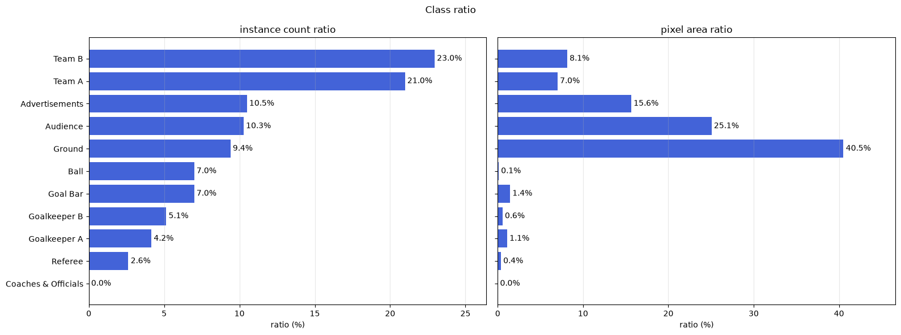

> **한 줄 요약**
> 축구 중계 화면 100장으로 픽셀 단위 분할 모델을 학습시켰더니, 공·심판·골키퍼처럼 **픽셀 1%도 안 되는 클래스**가 fold에 따라 IoU 0과 0.8 사이를 오갔다. 시드 실험으로 원인이 데이터 분할이 아니라 **학습 불안정**임을 확인하고, 손실을 **CE + Dice + 클래스 가중치**로 바꿔 test mIoU를 **0.770 → 0.873**, 공 IoU를 **0 → 0.771**로 올렸다.

## 1. 문제: 공이 안 잡힌다

데이터는 2017 UEFA 슈퍼컵 하이라이트에서 뽑은 **1920×1080 프레임 100장**, 10개 클래스(선수 A/B, 골키퍼 A/B, 심판, 공, 골대, 그라운드, 관중, 광고판)다.

데이터셋 문서에 적힌 클래스 비율은 인스턴스 수 기준이었다. 하지만 세그멘테이션 손실은 픽셀 단위로 계산되니 픽셀 면적으로 다시 봤고, 여기서 문제가 드러났다.

| 클래스 | 인스턴스 비율 | 픽셀 면적 비율 |
|---|---|---|
| Ground | 9.4% | **40.5%** |
| Ball | 7.0% | **0.1%** |
| Referee | 2.6% | **0.4%** |

공은 인스턴스로는 7%지만 픽셀로는 0.1%, 그라운드의 400분의 1이다.

## 2. 접근: 모델보다 데이터를 먼저 의심했다

학습 전에 점수가 부풀려질 수 있는 지점부터 막았다.

- **완전 중복 이미지(MD5)** 1쌍 → 같은 쪽에 묶기
- **유사 이미지(pHash)** 32장 / 100장 → 영상에서 뽑은 프레임이라 서로 닮은 장면이 많았다. 전부 train에 고정
- **분할 설계** → 나머지에서 인스턴스 수·픽셀 면적·등장 이미지 수가 모두 7:1.5:1.5에 가깝도록 탐색

## 3. 실험: 원인을 세 단계로 좁혔다

| 단계 | 한 일 | 알게 된 것 |
|---|---|---|
| LAB 1 | U-Net++ (ResNet34) + BCE + Dice, 5-fold 교차검증 | 큰 클래스는 0.9 이상으로 안정적인데, **작은 3개 클래스만** fold마다 IoU 0 ↔ 0.8로 요동. AP는 0.7 이상인데 IoU는 0 |
| LAB 2 | 같은 fold에서 **시드만** 바꿔 재학습 | 같은 데이터인데 심판 IoU가 0 ~ 0.93으로 갈림 → 원인은 데이터 분할이 아니라 **학습 불안정** |
| LAB 3 | BCE → **CE**, 픽셀 빈도에 반비례하는 **클래스 가중치** | 평균 mIoU +0.126, fold 간 표준편차 **0.099 → 0.024** |

결정적인 단서는 **"AP는 높은데 IoU는 0"**이라는 패턴이었다. 모델이 공을 아예 모르는 게 아니라, 마지막 argmax 경쟁에서 더 큰 클래스에 밀리고 있었다.

## 4. 결과

test 15장은 학습과 모델 선택에 한 번도 쓰지 않고 **딱 한 번** 평가했다.

| 모델 | mIoU | mDice | Ball | Referee | Goalkeeper B |
|---|---|---|---|---|---|
| BCE + Dice | 0.770 | 0.828 | **0.000** | 0.689 | 0.767 |
| **CE + Dice + 가중치** | **0.873** | **0.931** | **0.771** | **0.878** | **0.806** |

## 5. 배운 점과 한계

- 데이터를 볼 때 **어떤 단위로 손실이 계산되는지**에 맞춰 봐야 한다. 인스턴스 비율만 봤다면 공이 왜 안 잡히는지 한참 헤맸을 것이다.
- 두 가설을 가르는 **가장 싼 실험**(시드만 바꾸기)을 먼저 했다.
- LAB 3에서 CE 전환과 클래스 가중치를 **동시에** 바꿔 각각의 기여도는 분리하지 못했다. 다음에 따로 돌려 비교할 예정이다.
- 경계 지표(mBIoU 0.43)는 아직 낮고, 실제 중계 추적에 쓰려면 연속 프레임 안정성과 속도도 확인해야 한다.

> 데이터 점검 과정, fold별 수치, 놓친 객체 분석까지 담은 전체 실험 기록은 [Log 글](/log/computer-vision/segmentation/soccer-segmentation-class-imbalance)에 있다.
